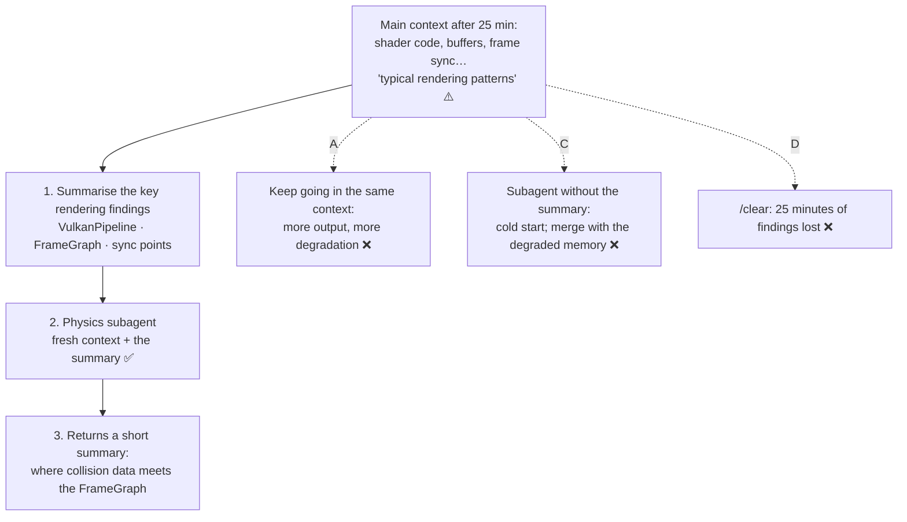

# Q71 — "Typical rendering patterns": summarise the findings, give them to a fresh subagent

**Domain / lesson:** D5 › 5.4 Codebase Exploration & Context Degradation
**Also touches:** D1 › 1.3 Subagent Invocation & Context Passing (what a subagent knows at the start)
**Scenario:** An agent exploring an unfamiliar codebase (a game engine), like the developer productivity scenario of [Q68](../Q68-trace-from-base-class-incremental-reading/question.md)–[Q69](../Q69-grep-distinctive-error-text/question.md)
**Follows:** [Q68](../Q68-trace-from-base-class-incremental-reading/question.md) (exploration fills the context) · [Q03](../Q03-crash-recovery-state-manifest/question.md) (state saved outside the context) · [Q58](../Q58-at-reference-example-files/question.md) check (explore in a subagent, get a summary back)

*Q70 is a gap: question text not available.*

## Question

Your agent has spent 25 minutes exploring a game engine's rendering subsystem – reading shader code, buffer management, and frame synchronization logic. An engineer now asks it to understand how the physics engine integrates with rendering for collision debug overlays. You notice recent responses reference "typical rendering patterns" rather than the specific VulkanPipeline and FrameGraph classes it discovered earlier.

What's the most effective approach?

- **A.** Continue in the current context with more targeted prompts referencing the specific classes by name.
- **B.** Summarize key rendering findings, then spawn a sub-agent for physics exploration with that summary in its initial context.
- **C.** Spawn a sub-agent to explore physics independently, then manually synthesize its findings with the rendering knowledge accumulated in the main conversation.
- **D.** Use /clear to reset context completely, then start fresh with physics exploration using file paths from the project's CLAUDE.md.

## Answer: **B**

## Diagram



## Concept

**Step 1: recognise the symptom.** *"Typical rendering patterns"* instead of `VulkanPipeline` and `FrameGraph` is the guide's textbook sign of **context degradation**. Guide 5.4: *"The observable symptom is that the model starts referring to "typical patterns" instead of the specific classes, methods and dependency chains it found earlier."*

**Step 2: know the cause.** It isn't a lack of space. It's 25 minutes of verbose output pushing the early, precise findings back. Guide 5.4: *"Earlier precise findings are further back in the context, while the newer verbose output dominates."* *"The model no longer uses details that come before newer verbose output. It has not exhausted its space."* Exploring physics in the same context would add even more output.

**Step 3: B fixes both halves of the problem.**

| B does | Why it helps | Guide 5.4 |
|---|---|---|
| **Summarises the rendering findings** | The precise facts (class names, files, sync points) are captured in a short form instead of being scattered through 25 minutes of output | Summary injection between phases |
| **Spawns a subagent for physics** | The physics exploration happens in a **fresh, isolated context**, so its verbose output never touches the main one | *"their main value is context isolation"* |
| **Puts the summary in its initial context** | The subagent starts knowing how rendering works, so it can look for the *integration* points (where a debug overlay would plug into the FrameGraph) | Avoids the *"cold start"* problem |

**What the injected summary might look like** *(VulkanPipeline and FrameGraph are from the question; the rest is illustrative)*:

```text
Rendering findings (phase 1). Use these; don't re-explore rendering.
- VulkanPipeline (src/render/vulkan_pipeline.cpp): builds the graphics pipelines;
  debug geometry already uses createDebugPipeline().
- FrameGraph (src/render/frame_graph.cpp): passes are registered per frame;
  an overlay would be a pass after the main lighting pass.
- Frame sync: CPU may write vertex buffers only between the fence wait and submit.
Your task: find how the physics engine exposes collision shapes, and where a
debug-overlay pass could read them each frame. Return file paths, class names
and a short integration sketch.
```

Guide 5.4: *"Without this summary, the Phase 2 subagents duplicate Phase 1's exploration, because nobody gave them the findings."* *"The summary also gives the subagents the architectural understanding to ask the right questions."*

## Why the others are wrong

| Option | Why not |
|---|---|
| **A** Continue in the same context with prompts naming the classes | **Treats the symptom, not the cause.** Naming `VulkanPipeline` may help for one answer, but the cause is the verbose output already in the context, and exploring physics there adds much more. The agent will keep slipping back to "typical patterns", and you'd have to keep reminding it. |
| **C** Subagent for physics without the summary, then merge by hand | **The tempting one: it uses a subagent.** But (1) the subagent starts **cold**: *"A subagent starts with its own isolated context. It does not see the parent's conversation history."* It doesn't know how rendering works, so it can't look for the integration points, and may re-explore rendering itself. (2) The merge relies on *"the rendering knowledge accumulated in the main conversation"*, which is exactly the part that has degraded. Guide 5.4 exam trap: *"Expecting next-phase subagents to inherit phase-one history"*. |
| **D** `/clear`, then start fresh from CLAUDE.md's file paths | **Throws away 25 minutes of findings.** Guide 5.4 exam trap: *"Restarting a session to fix context degradation without saving state"*. *"Restarting loses all accumulated knowledge."* CLAUDE.md has file paths, not what the agent learned about `VulkanPipeline` and `FrameGraph`. And the task is about the *integration* with rendering, so the rendering knowledge is still needed. |

## Pattern to remember

> **"Typical patterns" instead of the specific classes = context degradation. Keep the findings (summarise them), move the next exploration into a subagent (fresh, isolated context), and give it the summary at the start.** Not "push harder" in the same context (A), not a subagent that starts cold (C), not a reset that loses everything (D).

**Context degradation: which fix?**

| Situation | Fix (guide 5.4) |
|---|---|
| Starting a long exploration | **Scratchpad file** from the start: findings recorded outside the context (the primary fix, Q71 check) |
| The next phase needs a lot of new exploration | **Subagent** + **summary of earlier findings** in its initial context (Q71) |
| The session might crash or be restarted | **State manifest**, loaded and injected on resume (Q03) |
| Context filling with output during a long session | **`/compact`**, used proactively |
| ❌ Bigger context window · restart without saving · subagent without the summary | Not fixes: degradation isn't a space problem; findings get lost; cold start |

**Exam signals:**
- *"Typical patterns"* / *"generic"* instead of named classes → **context degradation**.
- *"Spawn a sub-agent … with that summary in its initial context"* → summary injection: the right shape.
- *"/clear"*, *"restart"*, *"start fresh"* without saving findings → loses state.

### Where this comes from

**Guide D5 › 5.4 Codebase Exploration & Context Degradation:**
- *"The observable symptom is that the model starts referring to "typical patterns" instead of the specific classes, methods and dependency chains it found earlier."*
- *"Earlier precise findings are further back in the context, while the newer verbose output dominates."* *"It has not exhausted its space."*
- Subagents: *"Each subagent explores verbosely in its own isolated context, then returns a structured summary."* *"The obvious interpretation is that subagents are for parallelisation, but their main value is context isolation."*
- Summary injection: *"Before spawning Phase 2 subagents, summarise the main Phase 1 findings and inject them into the initial context of those subagents. Without this summary, the Phase 2 subagents duplicate Phase 1's exploration, because nobody gave them the findings. This is the "cold start" problem."* (**C**)
- Exam trap: *"Expecting next-phase subagents to inherit phase-one history, or handing each the full transcript"*. *"Summarise the key findings and inject the summary into each subagent's initial context."* (**C**)
- Exam trap: *"Restarting a session to fix context degradation without saving state"*. *"Restarting loses all accumulated knowledge."* (**D**)

## How this connects to earlier questions

| Question | Link |
|---|---|
| [Q68](../Q68-trace-from-base-class-incremental-reading/question.md) | Prevention: read incrementally so less output piles up. Q71 is what to do once it has |
| [Q03](../Q03-crash-recovery-state-manifest/question.md) | Same principle: knowledge that must survive goes into something outside the context (a manifest there, a summary here) |
| [Q58](../Q58-at-reference-example-files/question.md) | The check there: explore in a subagent that returns only a summary |
| [Q45](../Q45-fresh-session-structured-summary/question.md) | Starting fresh is fine *with* a structured summary of what mattered, and loses everything without one |
| [Q05](../Q05-goals-not-procedures-delegation/question.md) | What goes into a subagent's prompt: goals and context, written explicitly |

## Check question

**B's summary is written *now*, from a context that is already degraded. What should the agent have done from the start of the 25-minute rendering exploration, so that this summary would have been easy to write and accurate?**

*My answer:* "The whole analysis part might have been implemented as a subagent." 🟡 **A good answer, and the guide backs it: subagents are its second main defence. The main context would have stayed clean. But it only moves the problem: 25 minutes in one subagent degrades *inside* the subagent. The guide's primary answer is a scratchpad file, kept from the start.**

**Why your answer helps.** Guide 5.4: *"Spawning subagents for specific investigation tasks is the second major way to limit context degradation."* The subagent reads shaders, buffers and sync code in its own context and returns a structured summary, so the main conversation never fills up.

**Why it isn't enough on its own.** One subagent doing the whole 25-minute exploration fills *its own* context the same way. It writes its final summary at the end, from that full context, so it can say "typical rendering patterns" too. The degradation has moved, not gone.

**The guide's primary answer: a scratchpad file from the start.** Guide 5.4: *"Scratchpad files are the primary way to limit context degradation. The agent writes important findings to a file and reads that file again for later questions. The file is outside the conversation context, so context degradation does not affect its contents."* And: *"Instruct agents to keep scratchpad files from the start of any extended exploration session. Scratchpad files are a deliberate strategy. They are not an emergency fix to use once answers become vague."*

```markdown
# Scratchpad: rendering exploration
## Key classes
- VulkanPipeline (src/render/vulkan_pipeline.cpp): builds pipelines; debug geometry via createDebugPipeline()
- FrameGraph (src/render/frame_graph.cpp): passes registered per frame; lighting pass runs before post-processing
## Frame sync
- CPU writes vertex buffers only between the fence wait and submit (FrameSync)
## Open questions
- Where is per-frame debug data collected?
```

Each fact is written **when it's found**, while the context is still sharp. B's summary then becomes *read the scratchpad*: easy and accurate.

| Done from the start | Main context | Is B's summary accurate? |
|---|---|---|
| Nothing (what happened) | Degraded | ❌ Written from degraded memory |
| One subagent for all 25 minutes (your answer) | ✅ Clean | ⚠️ The subagent's own context fills; its summary comes at the end |
| Scratchpad from the start | Still fills, but findings are on file | ✅ Each fact recorded when found |
| **Both: focused subagents + a scratchpad** | ✅ Clean | ✅ Accurate |

**Best of both:** split the rendering exploration into **focused** subagent tasks (shaders, buffers, frame sync), each short enough to stay sharp, and have the findings written to a scratchpad as they come in. Guide's examples of focused tasks: *"Trace the deposit payment flow from API endpoint to database and list all intermediate services."*

> **Long exploration → keep a scratchpad from the start (the primary defence: findings recorded while they're sharp, outside the context) and give subagents focused tasks (the second: verbose work stays out of the main context). A subagent alone moves the degradation; it doesn't remove it.**

## Glossary

- **Context degradation:** the model using earlier findings less precisely (e.g. "typical patterns" instead of class names) as verbose output piles up in the context. It's not about running out of tokens.
- **Summary injection:** putting a summary of earlier findings into a subagent's initial context so it doesn't start from nothing.
- **Cold start:** a subagent beginning without the knowledge the earlier phase gathered, so it re-explores or misses connections.
- **Context isolation:** a subagent's verbose work stays in its own context; only its summary comes back.
- **`/clear`:** a Claude Code command that clears the conversation and starts over.

## Related course lessons

*Lecture lengths aren't recorded in the study-map files, so the watch times below are estimates from each course's average lecture length.*

### Udemy A (primary): Claude Certified Architect (CCAR-F) - 2026 Exam Prep
| # | Lecture | Part | Why |
|---|---|---|---|
| **122** | **Why Delegate Discovery to a Subagent** | 5C | ⭐ Context isolation: why B moves physics into a subagent *(also in Q68)* |
| **123** | **Delegation Mechanics — Prompts, Returns, and Failure Modes** | 5C | ⭐ What goes into the subagent's prompt (B vs C) *(also in Q05)* |
| 124 | Long-Conversation Coherence, Compaction, and Session Memory | 5C | The degradation symptom, and why restarting loses state (D) *(also in Q03, Q45)* |
| 120 | The Scratchpad Pattern — Persisting Findings Outside the Context | 5C | The primary 5.4 fix: the check question's answer *(also in Q03)* |
| Quiz 17 | 5C quiz | | Self-test |

**▶ Watch in this order (~25 min, est.):** #122 → #123 → #124 → #120, then do **Quiz 17**.

### Udemy B: Claude Certified Architect Foundations: Complete Course (Voroniuk)
| # | Lecture | Section | Why |
|---|---|---|---|
| **86** | **Keeping Long Explorations Sharp** | S8 Claude Code Setup | ⭐ Exactly this lesson: degradation and its fixes *(also in Q03)* |
| 87 | Phases, Subagents and Manifests | S8 Claude Code Setup | Summary injection between phases (B) |
| 81 | The Explore Subagent | S8 Claude Code Setup | Exploration in an isolated context |
| Quiz 8 | Claude Code Setup quiz | S8 | Self-test |

**▶ Watch in this order (~15 min, est.):** #86 → #87 → #81, then do **Quiz 8**.

### CBT Nuggets: CCA-F course
CBT has no lesson on codebase exploration or context degradation (5.4). Use the guide lesson and Udemy B #86.
