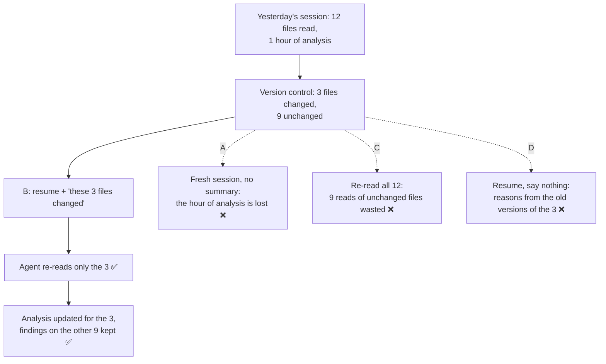

# Q72 — 3 of 12 files changed overnight: resume and tell the agent which ones

**Domain / lesson:** D1 › 1.7 Session State and Resumption
**Scenario:** Developer productivity tools built with the Claude Agent SDK (same as [Q68](../Q68-trace-from-base-class-incremental-reading/question.md), [Q69](../Q69-grep-distinctive-error-text/question.md), [Q71](../Q71-degraded-context-summary-into-subagent/question.md))
**Follows:** [Q45](../Q45-fresh-session-structured-summary/question.md) (stale tool results → fresh session + summary: the other side of the same decision) · [Q71](../Q71-degraded-context-summary-into-subagent/question.md) (don't throw away accumulated knowledge)

## Question

You are building developer productivity tools using the Claude Agent SDK. The agent helps engineers explore unfamiliar codebases, understand legacy systems, generate boilerplate code, and automate repetitive tasks. It uses the built-in tools (Read, Write, Bash, Grep, Glob) and integrates with Model Context Protocol (MCP) servers.

Your codebase exploration tool stores session IDs to allow engineers to continue investigations across work sessions. An engineer spent an hour yesterday analyzing a legacy authentication module, building context about its architecture and dependencies. They want to continue today. The session ID is valid, but version control shows 3 of the 12 files the agent previously read were modified overnight by a teammate's merge. What approach best balances efficiency and accuracy?

- **A.** Start fresh session to ensure the agent works with current codebase state without stale assumptions
- **B.** Resume the session and inform the agent which specific files changed for targeted re-analysis
- **C.** Resume the session and immediately have the agent re-read all 12 previously analyzed files
- **D.** Resume the session without informing the agent about the changed files

## Answer: **B**

## Diagram



## Concept

**Count what's still valid: 9 of the 12 files are unchanged.** Yesterday's analysis of those 9 files, and most of the reasoning about the module's architecture, still matches the code. Guide 1.7 on resume: *"Use it when the prior context is mostly still valid."* And for exactly this case: *"If most of the context is still valid, resume and tell the agent which files changed."*

**Why you must tell the agent.** The agent can't see that the files changed. Their old contents sit in its history as tool results, and it has no reason to read them again. If nobody tells it, it reasons from the old versions: the guide's **stale context problem**. Telling it which 3 files changed turns that into a **targeted re-analysis**: re-read those 3, update the conclusions that depend on them, keep the rest.

**What it looks like in the SDK.** The stored session ID goes into `resume`, and the first message names the changed files:

```python
from claude_agent_sdk import query, ClaudeAgentOptions

options = ClaudeAgentOptions(resume=session_id)  # the ID stored yesterday

prompt = """Since yesterday, a teammate's merge changed 3 of the files you analysed:
- auth/token_service.py
- auth/session_store.py
- auth/middleware.py
Your earlier reads of these 3 files are out of date. Re-read only these 3,
update your analysis of them, and re-check any conclusion that depended on them.
The other 9 files are unchanged: keep your analysis of them."""

async for message in query(prompt=prompt, options=options):
    ...
```

*Practical tip, not guide wording:* store the commit hash next to the session ID. Next time, `git diff --name-only <stored hash> HEAD` lists what changed, and you can match it against the files the agent read. That's how the tool "knows" 3 of the 12 changed.

**"But the guide says resuming and re-reading isn't the best answer?"** It does, in its shop example. There, all the files the day-one analysis was built on had changed. The guide's practice scenario does the same: the 3 changed files *"are the core modules, and most of the session's earlier reasoning was built on their old versions."* In that case most of the history is stale, so the answer is a fresh session with a summary (Q45). Here nothing says the 3 files are the core of the module, and 9 of 12 are untouched.

**How much of the history is stale? (guide 1.7)**

| Since the last session | Choice |
|---|---|
| Nothing changed | **Resume** |
| A few files changed; most of the analysis still holds | **Resume + name the changed files** for targeted re-analysis ✅ (Q72) |
| The files most of the analysis was built on changed | **Fresh session + structured summary + targeted re-analysis** of the changed files (the guide's shop, Q45) |
| You want to compare two approaches from the same analysis | **Fork** (`fork_session`) |

## Why the others are wrong

| Option | Why not |
|---|---|
| **A** Start a fresh session | **Accurate, but throws away an hour of valid work.** As written, A has no summary, so the agent starts with nothing and must explore the module again from scratch. Guide: *"Full re-exploration is wasteful."* Even a fresh start *with* a summary costs more than needed here: *"If the prior context is still valid and you want the full conversation history, resume is more efficient."* A fixes 3 files' worth of staleness by discarding 12 files' worth of analysis. |
| **C** Resume and re-read all 12 files | **Right idea, wrong scope.** 9 of the 12 re-reads are of files that haven't changed: *"Re-reading 50 files because 3 of them changed is wasted time."* Twelve fresh reads also add a lot of output to a session that's already an hour long (5.4: more clutter, more degradation). And the agent still isn't told **which** files changed, so it has to compare old and new versions of all 12 itself. You already know the answer from version control: pass it on. |
| **D** Resume without saying anything | **The stale context problem.** The agent trusts its old reads of the 3 changed files. Guide: *"The agent recommends changes that were already made, or refers to code that no longer exists."* Cheapest option, least accurate. |

## Pattern to remember

> **Most of the earlier context is still valid, and you know which files changed → resume and name those files for targeted re-analysis.** Don't re-read everything, don't say nothing, and don't throw the session away. If the changed files are what most of the analysis was built on, switch to a fresh session with a structured summary instead.

**Exam signals:**
- *"3 of 12 files changed"*, *"balance efficiency and accuracy"* → **resume + inform**.
- *"The 3 core files most of the analysis relied on changed"* → **fresh session + structured summary** + targeted re-analysis (Q45).
- *"Re-read all"*, *"re-analyse everything"* → wasteful.
- *"Resume without informing"* → stale context.
- *"Fork"* for changed files → the fork inherits the stale results.

### Where this comes from

**Guide D1 › 1.7 Session State and Resumption:**
- *"Use it when the prior context is mostly still valid. The files have not changed significantly since the last session, and you want to continue from exactly where you stopped."*
- *"If most of the context is still valid, resume and tell the agent which files changed. Otherwise the stale context problem occurs: the agent reasons from tool results that no longer reflect the current files."* (**B**, **D**)
- *"When files have changed, the agent does not need to re-analyse everything. Re-reading 50 files because 3 of them changed is wasted time. Targeted re-analysis means telling the agent which files changed and letting it re-analyse only those."* (**C**)
- Exam trap: *"Suggesting full re-exploration of a 50-file codebase when only 3 files changed."* *"Full re-exploration is wasteful. Inform the agent about the specific 3 files that changed for targeted re-analysis."* (**A**, **C**)
- *"If the prior context is still valid and you want the full conversation history, resume is more efficient."* (**A**)
- *"The symptom is contradictory advice about the changed files. The agent recommends changes that were already made, or refers to code that no longer exists."* (**D**)
- Exam trap: *"Resuming a session when most of its earlier tool results describe files that have since changed."* *"Start fresh with a structured summary instead. If most of the context is still valid, resume and tell the agent which files changed."* (the boundary)

## How this connects to earlier questions

| Question | Link |
|---|---|
| [Q45](../Q45-fresh-session-structured-summary/question.md) | The other side of the same decision. There, the old tool results were stale → fresh session + summary. Here most of the context is still valid → resume + inform |
| [Q71](../Q71-degraded-context-summary-into-subagent/question.md) | Don't throw away accumulated knowledge: restarting from scratch was the trap there (D), and is the cost of A here |
| [Q68](../Q68-trace-from-base-class-incremental-reading/question.md) | Same principle as targeted re-analysis: read only what you can justify. There, by what the last step found; here, by what version control shows changed |
| [Q03](../Q03-crash-recovery-state-manifest/question.md) | Picking up after a break: carry state forward deliberately, don't replay everything |

## Check question

**You choose B. The agent re-reads the 3 changed files and updates its analysis. An hour later, while explaining the password-reset flow (in `auth/reset.py`, one of the 9 unchanged files), it says reset tokens *"expire after 30 minutes, as set in `token_service.py`"*. The merge changed that value to 15 minutes, and the agent re-read the new version this morning. Why did this happen, and what do you do now?**

## Glossary

- **Session ID:** the identifier of a stored agent session; passing it to `resume` continues that session with its full history.
- **Resume (`resume` / `--resume`):** continue an existing session with its whole history, including every earlier tool result.
- **Stale tool result:** a tool result that described a file correctly when it was read, but the file has changed since.
- **Stale context problem:** the agent reasons from stale tool results in its history, giving outdated or contradictory advice.
- **Targeted re-analysis:** telling the agent which files changed so it re-reads and re-analyses only those.
- **Full re-exploration:** re-reading everything because something changed; the guide calls it wasteful.
- **Fresh start + summary injection:** a new session with a curated summary of the previous one and no old tool results.
- **Fork (`fork_session`):** a new session started from a copy of an existing session's history, for comparing approaches. It inherits any stale results.

## Related course lessons

*Lecture lengths aren't recorded in the study-map files, so the watch times below are estimates from each course's average lecture length.*

### Udemy A (primary): Claude Certified Architect (CCAR-F) - 2026 Exam Prep
| # | Lecture | Part | Why |
|---|---|---|---|
| **81** | **The Claude Agent SDK — Session Control** | 3D | ⭐ Resuming a stored session in the SDK: this tool exactly *(also in Q03, Q45)* |
| **22** | **Session Continuity Across Turns and Failures** | 1C | ⭐ Resume vs. start fresh *(also in Q03, Q45, Q46)* |
| Quiz 3, Quiz 11 | 1C and 3D quizzes | | Self-test |

**▶ Watch in this order (~15 min, est.):** #81 → #22, then do **Quiz 11** and **Quiz 3**.

### Udemy B: Claude Certified Architect Foundations: Complete Course (Voroniuk)
| # | Lecture | Section | Why |
|---|---|---|---|
| **84** | **Sessions: Resume or Start Fresh** | S8 Claude Code Setup | ⭐ This exact decision *(also in Q03, Q45)* |
| 85 | Forking a Session | S8 Claude Code Setup | The third option, and why it doesn't help with changed files *(also in Q03, Q45)* |
| Quiz 8 | Claude Code Setup quiz | S8 | Self-test |

**▶ Watch in this order (~10 min, est.):** #84 → #85, then do **Quiz 8**.

### CBT Nuggets: CCA-F course

*CBT doesn't cover 1.7 (see the study map). Use the guide and the Udemy lectures for session resumption.*
