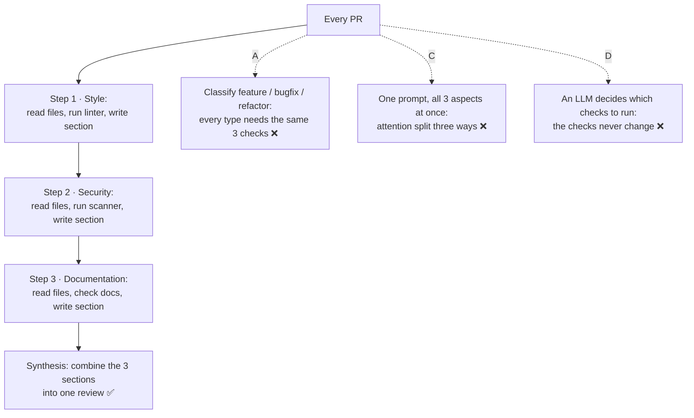

# Q73 — Same three review steps for every PR: prompt chaining (a fixed pipeline)

**Domain / lesson:** D1 › 1.6 Task Decomposition Strategies
**Note:** the option names (prompt chaining, routing, orchestrator-workers) come from Anthropic's *Building effective agents* article. The guide calls prompt chaining a **fixed sequential pipeline**, and its closest term for orchestrator-workers is **dynamic adaptive decomposition**.
**Scenario:** Developer productivity tools built with the Claude Agent SDK (same as [Q68](../Q68-trace-from-base-class-incremental-reading/question.md)–[Q72](../Q72-resume-and-name-changed-files/question.md))
**Follows:** [Q13](../Q13-agentic-loop-model-decides-next-tool/question.md) (when the model decides vs when code decides) · [Q11](../Q11-analysis-gap-feedback-loop/question.md) (a strict pipeline can't act on what it finds)

## Question

You are building developer productivity tools using the Claude Agent SDK. The agent helps engineers explore unfamiliar codebases, understand legacy systems, generate boilerplate code, and automate repetitive tasks. It uses the built-in tools (Read, Write, Bash, Grep, Glob) and integrates with Model Context Protocol (MCP) servers.

Your code review assistant needs to analyze pull requests and provide feedback on three aspects: code style compliance, potential security issues, and documentation completeness. Each aspect requires reading files, running analysis tools, and generating a report section. The review process follows the same three-step workflow for every PR. Which task decomposition pattern is most appropriate for this workflow?

- **A.** Routing – classify each PR by type (feature, bugfix, refactor) first, then route to different review prompts optimized for that category.
- **B.** Prompt chaining – break the review into sequential steps where each aspect (style, security, documentation) is analyzed separately, with outputs combined in a final synthesis step.
- **C.** Single comprehensive prompt – include all instructions in one prompt and let the model handle all three aspects simultaneously.
- **D.** Orchestrator-workers – have a central LLM analyze each PR to dynamically determine which checks are needed, then delegate to specialized worker LLMs for each identified subtask.

## Answer: **B**

## Diagram



## Concept

**The deciding phrase: *"the same three-step workflow for every PR."*** The steps are known in advance and never change. That's a **fixed sequential pipeline**, also called prompt chaining. Guide 1.6: *"A fixed sequential pipeline, also called prompt chaining, runs predetermined steps in order."* And: *"Fixed pipelines suit predictable, structured tasks with known steps: code reviews, document processing, data extraction pipelines and compliance checks."* The guide's own decision table pairs *"Multi-file code review"* with *"Fixed pipeline"*.

**What you get from it (guide 1.6):**

| Advantage | In this review |
|---|---|
| *"Consistent, reliable results"* | Every PR gets the same three checks, in the same order |
| *"Easy debugging, because you know which step produced which output"* | A wrong security comment → look at step 2 only |
| *"Easy monitoring, because you can log the output of each step"* | Log each section separately; see which step is slow or failing |

**Why one aspect per step.** Each step has one job: read the files for that aspect, run its tool, write its section. Anthropic's article: prompt chaining trades latency for accuracy *"by making each LLM call an easier task"*, and *"LLMs generally perform better when each consideration is handled by a separate LLM call, allowing focused attention on each specific aspect."*

**Your code decides the steps, not the model.** That's what makes it fixed:

```python
ASPECTS = ["style", "security", "documentation"]   # the same for every PR

def review(pr):
    sections = {}
    for aspect in ASPECTS:                          # fixed order, never changes
        sections[aspect] = run_step(aspect, pr)     # read files, run tool, write section
    return synthesize(pr, sections)                 # final step: one report
```

*Note from the article, not the guide:* the three aspect steps don't use each other's output, so you could also run them **in parallel** and then synthesise. The article calls that *"sectioning"*. It's still a fixed, predefined workflow; only the synthesis waits for all three. B is the only option here that's a fixed workflow.

**The option names, mapped to the guide:**

| Pattern | Who decides the steps | Fits when (article) | Guide's term |
|---|---|---|---|
| **Prompt chaining** | Your code, in advance | *"the task can be easily and cleanly decomposed into fixed subtasks"* | Fixed sequential pipeline |
| **Routing** | A classifier picks one of several paths | *"distinct categories that are better handled separately"* | (no separate term) |
| **Orchestrator-workers** | A central LLM, for each input | *"you can't predict the subtasks needed"* | Dynamic adaptive decomposition |

## Why the others are wrong

| Option | Why not |
|---|---|
| **A** Routing by PR type | **There's nothing to route.** Routing fits *"distinct categories that are better handled separately"*. Here every PR, whatever its type, gets the same three checks: a bugfix needs a security check as much as a feature does. A adds a classification step that can misclassify, and every specialised prompt would still have to cover all three aspects. It solves a problem the task doesn't have. |
| **C** One comprehensive prompt | **Too few passes.** Three aspects, each needing file reads, a tool run and a report section, all in one call. Guide: *"Attention dilution is a failure mode that occurs when the work is split into too few passes."* Some aspects get a thorough review and others get skimmed. It also loses the pipeline's debugging and monitoring: when the security section is weak, there's no step to look at. |
| **D** Orchestrator-workers | **Flexibility the task doesn't need, at a cost.** Orchestrator-workers is for tasks *"where you can't predict the subtasks needed"*. Here you can: the same three, every time. Guide exam trap: *"Choosing dynamic adaptive decomposition for a structured task whose steps are known in advance"*: it's *"less predictable and harder to debug"*. And there's a risk: an LLM that decides *"which checks are needed"* can decide a PR doesn't need a security check. A check that must run on every PR shouldn't depend on a model's choice. D is the option that *sounds* most advanced, which is the guide's warning: *"Match the pattern to the task characteristics, not to what sounds more sophisticated."* |

## Pattern to remember

> **Same steps for every input → fixed pipeline (prompt chaining): code runs one step per aspect in a fixed order, then a synthesis step.** Orchestrator-workers or dynamic decomposition only when the subtasks can't be known in advance. Don't pick the pattern that sounds smarter.

**Exam signals:**
- *"Same workflow for every…"*, *"steps known in advance"*, *"structured"*, code review, document extraction, compliance checks → **fixed pipeline / prompt chaining**.
- *"Open-ended"*, *"unknown scope"*, *"investigate"*, legacy exploration, debugging an unfamiliar system, *"can't predict the subtasks"* → **dynamic decomposition / orchestrator-workers**.
- *"Distinct categories that need different handling"* → **routing**.
- *"All in one prompt"* → attention dilution.

### Where this comes from

**Guide D1 › 1.6 Task Decomposition Strategies:**
- *"A fixed sequential pipeline, also called prompt chaining, runs predetermined steps in order. Dynamic adaptive decomposition generates subtasks from what each step discovers."*
- *"In a fixed pipeline, each step takes the previous step's output as input. The sequence does not change based on intermediate results."*
- *"Fixed pipelines suit predictable, structured tasks with known steps: code reviews, document processing, data extraction pipelines and compliance checks. The same input always follows the same path."* (**B**)
- *"Attention dilution is a failure mode that occurs when the work is split into too few passes."* (**C**)
- *"A fixed pipeline cannot adapt to unexpected findings."* Dynamic decomposition *"suits open-ended investigation where the full scope is unknown at the start: exploring legacy systems, security audits, research projects and debugging unfamiliar codebases."* (the check question)
- *"The jeweller's listing check has known steps and needs a fixed pipeline. The stock mismatch has unknown scope and needs dynamic decomposition."* (one agent, two jobs, two patterns)
- Exam trap: *"Choosing dynamic adaptive decomposition for a structured task whose steps are known in advance."* *"An adaptive plan makes the runtime and output depend on what each step finds, so it is less predictable and harder to debug. When the steps are known in advance, a fixed pipeline gives consistent, reliable results."* (**D**)
- Exam trap: *"A question may offer a fixed pipeline for an open-ended investigation task, or dynamic decomposition for a structured processing task. Match the pattern to the task characteristics, not to what sounds more sophisticated."*

**Anthropic, *Building effective agents*:**
- Prompt chaining: *"This workflow is ideal for situations where the task can be easily and cleanly decomposed into fixed subtasks. The main goal is to trade off latency for higher accuracy, by making each LLM call an easier task."* (**B**)
- Routing: *"Routing works well for complex tasks where there are distinct categories that are better handled separately."* (**A**)
- *"For complex tasks with multiple considerations, LLMs generally perform better when each consideration is handled by a separate LLM call, allowing focused attention on each specific aspect."* (**C**)
- Orchestrator-workers: *"well-suited for complex tasks where you can't predict the subtasks needed"*. *"subtasks aren't pre-defined, but determined by the orchestrator based on the specific input."* (**D**)

## How this connects to earlier questions

| Question | Link |
|---|---|
| [Q13](../Q13-agentic-loop-model-decides-next-tool/question.md) | The other side: there, the next step depended on a tool result (refund or escalate?), so the model decided. Here the steps never depend on anything, so code decides |
| [Q29](../Q29-compose-mechanical-keep-judgment/question.md) | Same split: mechanical sequencing in code, judgment with the model. Here the order of steps is mechanical; the review inside each step is judgment |
| [Q11](../Q11-analysis-gap-feedback-loop/question.md) | The limit of a strict pipeline: it can't act on what it finds |
| [Q65](../Q65-review-checklist-as-slash-command/question.md) | Also about reviews: Q65 was where the review instructions live (a `/review` command); Q73 is how the review is split into steps |

## Check question

**Your pipeline is running. On one PR, the security step finds an AWS access key hard-coded in `config/settings.py`. The engineer now wants to know where else that key is used, whether other files or services hold secrets, and how long the key has been in the git history. Nobody knows how far it goes. Should you switch the review assistant to orchestrator-workers (D)? What would you do?**

*My answer:* "It is still achievable with a prompt." 🟡 **Right that you don't switch the review assistant: the review still has the same three steps for every PR. But "a prompt" needs to be more precise. The investigation is a separate task with its own pattern, dynamic decomposition. It's not one more step in the pipeline, and not a single prompt answered in one pass.**

**There are two tasks here, and they have different characteristics.** That's the guide's jeweller example: one agent, two jobs. *"The jeweller's listing check has known steps and needs a fixed pipeline. The stock mismatch has unknown scope and needs dynamic decomposition."*

| Task | Steps known in advance? | Pattern |
|---|---|---|
| Review every PR (style, security, docs) | Yes, the same every time | **Fixed pipeline**: keep it as it is |
| Find how far the leaked key reaches | No: each finding decides the next step | **Dynamic decomposition**, as a separate run |

The guide even names this kind of task: dynamic decomposition *"suits open-ended investigation where the full scope is unknown at the start: exploring legacy systems, security audits, research projects and debugging unfamiliar codebases."*

**When "a prompt" is right.** A prompt works if it goes to an **agent that plans from what it finds**: a loop with Grep, Read and Bash (for the git history), maybe subagents for each service. That *is* dynamic decomposition: the prompt sets the goal, and the agent picks the steps. Give it a goal and criteria, not a procedure (Q05):

```text
Goal: find out how far the leaked AWS key (found in config/settings.py, PR #482) reaches.
Find: every place the key is used (code, config, CI, other services you can access),
any other hard-coded secrets, and when the key first entered the git history.
Follow new leads as you find them.
Report: each finding with file or commit, and anything you could not check.
```

For example: the git history shows the key was first committed 8 months ago in a different service. That changes the plan, so the agent investigates that service next. A fixed pipeline can't do that: *"A fixed pipeline cannot adapt to unexpected findings."*

**What doesn't work:**
- **Adding the investigation to the security step.** Every PR's review would then depend on what each one finds, so it's no longer predictable or easy to debug.
- **One prompt expected to answer everything in one pass**, without tools and a loop. It can't search the git history or follow leads.
- **Switching the whole assistant to D.** The routine review would lose its consistency because of one unusual run. (D's pattern is fine *for the investigation*: the article lists *"Search tasks that involve gathering and analyzing information from multiple sources"* as a fit.)

**What the pipeline does with this PR:** the security step reports the key as a critical finding, the synthesis step puts it at the top of the review (and blocks the merge, if your process allows that), and the investigation starts as its own job. *(Practical tips, not guide wording: rotate the key first, because an investigation doesn't undo the exposure; `git log -S "<key>" --all` finds the commits that added or removed it.)*

> **Two tasks, two patterns. The routine review keeps its fixed pipeline. The open-ended investigation it uncovered runs separately, with an agent that plans from what it finds. Don't change the pattern of a routine task because one run turned up something open-ended.**

## Glossary

- **Prompt chaining / fixed sequential pipeline:** predetermined steps run in a fixed order; each step gets one job, and the sequence doesn't change based on what the steps find.
- **Synthesis step:** the final step that combines the outputs of the earlier steps into one result (here, one review).
- **Sectioning:** a variant of parallelization (article): independent subtasks run at the same time, then their results are combined.
- **Routing:** classify the input first, then send it to a specialised prompt or process for that category.
- **Orchestrator-workers:** a central LLM decides the subtasks for each input, delegates them to workers and synthesises the results.
- **Dynamic adaptive decomposition:** the guide's term for a plan that changes as the agent discovers things.
- **Attention dilution:** too much work in one pass, so some parts get thorough treatment and others get skimmed.

## Related course lessons

*Lecture lengths aren't recorded in the study-map files, so the watch times below are estimates from each course's average lecture length.*

### Udemy A (primary): Claude Certified Architect (CCAR-F) - 2026 Exam Prep
| # | Lecture | Part | Why |
|---|---|---|---|
| **12** | **Sequential Pipelines** | 1B | ⭐ Exactly B: fixed steps in order |
| **11** | **Decomposition Patterns — Hierarchical, Sequential, and Parallel** | 1B | ⭐ Choosing the pattern *(also in Q11)* |
| 8 | When Workflows Outperform Agents | 1A | Why D's flexibility costs more than it gives here *(also in Q13, Q29)* |
| 13 | Parallel Execution — Fan-Out, Fan-In | 1B | The three aspects are independent: running them in parallel |
| 14 | Adaptive Planning — Updating the Plan Mid-Execution | 1B | The other side: when the plan must change *(also in Q05, Q06, Q11)* |
| Quiz 1, Quiz 2 | 1A and 1B quizzes | | Self-test |

**▶ Watch in this order (~35 min, est.):** #8 → #11 → #12 → #13 → #14, then do **Quiz 1** and **Quiz 2**.

### Udemy B: Claude Certified Architect Foundations: Complete Course (Voroniuk)
| # | Lecture | Section | Why |
|---|---|---|---|
| **59** | **Workflow or Agent: How Work Is Decomposed** | S7 Multi-Agent | ⭐ Fixed pipeline vs adaptive: this question's decision *(also in Q11)* |
| Quiz 7 | Multi-Agent quiz | S7 | Self-test |

**▶ Watch in this order (~5 min, est.):** #59, then do **Quiz 7**.

### CBT Nuggets: CCA-F course
| Skill | Why |
|---|---|
| **36. Design Workflows and Agent Systems** | ⭐ Fixed workflows vs agent systems *(also in Q01–Q07, Q09–Q13, Q29, Q36, Q39)* |
