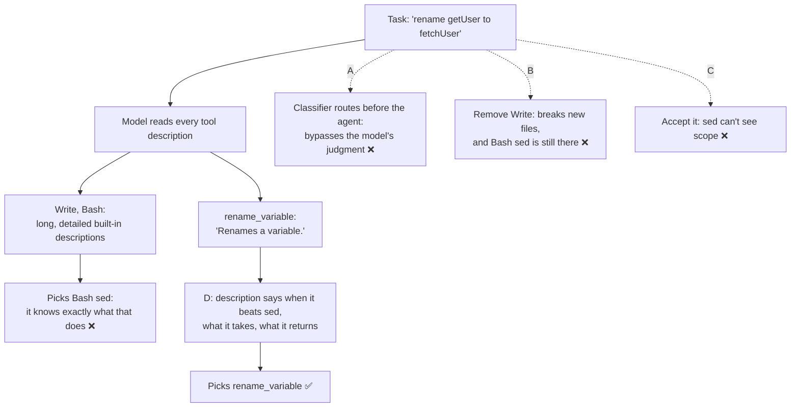

# Q74

**Scenario:** Developer productivity tools built with the Claude Agent SDK (same as [Q68](../Q68-trace-from-base-class-incremental-reading/question.md)–[Q73](../Q73-same-steps-every-pr-prompt-chaining/question.md))

## Question

You are building developer productivity tools using the Claude Agent SDK. The agent helps engineers explore unfamiliar codebases, understand legacy systems, generate boilerplate code, and automate repetitive tasks. It uses the built-in tools (Read, Write, Bash, Grep, Glob) and integrates with Model Context Protocol (MCP) servers.

After adding an MCP server with specialized code refactoring tools (extract_function, rename_variable, inline_function), you notice the agent still uses basic text manipulation via Write and Bash sed commands for refactoring tasks. The MCP server is connected and healthy. Examining the configuration, you find each MCP tool has a minimal description like "extract_function: Extracts a function from code."

What's the most effective way to improve adoption of the MCP refactoring tools?

- **A.** Implement a request classifier that detects refactoring intent and automatically routes those requests to the MCP server before the agent processes them.
- **B.** Remove the Write tool from the agent's configuration for refactoring sessions so it must use the MCP tools for code modifications.
- **C.** Accept this as expected behavior since simpler tools like sed are more predictable than specialized refactoring tools.
- **D.** Enhance the MCP tool descriptions to explain when each tool is preferable to text manipulation and clarify expected inputs and outputs.

<details>
<summary><b>Show answer and explanation</b></summary>

**Topic:** MCP refactoring tools ignored for Write and sed: write descriptions that compete with the built-ins
**Domain / lesson:** D2 › 2.4 MCP Server Integration (detailed MCP tool descriptions)
**Also touches:** D2 › 2.1 Tool Interface Design (the five elements of a description; the routing-classifier trap)
**Follows:** [Q23](../Q23-expand-minimal-tool-descriptions/question.md) (minimal descriptions → expand them) · [Q04](../Q04-tool-scoping-per-subagent/question.md) (when removing tools *is* right)

## Answer: **D**

## Diagram



## Concept

**First, rule things out from the question.** The server is *"connected and healthy"*, so the agent can see the tools. Nothing is broken in the connection. The agent sees the MCP tools and **chooses** the built-ins. That's a **selection** problem, and selection runs on descriptions. Guide 2.1: *"Tool descriptions are the primary mechanism LLMs use for tool selection."*

**Why the built-ins win.** The MCP tools aren't only competing with each other; they're competing with Read, Write, Bash and Grep. Guide 2.4: *"Built-in tools such as Grep have rich, detailed descriptions, so the model has better context about them. When an MCP tool has a sparse description, the agent may prefer the built-in tool even when the MCP tool is more capable."* The model knows exactly what `sed` does. *"Extracts a function from code"* tells it almost nothing: what input? what comes back? why is it better than editing the file myself?

**The fix: a description that competes.** Guide 2.4: *"The fix is a description that explains capabilities and outputs in detail."* Its build exercise expects descriptions that explain *"what the tool does, what it returns, when to use it, and how it compares to built-in alternatives."* For `rename_variable` that could be (illustrative: the real server's behaviour may differ):

```text
rename_variable: "Renames a variable, function or class and updates every
reference to it, using the language's syntax tree. Input: file path, line
and column of one occurrence, and the new name. Renames only references to
that symbol: not other symbols with the same name in other scopes, and not
matching text in comments or strings. Returns a diff of every changed file
and a count of renamed references. Use this instead of Bash sed or Write for
any rename: sed replaces every text match, so it also changes unrelated
names, comments and strings."
```

| Element | In the example |
|---|---|
| What it does | Renames a symbol and every reference to it |
| Inputs | File, position of one occurrence, new name |
| Outputs | A diff of every changed file + a count |
| Limits | Only that symbol; not same-named symbols or text |
| **When to prefer it over the built-ins** | *"Use this instead of Bash sed or Write for any rename"*, with the reason |

The last row is the one that matters most here. Q23's descriptions had to separate two MCP tools from each other. Here each description must also say why it beats **text manipulation**, because that's what the model is choosing instead.

**Why it matters for the code, not just for adoption.** Text edits don't understand code. `sed 's/count/total/g'` also changes `account` (to `actotal`), `countries` (to `totalries`) and a `count` in an unrelated function. Rewriting a whole file with Write to extract one function risks dropping or changing lines by accident. The refactoring tools exist to avoid exactly that.

## Why the others are wrong

| Option | Why not |
|---|---|
| **A** Request classifier that routes refactoring requests to the MCP server | **Guide 2.1 exam trap:** *"Implementing a routing classifier as the first step to fix tool selection."* *"A routing classifier is over-engineered as a first response. It bypasses the LLM's natural language understanding and adds infrastructure. Expanding the tool descriptions addresses the root cause directly."* Detecting "refactoring intent" is also fuzzy: is *"clean up this module"* a refactoring? And the descriptions stay minimal, so whenever the classifier misses, the agent still picks sed. |
| **B** Remove Write for refactoring sessions | **Guide 2.4 exam trap:** *"Adding a system prompt rule or removing built-in tools to make the agent use an MCP tool."* *"The model does not always follow prompt rules, and removing built-in tools breaks work they still do."* Write is still needed: a refactoring often creates a new file or a test. And B doesn't even work: the question says the agent also uses **Bash sed**, which B leaves in place. Remove Write and it does more with sed. |
| **C** Accept it: sed is more predictable | **Backwards.** Text manipulation is predictable as text, not as code: it can't see scope, references or syntax, which is exactly what refactoring needs. The cause is diagnosable (minimal descriptions) and the fix is cheap. Accepting it means the team's refactoring server is wasted, and refactorings stay riskier than they need to be. |

**"But Q04 said remove access, don't forbid it?"** Q04 removed tools that belonged to **another role**: that agent should never use them at all. Here Write does legitimate work in the same session (new files, tests, boilerplate). The agent needs all the tools; it just needs to know which one fits which job.

## Pattern to remember

> **MCP tool connected but ignored in favour of a built-in → its description is losing to the built-in's. Rewrite it: what it does, inputs, outputs, limits, and *when to use it instead of the built-in*, with the reason.** Don't remove the built-in, don't add a routing classifier, don't accept it.

**Exam signals:**
- *"Connected and healthy"* + *"still uses Grep / Write / Bash"* + *"minimal description"* → **enhance the MCP tool descriptions**.
- *"Remove the built-in tool"*, *"add a system prompt rule"* to force the MCP tool → trap (2.4).
- *"Routing classifier"*, *"route before the agent processes it"* → over-engineered first step (2.1).
- *"Most effective first step"*, *"root cause"* → the description.

### Where this comes from

**Guide D2 › 2.4 MCP Server Integration:**
- *"Built-in tools such as Grep have rich, detailed descriptions, so the model has better context about them. When an MCP tool has a sparse description, the agent may prefer the built-in tool even when the MCP tool is more capable."*
- *"The fix is a description that explains capabilities and outputs in detail."* *"The detailed description gives the model enough context to prefer the MCP tool when it is more capable than the built-in alternative."* (**D**)
- The guide's own example: *"More accurate than text-based grep for finding code by intent rather than exact string match. Use this instead of Grep when searching for code by what it does rather than what it contains."*
- Exam trap: *"Adding a system prompt rule or removing built-in tools to make the agent use an MCP tool."* *"The model does not always follow prompt rules, and removing built-in tools breaks work they still do. The agent reads tool descriptions when choosing, and it prefers built-in tools to MCP tools with sparse descriptions. Expand the description to explain capabilities and outputs."* (**B**)
- Build exercise: descriptions *"explaining what the tool does, what it returns, when to use it, and how it compares to built-in alternatives."*

**Guide D2 › 2.1 Tool Interface Design:**
- *"Tool descriptions are the primary mechanism LLMs use for tool selection."*
- Five elements: what the tool does, *"What inputs it expects"*, *"Example queries it handles well"*, *"Edge cases and limitations"*, *"Explicit boundaries: when to use this tool versus similar tools in the same toolkit"*.
- Exam trap: *"Implementing a routing classifier as the first step to fix tool selection."* *"It bypasses the LLM's natural language understanding and adds infrastructure."* (**A**)
- *"The exam consistently favours low-effort fixes with a large effect: better descriptions before routing classifiers…"* (**A**, **C**)
- *"Keyword-sensitive instructions in system prompts can create unintended tool associations that override well-written descriptions."* Exam trap: *"Ignoring system prompt wording after updating tool descriptions."* *"After any description change, review the system prompt and rephrase wording that matches a tool."* (the check question)

## How this connects to earlier questions

| Question | Link |
|---|---|
| [Q23](../Q23-expand-minimal-tool-descriptions/question.md) | Same fix. There, two MCP tools competed with each other (`archive_file` vs `delete_file`); here MCP tools compete with the built-ins, whose descriptions are much richer |
| [Q04](../Q04-tool-scoping-per-subagent/question.md) | Removing tools is right when they belong to another role. Here Write still does legitimate work, so removing it is the trap |
| [Q47](../Q47-merge-overlapping-tools/question.md) | When descriptions are **not** the fix: too many overlapping tools. Here it's three new tools with one-line descriptions: a description problem |
| [Q59](../Q59-mcp-scopes-project-vs-user/question.md) | Also 2.4: where the server is configured. Here configuration is fine; selection is the problem |

## Check question

**You rewrite all three descriptions. The agent now uses `extract_function` and `inline_function`, but for renames across several files it still runs `sed -i 's/getUser/fetchUser/g'`. Its system prompt includes the line *"For quick edits across many files, use Bash with sed."* What's going on, and what do you change?**

*My answer:* "System prompt gives an answer what to do for quick edit and that is not looking for tools. System prompt must be modified." ✅ **Correct on both counts. The system prompt line already decides the tool, so the agent doesn't weigh the descriptions, and the fix is to change the system prompt. The guide calls this a "subtle failure mode".**

**Why the system prompt wins.** A rename across several files fits *"quick edits across many files"* exactly, and that line names a tool. A direct instruction that matches the task beats a description, however good. Guide 2.1: *"Keyword-sensitive instructions in system prompts can create unintended tool associations that override well-written descriptions."* The guide's example is the same shape: *"always check customer details before proceeding"* sends every customer-related query to `get_customer`, *"whatever the descriptions say."* That's why only renames still go to sed: `extract_function` and `inline_function` don't match the line.

**What to change.** Guide: *"After any description change, review the system prompt and rephrase wording that matches a tool."* Either delete the line, or narrow it to the job sed is actually good at:

| | System prompt line |
|---|---|
| Before | *"For quick edits across many files, use Bash with sed."* |
| After (option 1) | Delete it: the descriptions now say when each tool fits |
| After (option 2) | *"For plain-text changes such as comments, strings or config values, Bash with sed is fine. Renaming or restructuring code is a refactoring: use the refactoring tools."* |

Don't swing the other way with *"ALWAYS use rename_variable"*. That's the 2.4 trap (*"Adding a system prompt rule… to make the agent use an MCP tool"*), and it creates a new keyword association of its own. The aim is to remove the conflict so the descriptions can do their job.

**Then measure.** The guide's build exercise: re-run the same test queries and compare which tool is picked before and after. Renames should now go to `rename_variable`.

*(Practical tip, not guide wording: in Claude Code, check CLAUDE.md, rules files, skills and slash commands too. Anything loaded into context can carry the same kind of instruction.)*

> **Descriptions decide tool selection only when nothing louder contradicts them. After changing a description, reread the system prompt for any line that names a tool for a kind of task, and rephrase or remove it.**

## Glossary

- **Built-in tools:** the tools that come with Claude Code and the Agent SDK (Read, Write, Edit, Bash, Grep, Glob…), with long, detailed descriptions.
- **MCP tool description:** the text the MCP server sends with each tool; the model reads it to decide when to call the tool.
- **Tool selection:** the model's choice of which tool to call, based mostly on the descriptions it sees.
- **Routing classifier:** code that inspects the request before the model sees it and picks the tool or path itself.
- **AST-aware refactoring:** changes made on the code's syntax tree, so they follow scope and references instead of matching text.
- **`sed`:** a command-line stream editor; `s/old/new/g` replaces every text match, with no idea what the text means in the code.

## Related course lessons

*Lecture lengths aren't recorded in the study-map files, so the watch times below are estimates from each course's average lecture length.*

### Udemy A (primary): Claude Certified Architect (CCAR-F) - 2026 Exam Prep
| # | Lecture | Part | Why |
|---|---|---|---|
| **33** | **Writing Tool Descriptions That Route Correctly** | 2A | ⭐ Exactly D *(also in Q17, Q19, Q20, Q23, Q30, Q48)* |
| **32** | **How Claude Selects Tools** | 2A | ⭐ Why the model picks the tool it understands best *(also in Q04, Q17, Q23, Q29, Q47)* |
| 55 | MCP in Production | 2C | MCP tools working next to the built-ins *(also in Q59)* |
| 54 | Tool Boundaries, Access Scoping, and Least Privilege | 2C | When removing a tool is right, and when it isn't (B) *(also in Q04, Q59)* |
| Quiz 5, Quiz 7 | 2A and 2C quizzes | | Self-test |

**▶ Watch in this order (~28 min, est.):** #32 → #33 → #55 → #54, then do **Quiz 5** and **Quiz 7**.

### Udemy B: Claude Certified Architect Foundations: Complete Course (Voroniuk)
| # | Lecture | Section | Why |
|---|---|---|---|
| **41** | **How Claude Chooses a Tool** | S5 Tools & MCP | ⭐ Descriptions decide the choice *(also in Q04, Q17, Q19, Q20, Q23, Q29, Q30, Q47, Q48)* |
| **91** | **Dev Agent Case: MCP Servers** | S8 Claude Code Setup | ⭐ MCP servers in this same dev-agent scenario *(also in Q57, Q59)* |
| 42 | Renaming, Splitting and Keyword Triggers | S5 Tools & MCP | Fixing tool selection *(also in Q04, Q17, Q19, Q20, Q23, Q29, Q30, Q47)* |
| Quiz 5, Quiz 8 | Tools & MCP, and Claude Code Setup quizzes | S5, S8 | Self-test |

**▶ Watch in this order (~15 min, est.):** #41 → #91 → #42, then do **Quiz 5** and **Quiz 8**.

### CBT Nuggets: CCA-F course
| Skill | Why |
|---|---|
| **34. Build MCP Tools Resources and Prompts** | ⭐ Writing MCP tool definitions and descriptions *(also in Q17, Q19, Q23, Q25, Q33, Q57)* |
| 22. Route Requests Across Multiple Tools | How the model chooses between tools *(also in Q04, Q17, Q23, Q29, Q30, Q47, Q48)* |

</details>
