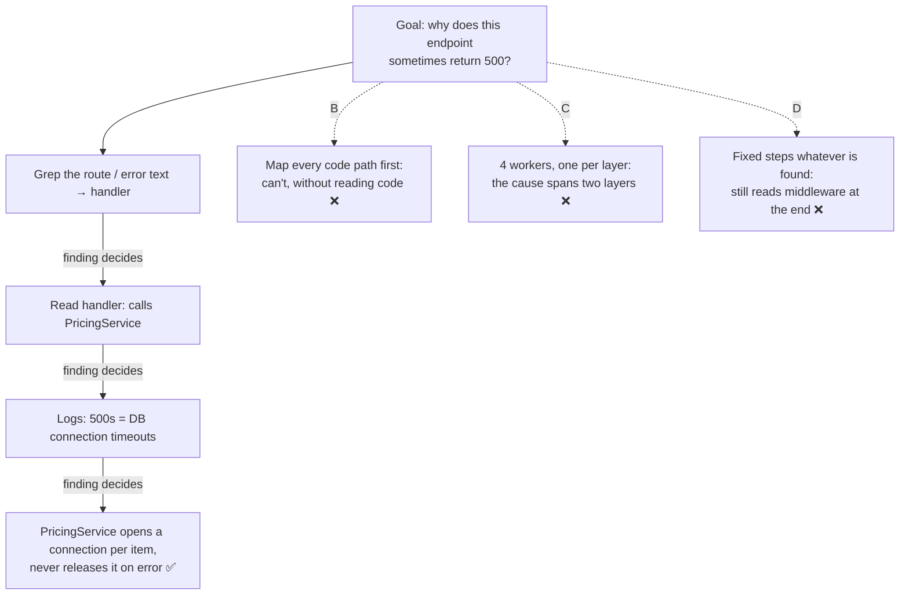

# Q75

**Scenario:** Developer productivity tools built with the Claude Agent SDK (the pasted text leaves out the scenario intro; same set as [Q68](../Q68-trace-from-base-class-incremental-reading/question.md)–[Q74](../Q74-mcp-descriptions-compete-with-built-ins/question.md))

## Question

A developer asks the agent to investigate why a specific API endpoint intermittently returns 500 errors. The codebase has 200+ files and the developer doesn't know which components are involved. The agent must trace the error through routing, middleware, business logic, and database layers. What task decomposition approach would be most effective?

- **A.** Have the agent dynamically generate investigation subtasks based on what it discovers at each step, adapting its exploration plan as new information about the error path emerges.
- **B.** Have the agent first create a comprehensive plan mapping all code paths through the endpoint before beginning any file exploration or code reading.
- **C.** Run parallel worker agents that simultaneously investigate all four layers, then synthesize their findings to identify where the error originates.
- **D.** Define a fixed sequence of investigation steps upfront – grep for error patterns, then read error handlers, then check database queries, then examine middleware – executing each step regardless of intermediate findings.

<details>
<summary><b>Show answer and explanation</b></summary>

**Topic:** Intermittent 500s, components unknown: dynamic adaptive decomposition
**Domain / lesson:** D1 › 1.6 Task Decomposition Strategies
**Also touches:** D2 › 2.5 Built-in Tools (incremental discovery: each step justified by the last)
**Follows:** [Q73](../Q73-same-steps-every-pr-prompt-chaining/question.md) (the mirror image: known steps → fixed pipeline) · [Q69](../Q69-grep-distinctive-error-text/question.md) (start from the evidence you have)

## Answer: **A**

## Diagram



## Concept

**The deciding phrase: *"the developer doesn't know which components are involved."*** Nobody knows where the cause is, so nobody can write the steps in advance. That's an open-ended investigation, and the guide's pattern for it is **dynamic adaptive decomposition**: *"Dynamic adaptive decomposition generates subtasks from what each step discovers."* Its decision table pairs *"Debugging an unfamiliar system"* with *"Dynamic decomposition"*, because the *"Root cause is unknown; investigation must adapt"*.

**How it works:** *"The agent starts with a high-level goal. It investigates, and it plans from what it finds. New information may change the remaining steps, and the agent adapts the plan."* An illustrative trace:

| Step | Finding | So the next step is… |
|---|---|---|
| 1. Grep for the route, or the error text from the logs | The handler, `OrderSummaryController.get` | Read the handler |
| 2. Read the handler | It calls `PricingService` and `InventoryClient` | Find which call fails: check the logged stack traces |
| 3. Read the 500s' stack traces | They're all database connection timeouts | The database layer, not middleware: skip middleware for now |
| 4. Grep where `PricingService` gets connections | It takes one connection per order line and doesn't release it when an exception is thrown | That explains *"intermittent"*: only large orders, under load |

No step could have been planned before the one before it. Step 1 is guide 2.5's incremental discovery: *"Grep to find entry points. Search for the function name, class name or error message that starts your investigation."* Every later step follows *"Justify each file you read by what you found in the previous step."*

**"Intermittent" is a signal too.** If it failed every time, one careful read of the code might find it. An error that comes and goes depends on conditions: load, data size, timing. You find those by following evidence (logs, traces), not by reading each layer in turn.

**The cost, and why it's worth it here.** Guide: dynamic decomposition *"is less predictable. Execution time varies with discoveries, so completion time and resource usage are harder to estimate."* For a fixed task like Q73's review, that cost buys nothing. For an unknown cause, there's no alternative: the plan can't exist until the evidence does.

**A can still use workers.** If step 3 had pointed to three services at once, the agent could send a subagent to each. That's still dynamic: the **findings** decide which subtasks exist. The difference from C is who defines the subtasks, and when.

## Why the others are wrong

| Option | Why not |
|---|---|
| **B** Map all code paths before reading any code | **You can't map code paths without reading code.** In 200+ files, "all code paths through the endpoint" means reading most of the codebase up front: guide 2.5's exam trap, *"Reading all source files upfront before understanding what is relevant"*. And the map wouldn't show the cause anyway: an intermittent error lives in runtime conditions (load, data), not in the shape of the call graph. Making a plan is fine; making a *complete* one before any evidence isn't. |
| **C** Parallel workers, one per layer, then synthesise | **The split is decided before anything is known.** The article's distinction: in orchestrator-workers, *"subtasks aren't pre-defined, but determined by the orchestrator based on the specific input."* C's four subtasks are pre-defined: one per layer. Two problems follow. Workers spend effort on layers that turn out to be irrelevant (middleware, here). And the cause often **spans** layers: the business logic holds the connections, the database layer runs out. Each worker sees half of it, and a synthesis at the end can't send anyone to follow a lead. |
| **D** Fixed sequence, run whatever is found | **The guide's exam trap: *"Applying fixed pipelines to open-ended investigation tasks."*** *"Fixed pipelines cannot respond to unexpected findings."* Even after the database timeouts point to the cause, D still goes on to *"examine middleware"*. And if the cause is somewhere D's four steps don't cover (a cache, a third-party client), D never finds it. |

## Pattern to remember

> **Cause unknown, components unknown → dynamic adaptive decomposition: start from the evidence, and let each finding choose the next step.** Don't plan everything before reading, don't split by a structure you've assumed, and don't run fixed steps whatever they find.

**Exam signals:**
- *"Doesn't know which components are involved"*, *"intermittent"*, *"investigate"*, *"trace"*, *"unfamiliar"*, *"root cause"* → **dynamic decomposition**.
- *"Regardless of intermediate findings"*, *"fixed sequence"* → fixed pipeline on an open-ended task (trap).
- *"Comprehensive plan before any exploration"* → planning without evidence; reading up front.
- *"Parallel workers on all layers"* for **one** error path → a predefined split that can't follow leads.

### Where this comes from

**Guide D1 › 1.6 Task Decomposition Strategies:**
- *"Dynamic adaptive decomposition generates subtasks from what each step discovers."*
- *"With dynamic decomposition, the plan changes as the agent learns. The agent starts with a high-level goal. It investigates, and it plans from what it finds. New information may change the remaining steps, and the agent adapts the plan."* (**A**)
- *"Nobody knows the cause at the start, so nobody can write the steps in advance."*
- *"This pattern suits open-ended investigation where the full scope is unknown at the start: exploring legacy systems, security audits, research projects and debugging unfamiliar codebases. It responds to unexpected complexity."*
- Decision table: *"Debugging an unfamiliar system"* → *"Dynamic decomposition"*, *"Root cause is unknown; investigation must adapt"*.
- *"It is less predictable. Execution time varies with discoveries, so completion time and resource usage are harder to estimate. Debugging is also harder."*
- Exam trap: *"Applying fixed pipelines to open-ended investigation tasks."* *"Open-ended tasks require adaptability. Fixed pipelines cannot respond to unexpected findings. Dynamic adaptive decomposition is the correct pattern when the full scope is unknown at the start."* (**D**)

**Guide D2 › 2.5 Built-in Tools:**
- *"Grep to find entry points. Search for the function name, class name or error message that starts your investigation."*
- *"Read only what you need. Justify each file you read by what you found in the previous step."*
- Exam trap: *"Reading all source files upfront before understanding what is relevant."* (**B**)

**Anthropic, *Building effective agents*:**
- Orchestrator-workers: *"subtasks aren't pre-defined, but determined by the orchestrator based on the specific input."* (**C** pre-defines them)

## How this connects to earlier questions

| Question | Link |
|---|---|
| [Q73](../Q73-same-steps-every-pr-prompt-chaining/question.md) | The mirror image in the same lesson: known steps → fixed pipeline. Its check question (the leaked key) was this pattern |
| [Q69](../Q69-grep-distinctive-error-text/question.md), [Q68](../Q68-trace-from-base-class-incremental-reading/question.md) | Incremental discovery is dynamic decomposition at the tool level: Grep the entry point, read, follow what you find |
| [Q66](../Q66-clear-stack-trace-direct-execution/question.md) | The contrast: a clear stack trace pointed straight at the function, so no investigation was needed |
| [Q11](../Q11-analysis-gap-feedback-loop/question.md) | A strict pipeline couldn't act on what it found; it needed a loop |
| [Q71](../Q71-degraded-context-summary-into-subagent/question.md) | A long investigation degrades context: keep a scratchpad, use focused subagents |

## Check question

**The agent finds the cause: `PricingService` takes a database connection for every order line and doesn't release it when an exception is thrown, so large orders under load exhaust the connection pool. The developer now asks: "Check our other 40 endpoints for the same pattern." Do you keep the dynamic approach for this? Which pattern now, and how would you run it?**

*My answer:* "Now the scope is known and you can run 40 agents to check for the pattern." 🟡 **The decision and the reason are right: the scope is now known, so you don't keep the dynamic approach, and one pass per endpoint is the right split. What's missing is the piece the guide says the exam tests: one cross-item integration pass after the 40 checks.**

**Why the pattern changes.** The investigation turned an unknown into a known: there is now a list (40 endpoints) and one check to run on each (does it take a connection and fail to release it on an exception?). The steps are the same for every endpoint, so this is a **fixed pipeline**. Running the 40 checks at the same time is fine; the article calls that *sectioning*, and it's still fixed. It's the same pattern as Q73's review, with endpoints instead of aspects.

**Why one pass per endpoint.** Putting all 40 in one prompt gives attention dilution. Guide 1.6: *"Attention dilution occurs when an agent processes too many items in a single pass."* *"Early items get a disproportionate share, and the model skims later items."*

**The missing piece: the integration pass.** The guide's own example also has 40 items: *"With 40 single-listing passes and one integration pass, the pass for listing 35 catches its wrong price. The integration pass finds that the same missing hallmark was judged in two different ways."* The per-endpoint passes find local problems. The integration pass compares their results, and it finds things no single pass can see:

| The 40 results say | The integration pass sees |
|---|---|
| 9 endpoints leak, each reported in its own handler | All 9 call the same `OrderRepository.load_lines()`: **one bug, one fix**, not 9 |
| `/refund` flagged, `/exchange` passed, but they use the same code | The same code was judged in two different ways: re-check one of them |
| Some endpoints release connections with `try/finally`, others with a context manager, one does neither | An inconsistent pattern worth one team-wide fix |

The guide's exam trap covers the shortcut: *"Batching files into groups without adding a cross-file integration pass."* *"Without a dedicated cross-file integration pass, data flow issues and pattern inconsistencies across batches go undetected."*

**What each per-endpoint pass gets.** The same instructions every time, with the pattern taken from what the investigation found, and a fixed report format so the integration pass can compare the results:

```text
Check one endpoint for a database connection leak.
The pattern (found in PricingService): a connection is taken and is not
released when an exception is thrown (no try/finally, no context manager).
Endpoint: POST /orders/{id}/refund  →  handler: RefundController.create
Follow the calls this handler makes into the code that takes connections.
Report as JSON: endpoint, file:line where each connection is taken,
released_on_every_path (yes / no / unsure), shared helper used (if any).
```

**If one endpoint turns up something different** (say, a cache client that leaks sockets), don't change the sweep. The sweep reports it, and the new problem becomes its own investigation, run the dynamic way. That's the Q73 check again.

*(Practical tips, not guide wording: a Grep first for where connections are taken, such as `get_connection` or `pool.acquire`, can skip the endpoints that never touch the database. It's still a fixed step. Also, 40 agents cost 40 contexts' worth of tokens. Running the passes in parallel is for speed; the guide's fix is the split into per-item passes, not the parallelism.)*

> **Investigate dynamically until the cause is known, then sweep with a fixed pipeline: one pass per item, plus one integration pass that compares them. The first job's finding defines the second job's check.**

## Glossary

- **Dynamic adaptive decomposition:** the plan is built and changed from what each step finds; subtasks don't exist until the evidence calls for them.
- **Fixed pipeline:** predetermined steps in a fixed order, the same whatever the steps find.
- **Intermittent error:** fails only sometimes, so the cause depends on conditions (load, data, timing), not just on the code.
- **Error path:** the route a failing request takes through the code, from the endpoint to where the error starts.
- **Entry point:** where an investigation starts: the route, the function or the error message you can search for.
- **Connection pool:** a fixed set of reusable database connections; if code takes connections and doesn't return them, later requests wait and time out.

## Related course lessons

*Lecture lengths aren't recorded in the study-map files, so the watch times below are estimates from each course's average lecture length.*

### Udemy A (primary): Claude Certified Architect (CCAR-F) - 2026 Exam Prep
| # | Lecture | Part | Why |
|---|---|---|---|
| **14** | **Adaptive Planning — Updating the Plan Mid-Execution** | 1B | ⭐ Exactly A *(also in Q05, Q06, Q11, Q73)* |
| **11** | **Decomposition Patterns — Hierarchical, Sequential, and Parallel** | 1B | ⭐ A vs C vs D in one lecture *(also in Q11, Q73)* |
| 10 | Breaking Complex Goals Into Actionable Subtasks | 1B | Turning "find the 500s" into next steps |
| 13 | Parallel Execution — Fan-Out, Fan-In | 1B | When fan-out helps, and why C's split by layer doesn't *(also in Q73)* |
| Quiz 2 | 1B quiz | | Self-test |

**▶ Watch in this order (~28 min, est.):** #10 → #11 → #14 → #13, then do **Quiz 2**.

### Udemy B: Claude Certified Architect Foundations: Complete Course (Voroniuk)
| # | Lecture | Section | Why |
|---|---|---|---|
| **59** | **Workflow or Agent: How Work Is Decomposed** | S7 Multi-Agent | ⭐ Adaptive vs fixed: this question's decision *(also in Q11, Q73)* |
| **80** | **Exploring a Codebase Step by Step** | S8 Claude Code Setup | ⭐ Following the evidence one step at a time *(also in Q58, Q68, Q69)* |
| 90 | Dev Agent Case: Exploring Code | S8 Claude Code Setup | A worked case in this scenario *(also in Q68, Q69)* |
| Quiz 7, Quiz 8 | Multi-Agent, and Claude Code Setup quizzes | S7, S8 | Self-test |

**▶ Watch in this order (~15 min, est.):** #59 → #80 → #90, then do **Quiz 7** and **Quiz 8**.

### CBT Nuggets: CCA-F course
| Skill | Why |
|---|---|
| **36. Design Workflows and Agent Systems** | ⭐ Adaptive agents vs fixed workflows *(also in Q01–Q07, Q09–Q13, Q29, Q36, Q39, Q73)* |
| 23. Apply Built In Tools Safely | Grep → Read → follow: the tool side of an adaptive investigation *(also in Q68, Q69)* |

</details>
