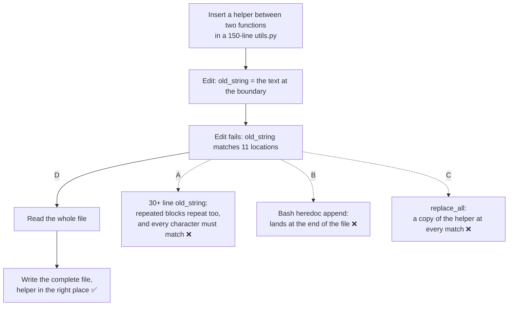

# Q76 — Edit can't find a unique anchor: Read the file, then Write it

**Domain / lesson:** D2 › 2.5 Built-in Tools
**Scenario:** Developer productivity tools built with the Claude Agent SDK (same set as [Q68](../Q68-trace-from-base-class-incremental-reading/question.md)–[Q75](../Q75-intermittent-500-dynamic-decomposition/question.md))
**Follows:** [Q69](../Q69-grep-distinctive-error-text/question.md) and [Q68](../Q68-trace-from-base-class-incremental-reading/question.md) (same lesson: finding code; this one is changing it) · [Q74](../Q74-mcp-descriptions-compete-with-built-ins/question.md) (the agent editing code with Write and `sed`)

## Question

You are building developer productivity tools using the Claude Agent SDK. The agent helps engineers explore unfamiliar codebases, understand legacy systems, generate boilerplate code, and automate repetitive tasks. It uses the built-in tools (Read, Write, Bash, Grep, Glob) and integrates with Model Context Protocol (MCP) servers.

Your agent needs to insert a new helper function into the middle of a 150-line utility module, between two existing functions. The Edit tool fails because its old_string parameter cannot find unique text to match – the file has repetitive docstrings, variable names, and structural patterns. What's the most reliable way to complete this insertion?

- **A.** Use Edit with an extremely long old_string capturing 30+ lines of context to guarantee uniqueness
- **B.** Use Bash to append the function definition to the end of the file using heredoc syntax
- **C.** Use Edit's replace_all parameter to target a common pattern and embed the new function in the replacement text
- **D.** Use Read to load the file, add the function at the appropriate location, then Write the updated file

## Answer: **D**

## Diagram



## Concept

**Edit has no "insert at line N".** It finds an exact piece of text (`old_string`, the guide calls it the *anchor*) and replaces it. To insert, you replace the text at the boundary with the same text plus the new function. So an insertion needs a boundary that appears **once** in the file.

**In a repetitive module, every boundary looks the same.** Utility modules often have many functions written to one template:

```python
def to_int(value, default=None):
    """Convert a value. Returns default if the value is empty or invalid."""
    if value in (None, ""):
        return default
    try:
        return int(value)
    except ValueError:
        return default


def to_float(value, default=None):
    """Convert a value. Returns default if the value is empty or invalid."""
    ...
```

The end of one function, the blank lines and the start of the next appear between every pair of functions. Edit then fails with an error like *"old_string matches 11 locations"*. That's on purpose. Guide 2.5: *"If the anchor appears in several places, Edit cannot tell which occurrence you mean, so Edit fails. This failure is a safety mechanism that stops you from changing text that you never meant to change."*

**Read + Write doesn't need an anchor.** The agent reads the whole file, so it can see where the two functions are. It builds the complete new version: everything before the boundary, the new helper, everything after. Then Write saves the whole file. Guide: *"Read + Write works every time, because it does not rely on Edit to find the text to change."* That's why it's the exam's answer when Edit can't find a unique anchor.

**What D looks like** (illustrative):

| Step | Tool | What happens |
|---|---|---|
| 1 | Read `utils.py` | All 150 lines come into context; the agent sees that `to_int` ends at line 62 and `to_float` starts at line 65 |
| 2 | (the model) | Builds the new file: lines 1–64 unchanged, the new helper, lines 65–150 unchanged |
| 3 | Write `utils.py` | Saves the complete new version; the helper sits exactly between the two functions |

*(Practical tips, not guide wording: Write replaces the whole file, so the new version must keep every original line; a line the agent drops is deleted. Check the result with `git diff`, or Read the file again. In Claude Code, Write refuses to overwrite an existing file the agent hasn't read first, so the Read step is required there anyway.)*

## Why the others are wrong

| Option | Why not |
|---|---|
| **A** A 30+ line `old_string` "to guarantee uniqueness" | **A longer anchor isn't unique when the blocks themselves repeat.** The question says the file has repetitive docstrings, names and structure, so 30 lines from one place can match 30 lines from another. The guide names this exam trap: *"Widening old_string or setting replace_all when no anchor, however long, would be unique and only one occurrence should change"*, because *"Widening needs a unique anchor"*. And 30+ lines must match **character for character** (indentation, blank lines, trailing spaces). One difference and Edit fails again. A retries the tool that just failed, instead of using the fallback that doesn't need an anchor. |
| **B** Bash heredoc, appended to the end of the file | **It does a different task.** The function has to go *between two existing functions*; appending puts it at the end of the file. In Python it may still run, so nothing signals the mistake: the module is just out of order. *(Practical tip: `>` instead of `>>` replaces the whole file with the new function.)* |
| **C** `replace_all` on a common pattern, with the function in the replacement | **`replace_all` changes every match.** Guide: *"replace_all changes every occurrence."* Put the helper in the replacement text and you get one copy of it at **every** match: 11 copies of the same function. In Python the last definition silently wins, so the file may still run, and the mess is easy to miss. `replace_all` is for changes you want everywhere (renaming something used throughout the file), not for one insertion. |

## Pattern to remember

> **Edit can't find a unique anchor and only one place should change → Read the whole file, make the change, Write the complete file.** Don't make the anchor longer in repetitive code, don't use `replace_all` for a one-place change, and don't append somewhere else because it's easier.

**Exam signals:**
- *"Edit fails"*, *"cannot find unique text"*, *"repetitive"* / *"similar patterns"*, inserting *"between"* existing code → **Read + Write**.
- *"replace_all"* when only one place should change → trap: it changes every occurrence.
- *"Longer old_string to guarantee uniqueness"* when the file repeats itself → trap: no anchor, however long, is unique.
- *"Append to the end"* when the task names a position → does a different task.
- *"Read + Write for every modification"* → trap: Edit first, Read + Write is the fallback (check question).

### Where this comes from

**Guide D2 › 2.5 Built-in Tools:**
- *"Read loads a file's full contents, Write saves a complete file, and Edit replaces exact text in a file."*
- *"Edit needs its anchor to be unique in the file. The anchor is the exact text that Edit searches for. If the anchor appears in several places, Edit cannot tell which occurrence you mean, so Edit fails. This failure is a safety mechanism that stops you from changing text that you never meant to change."*
- *"One option is Read + Write: read the full file, then write the complete modified version to the file. Read + Write works every time, because it does not rely on Edit to find the text to change."* (**D**)
- Key concept: *"on a non-unique match the exam's answer is Read + Write."*
- The exam guide's own words, quoted in the lesson: *"Using Read to load full file contents followed by Write when Edit cannot find unique anchor text"*.
- Exam trap: *"Widening old_string or setting replace_all when no anchor, however long, would be unique and only one occurrence should change."* *"Widening needs a unique anchor, and replace_all changes every occurrence. So use Read, then Write."* (**A**, **C**)
- *"It also spends tokens on the whole file for what was usually a one-line change. For that reason, Read + Write is the fallback, not the default."* (check question)
- Exam trap: *"Defaulting to Read + Write for every file modification instead of trying Edit first."* *"Edit is faster and uses less context because it only touches the specific text. Read + Write loads the entire file. Try Edit first."* (check question)
- Current state: *"On the exam, answer Read + Write. In real work, widen old_string first, because it is cheaper."*

## How this connects to earlier questions

| Question | Link |
|---|---|
| [Q69](../Q69-grep-distinctive-error-text/question.md), [Q68](../Q68-trace-from-base-class-incremental-reading/question.md) | Same lesson, the other half: Grep vs Glob vs Read to **find** code; this question is about **changing** it. Each tool has its own job |
| [Q74](../Q74-mcp-descriptions-compete-with-built-ins/question.md) | Same scenario: the agent changed code with Write and `sed` when a semantic refactoring tool was there. There the fix was the tool descriptions; here Write is the right tool |
| [Q52](../Q52-posttooluse-hook-runs-formatter/question.md) | A PostToolUse hook with an `Edit\|Write` matcher runs after either tool, so formatting still happens when the change comes from Write |
| [Q53](../Q53-direct-execution-for-clear-small-change/question.md) | A clear, small change: just make it. The question here isn't *whether* to plan, but *which tool* makes the change safely |

## Check question

**A teammate sees this and says: "Read + Write worked where Edit failed, and it works every time. Let's make it the agent's standard way to change files and stop using Edit." Do you agree? Why or why not?**

*My answer:* "No: in cases where it is possible to uniquely identify the function, it is more efficient to use Edit, as you do not need to read the whole file." ✅ **Right, and it's the guide's reason.** *"Edit is faster and uses less context because it only touches the specific text. Read + Write loads the entire file."* Read + Write *"spends tokens on the whole file for what was usually a one-line change. For that reason, Read + Write is the fallback, not the default."* The guide lists the teammate's idea as an exam trap: *"Defaulting to Read + Write for every file modification instead of trying Edit first."*

**One more reason: "works every time" also means it never refuses.** Edit's failure is a safety check: *"This failure is a safety mechanism that stops you from changing text that you never meant to change."* If the anchor doesn't match exactly once, Edit changes nothing and says so. Write just saves whatever it's given. *(Practical point, not guide wording: when the model writes 150 lines back, a line it drops or changes goes in without any error. With Edit, everything outside `old_string` stays untouched.)*

**The order of steps, exam vs real work.** The guide's "Current state" box separates them:

| Step | Exam (exam guide v1.0) | Real work (Edit tool docs, checked 6 October 2026) |
|---|---|---|
| 1 | Edit | Edit with *"the shortest anchor that is plausibly unique"* |
| 2 | No unique anchor → **Read + Write** | *"widen old_string until it matches one location, or use replace_all: true if you want every occurrence changed"* |
| 3 | | *"Use Read + Write as the fallback when neither of those options can identify the text to change"* |

Guide: *"On the exam, answer Read + Write. In real work, widen old_string first, because it is cheaper."*

**Applied to Q76 in real work.** Even when function bodies look the same, a function's `def` line is usually unique. Replace the next function's first line with *the new helper + that line*, and the helper lands right before it:

```text
Edit utils.py
  old_string: "def to_float(value, default=None):"
  new_string: "def to_decimal(value, default=None):\n    ...\n\n\ndef to_float(value, default=None):"
```

The guide's own example does the same: *"adding the enclosing function's first line to the anchor gives one match."* Q76 ruled this out (*"cannot find unique text"*), which is why its answer is D.

*(Practical tip, not guide wording: in Claude Code, Edit also expects the file to have been Read earlier in the session. So most of the saving is on the output side: Write has to output all 150 lines again, Edit only the text that changes.)*

> **Edit is the default; Read + Write is the fallback when no unique anchor exists. "It works every time" isn't a reason to make it the default: it costs the whole file every time, and it removes Edit's safety check.**

## Glossary

- **Edit:** a built-in tool that replaces an exact piece of text (`old_string`) with new text (`new_string`). It fails if the text isn't found, or is found more than once.
- **Anchor / `old_string`:** the exact text Edit searches for. It must appear once in the file.
- **`replace_all`:** an Edit option that replaces **every** occurrence of `old_string` instead of failing on a non-unique match.
- **Read + Write:** load the whole file with Read, then save the complete modified version with Write.
- **Write:** a built-in tool that saves a complete file, replacing whatever was there.
- **Heredoc:** shell syntax for passing several lines of text to a command (`cat >> file <<'EOF' … EOF`); `>>` appends to the file, `>` replaces it.

## Related course lessons

*Lecture lengths aren't recorded in the study-map files, so the watch times below are estimates from each course's average lecture length.*

### Udemy A (primary): Claude Certified Architect (CCAR-F) - 2026 Exam Prep
| # | Lecture | Part | Why |
|---|---|---|---|
| **59** | **The Tool System — Reads, Bash, Edits, and Web Search** | 3A | ⭐ Reads, Bash and Edits: the tools behind all four options *(also in Q58, Q68, Q69)* |
| 56 | The Built-in Toolset | 2C | What each built-in tool is for *(also in Q68, Q69)* |
| Quiz 7, Quiz 8 | 2C and 3A quizzes | | Self-test |

**▶ Watch in this order (~15 min, est.):** #56 → #59, then do **Quiz 7** and **Quiz 8**.

### Udemy B: Claude Certified Architect Foundations: Complete Course (Voroniuk)
| # | Lecture | Section | Why |
|---|---|---|---|
| **79** | **Built-in Tools: Grep, Glob, Read, Write and Edit** | S8 Claude Code Setup | ⭐ Edit vs Read + Write: exactly this question *(also in Q68, Q69)* |
| Quiz 8 | Claude Code Setup quiz | S8 | Self-test |

**▶ Watch in this order (~5 min, est.):** #79, then do **Quiz 8**.

### CBT Nuggets: CCA-F course
| Skill | Why |
|---|---|
| **23. Apply Built In Tools Safely** | ⭐ Choosing the file tool that changes only what you mean to change *(also in Q68, Q69, Q75)* |
