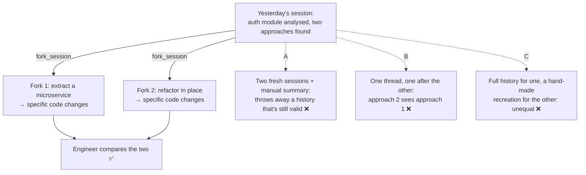

# Q77 — Two refactoring approaches from one analysis: fork the session

**Domain / lesson:** D1 › 1.7 Session State and Resumption
**Scenario:** Developer productivity tools built with the Claude Agent SDK (the pasted text leaves out the scenario intro; same set as [Q68](../Q68-trace-from-base-class-incremental-reading/question.md)–[Q76](../Q76-edit-no-unique-anchor-read-write/question.md))
**Follows:** [Q72](../Q72-resume-and-name-changed-files/question.md) (the same legacy auth module; there files had changed, here nothing has) · [Q45](../Q45-fresh-session-structured-summary/question.md) (fresh session + summary: the third option)

## Question

An engineer used the agent yesterday to analyze a legacy authentication module, identifying two distinct refactoring approaches: extracting a microservice versus refactoring in-place. Today, they want to explore both approaches in depth – having the agent propose specific code changes for each – before deciding which to implement. What's the most effective way to structure this exploration?

- **A.** Start two fresh sessions, manually providing a summary of yesterday's analysis findings to establish context.
- **B.** Resume yesterday's session and explore both approaches sequentially within the same conversation thread.
- **C.** Resume yesterday's session to explore the first approach, then start a new session for the second, manually recreating the original context.
- **D.** Use fork_session to create two branches from yesterday's analysis, exploring one approach in each fork.

## Answer: **D**

## Diagram



## Concept

**The deciding phrase: *"explore both approaches … before deciding"*.** That's a comparison of alternatives, and both start from the same analysis. The guide's decision matrix has this exact row: *"Comparing two refactoring approaches"* → *"fork_session"* → *"Divergent exploration from shared baseline"*.

**What a fork does.** *"Fork creates an independent branch from a shared analysis baseline. The baseline is the analysis in the session so far, and both branches start from it. After the fork, each branch operates independently. Changes in one branch do not affect the other, and neither branch can see the other's results."* That gives the comparison three things it needs:

| What the comparison needs | How the fork gives it |
|---|---|
| Both approaches start from **everything** learned yesterday | Each fork is a copy of the full history: every file read, every tool result, the reasoning |
| Both start from the **same** point | Same copy for both: *"Each fork starts from the same initial understanding and then follows a different approach."* |
| Neither one is shaped by the other | *"neither branch can see the other's results"* |

**Why yesterday's history can be reused here.** Nothing says the module changed overnight, so yesterday's tool results still describe the code as it is. That's the difference from Q72, where 3 files had changed. A fork copies the history as it is, so it only works when that history is still valid.

**In the SDK** (current state, from the guide): *"you set fork_session beside resume, not instead of it. resume picks the session, and fork_session: true starts a new session from a copy of that history instead of appending to it."* Illustrative:

```python
from claude_agent_sdk import query, ClaudeAgentOptions

async def explore(approach: str):
    # resume picks yesterday's session; fork_session copies it into a new one
    options = ClaudeAgentOptions(resume=yesterday_session_id, fork_session=True)
    prompt = f"Using your analysis of the auth module, propose specific code changes for: {approach}"
    async for message in query(prompt=prompt, options=options):
        ...

await explore("extracting authentication into a microservice")
await explore("refactoring the module in place")
```

The CLI does the same with `claude --resume <session> --fork-session`. Yesterday's session itself stays as it was.

## Why the others are wrong

| Option | Why not |
|---|---|
| **A** Two fresh sessions + a manual summary | **A fresh start is for stale or degraded context, and neither applies here.** Guide: *"Use a fresh start when tool results from the prior session are stale because files have changed, APIs have been updated or dependencies have changed."* *"If the prior context is still valid and you want the full conversation history, resume is more efficient."* A summary keeps the conclusions but not the detail behind them (which functions, which call sites, which files), and *specific code changes* need that detail. So each session would have to read the code again. |
| **B** Resume, explore both in the same thread | **The second approach is explored with the first one already in context.** That's the opposite of *"neither branch can see the other's results"*. The in-place proposals get shaped by the microservice design written just before (borrowing its ideas, or arguing against it), and they start from a longer context full of code for the other approach. The comparison isn't fair. And the original session keeps growing, so there's no clean baseline left to return to. |
| **C** Resume for the first, recreate the context by hand for the second | **The two approaches start from different places.** One gets the full history, the other a hand-made recreation of it. If the proposals differ, you can't tell whether that's the approach or the starting context. It's also extra work, and the recreation loses detail, like A. The fork gives both *"the same initial understanding"* for free. |

## Pattern to remember

> **A completed analysis, and you want to compare alternatives from it → `fork_session`, one fork per alternative.** Each fork gets the full history, the same starting point, and no view of the other.

**Exam signals:**
- *"Explore both approaches"*, *"compare two strategies"*, *"from the same analysis"*, *"before deciding"* → **fork**.
- *"Sequentially within the same conversation"* for alternatives → each one contaminates the next.
- *"Fresh session with a summary"* when nothing has changed → throws away a valid history (that's for stale or degraded context).
- Mixed set-ups (resume for one, recreate for the other) → unequal starting points.

### Where this comes from

**Guide D1 › 1.7 Session State and Resumption:**
- *"Fork creates an independent branch from a shared analysis baseline. The baseline is the analysis in the session so far, and both branches start from it. After the fork, each branch operates independently. Changes in one branch do not affect the other, and neither branch can see the other's results."*
- *"Use fork when you have completed an initial analysis and want to explore divergent approaches from that shared starting point. For example, after analysing a codebase, you fork to compare two refactoring strategies. Each fork starts from the same initial understanding and then follows a different approach."* (**D**)
- Current state: *"in the SDK you set fork_session beside resume, not instead of it. resume picks the session, and fork_session: true starts a new session from a copy of that history instead of appending to it. The CLI pairs --fork-session with --resume the same way."*
- Key concept: *"Three session management options serve three distinct purposes: resume for continuation, fork for divergent exploration, and fresh start with summary injection for when prior tool results are stale."*
- Decision matrix: *"Comparing two refactoring approaches"* → *"fork_session"* → *"Divergent exploration from shared baseline"*; *"Exploring a testing strategy vs a documentation strategy"* → *"fork_session"* → *"Two independent approaches from the same analysis"*.
- *"Use a fresh start when tool results from the prior session are stale because files have changed, APIs have been updated or dependencies have changed."* *"If the prior context is still valid and you want the full conversation history, resume is more efficient."* (**A**)

## How this connects to earlier questions

| Question | Link |
|---|---|
| [Q72](../Q72-resume-and-name-changed-files/question.md) | The same legacy auth module. There 3 of 12 files had changed (resume + name them); here nothing changed, so the history is valid and can be copied |
| [Q45](../Q45-fresh-session-structured-summary/question.md) | The third option: stale results → fresh session + structured summary. A fork wouldn't help there: it copies the stale results too |
| [Q71](../Q71-degraded-context-summary-into-subagent/question.md) | Context degraded by a long session → summary into a fresh subagent. B pushes in that direction: two explorations in one growing thread |
| [Q73](../Q73-same-steps-every-pr-prompt-chaining/question.md), [Q75](../Q75-intermittent-500-dynamic-decomposition/question.md) | Independent subtasks can run separately and in parallel; two forks are the session-level version of that |

## Check question

**The engineer reviews both forks and picks refactoring in place. Tomorrow they want to carry on implementing it. Which session should they continue, and how: resume it, or fork it again?**

## Glossary

- **Session:** one conversation with an agent that you can return to; its history holds the reasoning and every tool result.
- **Resume (`resume`, `--resume`):** continue an existing session; new messages are appended to its history.
- **Fork (`fork_session: true`, `--fork-session`):** start a **new** session from a copy of an existing session's history; the original stays unchanged.
- **Baseline:** the shared starting point both forks copy: here, yesterday's analysis.
- **Fresh start + summary injection:** a new, empty session given a structured summary of earlier findings; used when the old tool results are stale or the context has degraded.
- **Divergent exploration:** following two or more alternatives from the same starting point, separately.

## Related course lessons

*Lecture lengths aren't recorded in the study-map files, so the watch times below are estimates from each course's average lecture length.*

### Udemy A (primary): Claude Certified Architect (CCAR-F) - 2026 Exam Prep
| # | Lecture | Part | Why |
|---|---|---|---|
| **81** | **The Claude Agent SDK — Session Control** | 3D | ⭐ `resume` and `fork_session` in the SDK: exactly D *(also in Q03, Q45, Q72)* |
| 22 | Session Continuity Across Turns and Failures | 1C | Resume vs. start fresh, the other two options *(also in Q03, Q45, Q46, Q72)* |
| Quiz 11, Quiz 3 | 3D and 1C quizzes | | Self-test |

**▶ Watch in this order (~15 min, est.):** #81 → #22, then do **Quiz 11** and **Quiz 3**.

### Udemy B: Claude Certified Architect Foundations: Complete Course (Voroniuk)
| # | Lecture | Section | Why |
|---|---|---|---|
| **85** | **Forking a Session** | S8 Claude Code Setup | ⭐ This question's answer *(also in Q03, Q45, Q72)* |
| 84 | Sessions: Resume or Start Fresh | S8 Claude Code Setup | When resume or a fresh start fits instead (A, B, C) *(also in Q03, Q45, Q72)* |
| Quiz 8 | Claude Code Setup quiz | S8 | Self-test |

**▶ Watch in this order (~10 min, est.):** #85 → #84, then do **Quiz 8**.

### CBT Nuggets: CCA-F course

*CBT doesn't cover 1.7 (see the study map). Use the guide and the Udemy lectures for session forking.*
