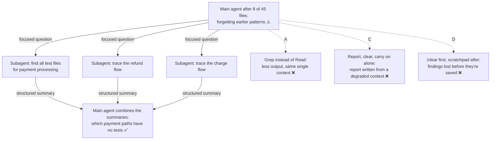

# Q78 — 8 of 45 files in, the agent is forgetting: focused subagents, the main agent coordinates

**Domain / lesson:** D5 › 5.4 Codebase Exploration & Context Degradation
**Also touches:** D1 › 1.3 Subagent Invocation & Context Passing (what each subagent gets, what it returns)
**Scenario:** Developer productivity tools built with the Claude Agent SDK (same set as [Q68](../Q68-trace-from-base-class-incremental-reading/question.md)–[Q77](../Q77-fork-session-compare-two-approaches/question.md))
**Follows:** [Q71](../Q71-degraded-context-summary-into-subagent/question.md) (the same symptom; there the next phase was new work, here it's the rest of the same investigation) · [Q68](../Q68-trace-from-base-class-incremental-reading/question.md) (exploration fills the context)

## Question

You are building developer productivity tools using the Claude Agent SDK. The agent helps engineers explore unfamiliar codebases, understand legacy systems, generate boilerplate code, and automate repetitive tasks. It uses the built-in tools (Read, Write, Bash, Grep, Glob) and integrates with Model Context Protocol (MCP) servers.

An engineer asks your agent to identify untested code paths in a legacy payment processing module spanning 45 files. After reading the first 8 source files, the agent's responses are becoming noticeably less accurate – it's forgetting previously discussed code patterns and hasn't yet located all test files or traced critical payment flows. What's the most effective approach to complete this investigation?

- **A.** Switch to using Grep to search for specific function names instead of reading full files, reducing the content loaded into context for remaining exploration.
- **B.** Spawn subagents to investigate specific questions (e.g., "find all test files for payment processing," "trace refund flow dependencies") while the main agent coordinates findings and preserves high-level understanding.
- **C.** Document all current findings in a summary report, clear context completely, then use that report as the sole reference for continuing the investigation.
- **D.** Clear context with /clear, then selectively re-read only the most critical files discovered so far, writing key findings to a scratchpad file that persists between context resets.

## Answer: **B**

## Diagram

## Concept

**The symptom is context degradation.** Guide 5.4: *"Long sessions cause context degradation. The model loses its grip on earlier findings as the context fills with verbose discovery output."* Eight full files of payment code are a lot of verbose output, and *"it's forgetting previously discussed code patterns"* is the symptom the guide describes.

**The problem isn't only what has happened; it's what's still to come.** 37 files are unread, the test files haven't been found, and the payment flows haven't been traced. If the main agent does all that itself, its context keeps filling. Guide: *"Without subagents, the coordinator does all the exploration itself. Every file that it reads and every search that it runs adds verbose output to its context."*

**B moves the verbose work out of the main context.** Guide: *"Spawning subagents for specific investigation tasks is the second major way to limit context degradation."* *"Each subagent explores verbosely in its own isolated context, then returns a structured summary. The coordinator keeps only the main findings, so its context stays free of verbose output for high-level coordination."* B's two examples are almost the guide's own: *"Find all test files for the quoting service and report their coverage status"*, *"Trace the deposit payment flow from API endpoint to database and list all intermediate services"*.

**What it looks like** (illustrative):

| Subagent's question | What it returns (a structured summary, not file contents) |
|---|---|
| Find all test files for payment processing, and which source files each one covers | 9 test files; `RefundService` and `LedgerWriter` have none; `ChargeService` is 80% covered |
| Trace the refund flow from the API endpoint to the database; list every service and function on the path | `RefundController.create → RefundService.issue → LedgerWriter.post → PaymentGateway.refund` |
| Trace the charge flow the same way | `CheckoutController.pay → ChargeService.capture → PaymentGateway.charge → LedgerWriter.post` |

The main agent never reads those files. It holds three short summaries and does the part only it can do: combine them. `RefundService.issue` and `LedgerWriter.post` sit on critical payment paths and have no tests. That's the answer the engineer asked for.

**Make it work: give each subagent what's already known.** A subagent doesn't see the main agent's history (Q71). Put the findings from the first 8 files into each subagent's prompt (key classes, files already read), or it starts cold and reads them again. Guide trap: *"Expecting next-phase subagents to inherit phase-one history"*. And in practice, have the main agent write findings to a scratchpad file as the summaries come back (Q71's check). B is the structure; the scratchpad keeps the main agent's record exact.

## Why the others are wrong

| Option | Why not |
|---|---|
| **A** Grep instead of reading full files | **It shrinks each step, not the problem.** Grep is the right way to find things (2.5), but: (1) the agent is already forgetting what it found; Grep doesn't bring that back. (2) The remaining work needs reading: you can't trace a payment flow or decide which paths are untested from search hits alone. (3) Everything still collects in one context. Guide: *"every search that it runs adds verbose output to its context."* A different tool, the same architecture. |
| **C** Summary report, clear everything, continue from the report only | **The report is written now, from a context that is already degraded,** so the patterns the agent is forgetting are the ones likely to be missing or vague in it (Q71 check). *"Sole reference"* means anything not in the report is gone. And the main agent then explores the remaining 37 files in its own context again, so it degrades again after a few more files. C resets the clock; it doesn't change the structure. |
| **D** `/clear`, re-read the critical files, then keep a scratchpad | **The order loses the state.** `/clear` comes first, so the findings from 8 files are wiped before anything is written down. Guide trap: *"Restarting a session to fix context degradation without saving state"*: *"Restarting loses all accumulated knowledge. Use scratchpad files and state manifests to persist findings before restarting."* Re-reading the critical files brings the same verbose output back. A scratchpad started after the clear can't recover what was lost, and the guide says scratchpads *"are a deliberate strategy. They are not an emergency fix to use once answers become vague."* The remaining 37 files would still go through the main context. |

## Pattern to remember

> **The context is degrading and much of the exploration is still ahead → focused subagents do the verbose work in their own contexts and return structured summaries; the main agent coordinates and combines.** Give each subagent the findings so far. Don't restart without saving state, and don't expect a cheaper tool or a one-off report to fix an architecture problem.

**Exam signals:**
- *"Forgetting previously discussed"*, *"less accurate"*, *"typical patterns"* → **context degradation**, not a token limit.
- Lots of exploration still to do (*"hasn't yet located … or traced"*) → **subagents for focused questions**.
- *"Clear context"* / `/clear` **before** findings are saved → loses state (trap).
- *"Sole reference"*, a report written **now** → written from the degraded context.
- *"Grep instead of Read"* → a tool tweak; the single context still fills.

### Where this comes from

**Guide D5 › 5.4 Codebase Exploration & Context Degradation:**
- *"Long sessions cause context degradation. The model loses its grip on earlier findings as the context fills with verbose discovery output. Context degradation is not related to exhausting the available tokens."*
- *"A subagent is a separate agent that the main agent, the coordinator, spawns for one task. Spawning subagents for specific investigation tasks is the second major way to limit context degradation. Without subagents, the coordinator does all the exploration itself. Every file that it reads and every search that it runs adds verbose output to its context."* (**A**, **B**)
- Delegation examples: *"Find all test files for the quoting service and report their coverage status"*, *"Trace the deposit payment flow from API endpoint to database and list all intermediate services"*.
- *"Each subagent explores verbosely in its own isolated context, then returns a structured summary. The coordinator keeps only the main findings, so its context stays free of verbose output for high-level coordination."* (**B**)
- *"Instruct agents to keep scratchpad files from the start of any extended exploration session. Scratchpad files are a deliberate strategy. They are not an emergency fix to use once answers become vague."* (**D**)
- Exam trap: *"Restarting a session to fix context degradation without saving state."* *"Restarting loses all accumulated knowledge. Use scratchpad files and state manifests to persist findings before restarting, then inject them into the new session."* (**C**, **D**)
- Exam trap: *"Expecting next-phase subagents to inherit phase-one history, or handing each the full transcript."* *"Summarise the key findings and inject the summary into each subagent's initial context."*

## How this connects to earlier questions

| Question | Link |
|---|---|
| [Q71](../Q71-degraded-context-summary-into-subagent/question.md) | Same symptom, same lesson. There: summarise, then one subagent for the next phase. Its check: keep a scratchpad from the start, give subagents focused tasks. Q78 is that advice applied |
| [Q68](../Q68-trace-from-base-class-incremental-reading/question.md), [Q69](../Q69-grep-distinctive-error-text/question.md) | Incremental reading and Grep (A's idea) are good habits inside each subagent; they don't replace the split |
| [Q03](../Q03-crash-recovery-state-manifest/question.md) | State saved outside the context (a manifest) before anything is lost: what D gets the wrong way round |
| [Q36](../Q36-coordinator-missing-task-tool/question.md), [Q10](../Q10-missing-context-in-subagent-prompt/question.md) | The mechanics: the coordinator needs the `Task` tool, and each subagent only knows what its prompt says |
| [Q75](../Q75-intermittent-500-dynamic-decomposition/question.md) | Splitting work into per-item passes avoids attention dilution; subagents avoid context degradation. Both are structural fixes |

## Check question

**A teammate objects to B: "Subagents only pay off when they run in parallel. Here the questions depend on each other: you need the test files and the traced flows before you can say which paths are untested. So they'd run one after another, and B gains nothing over the main agent doing it all itself." Do you agree?**

*My answer:* "No, the problem is context degradation, not parallelization." ✅ **Right, and the guide says it in almost those words:** *"The obvious interpretation is that subagents are for parallelisation, but their main value is context isolation."* Its key concept: *"Subagents isolate verbose exploration."*

**Why the order doesn't matter for this.** Run the subagents one after another and each one still reads its files in **its own** context. The main agent still gets only the summaries. Its context grows by three short summaries instead of 37 files, so it keeps the high-level picture sharp. The teammate's argument is about speed; the problem in Q78 is accuracy.

| | Main agent does it all | Subagents, one after another | Subagents in parallel |
|---|---|---|---|
| What enters the main context | 37 more files + every search result | 3 structured summaries | 3 structured summaries |
| Degradation in the main agent | Gets worse | Avoided | Avoided |
| Time | Slowest | About the same | Faster |

Parallel only changes the last row. Isolation is what changes the first two.

**The teammate is also partly wrong about the dependencies.** Finding the test files and tracing the flows don't depend on each other, so they *can* run at the same time. Only the last step, *"which paths are untested?"*, needs both results, and that step is the coordinator's job: combining summaries is the high-level work it keeps its context clean for. When one subagent does depend on another's result, the coordinator puts that result into the next subagent's prompt, because a subagent sees only its prompt (1.3, Q36 check).

> **Subagents are for context isolation first and parallelism second. Even run one at a time, they keep the verbose exploration out of the coordinator's context.**

## Glossary

- **Context degradation:** the model stops using specific earlier findings because newer verbose output fills the context; not the same as running out of tokens.
- **Coordinator (main agent):** the agent that splits the work, spawns subagents and combines their results.
- **Subagent:** a separate agent with its own context, spawned for one task; it sees only what its prompt contains.
- **Structured summary:** what a subagent returns: the findings (names, paths, flows), not the raw file contents it read.
- **Scratchpad file:** a file the agent writes findings to as it goes, and reads back later; it lives outside the context.
- **`/clear`:** a Claude Code command that empties the conversation context completely.
- **Untested code path:** a route through the code (e.g. a refund flow) with no test that exercises it.

## Related course lessons

*Lecture lengths aren't recorded in the study-map files, so the watch times below are estimates from each course's average lecture length.*

### Udemy A (primary): Claude Certified Architect (CCAR-F) - 2026 Exam Prep
| # | Lecture | Part | Why |
|---|---|---|---|
| **122** | **Why Delegate Discovery to a Subagent** | 5C | ⭐ Exactly B: discovery in a subagent, summaries back *(also in Q68, Q71)* |
| **123** | **Delegation Mechanics — Prompts, Returns, and Failure Modes** | 5C | ⭐ What each subagent gets and returns *(also in Q05, Q71)* |
| 124 | Long-Conversation Coherence, Compaction, and Session Memory | 5C | The degradation symptom, and why clearing loses state (C, D) *(also in Q03, Q45, Q71)* |
| 120 | The Scratchpad Pattern — Persisting Findings Outside the Context | 5C | D's ingredient, and why it belongs at the start *(also in Q03, Q71)* |
| Quiz 17 | 5C quiz | | Self-test |

**▶ Watch in this order (~25 min, est.):** #122 → #123 → #124 → #120, then do **Quiz 17**.

### Udemy B: Claude Certified Architect Foundations: Complete Course (Voroniuk)
| # | Lecture | Section | Why |
|---|---|---|---|
| **86** | **Keeping Long Explorations Sharp** | S8 Claude Code Setup | ⭐ Exactly this lesson: degradation and its fixes *(also in Q03, Q71)* |
| 87 | Phases, Subagents and Manifests | S8 Claude Code Setup | Subagents per question, summaries between phases *(also in Q03, Q71)* |
| 81 | The Explore Subagent | S8 Claude Code Setup | Exploration in an isolated context *(also in Q71)* |
| Quiz 8 | Claude Code Setup quiz | S8 | Self-test |

**▶ Watch in this order (~15 min, est.):** #86 → #87 → #81, then do **Quiz 8**.

### CBT Nuggets: CCA-F course

*CBT has no lesson on codebase exploration or context degradation (5.4). For the coordinator–subagent mechanics (1.3):*

| Skill | Why |
|---|---|
| 39. Build an Agentic Multimedia Article System: Part 1 | A coordinator handing focused tasks to subagents and combining what comes back *(also in Q01, Q02, Q03, Q05, Q06, Q07, Q09, Q11, Q36, Q39)* |
