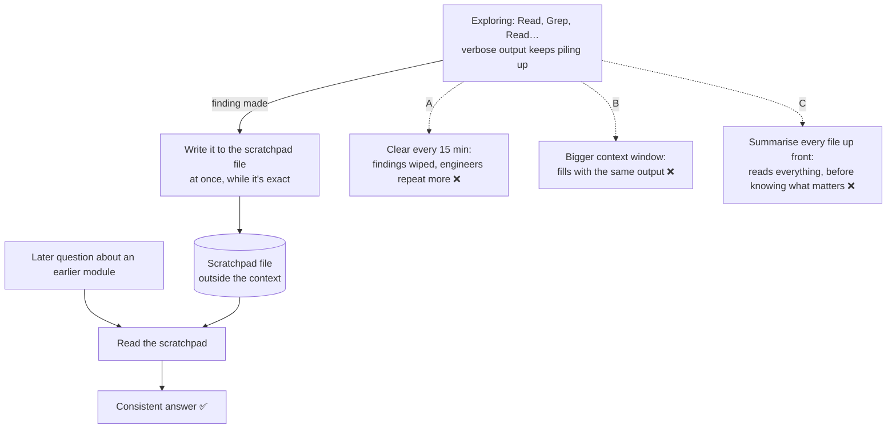

# Q79 — Inconsistent answers after 30+ minutes: a scratchpad file of key findings

**Domain / lesson:** D5 › 5.4 Codebase Exploration & Context Degradation
**Scenario:** Developer productivity tools built with the Claude Agent SDK (the pasted text leaves out the scenario intro; same set as [Q68](../Q68-trace-from-base-class-incremental-reading/question.md)–[Q78](../Q78-degrading-exploration-focused-subagents/question.md))
**Follows:** [Q78](../Q78-degrading-exploration-focused-subagents/question.md) (the second defence: subagents) · [Q71](../Q71-degraded-context-summary-into-subagent/question.md) (its check question: a scratchpad from the start)

## Question

During testing, you observe that in extended exploration sessions (30+ minutes), the agent starts giving inconsistent answers about code structure it discussed earlier. Engineers report having to repeat context about modules they've already explored. What's the most effective approach to address this?

- **A.** Implement automatic context clearing every 15 minutes to ensure the agent starts with fresh, uncontaminated context.
- **B.** Switch to a higher-capacity model tier to provide more context window space for accumulated exploration data.
- **C.** Create summaries of all source files before exploration begins, loading only these compressed representations into context.
- **D.** Have the agent maintain a scratchpad file that records key findings, referencing it for subsequent questions.

## Answer: **D**

## Diagram



## Concept

**The symptom is context degradation, again.** *"Inconsistent answers about code structure it discussed earlier"* after 30+ minutes is what guide 5.4 describes: *"The model loses its grip on earlier findings as the context fills with verbose discovery output."* The cause is position, not space: *"Earlier precise findings are further back in the context, while the newer verbose output dominates. The model's attention shifts to the recent output, and it loses the specific references to earlier findings."*

**This question is the guide's own exam pattern.** Guide: *"Exam questions usually describe the symptom: the agent refers to "typical patterns" instead of the classes it found earlier. The correct answer is scratchpad files. Wrong options enlarge the context window, but degradation is not a token problem. Or they restart without saving state, and then the findings are lost."* Map it onto the options: B enlarges the window, A restarts without saving, D is the scratchpad.

**Why a scratchpad works.** Guide: *"Scratchpad files are the primary way to limit context degradation. The agent writes important findings to a file and reads that file again for later questions. The file is outside the conversation context, so context degradation does not affect its contents."* Two things make it work:

| | What happens | Why it beats the context |
|---|---|---|
| **Write when found** | A finding goes into the file the moment the agent makes it | Recorded while it's still exact, before newer output pushes it back |
| **Read when asked** | A question about an earlier module → the agent reads the file first | The finding comes back as a fresh tool result, part of the **recent** output where, per the guide, *"the model's attention shifts"* |

**It also fixes the engineers' complaint.** They had to repeat context because the agent lost it. With a scratchpad, the agent re-reads its own record instead of asking them.

**How to set it up** (illustrative system-prompt lines):

```text
Keep exploration notes in ./exploration-notes.md for the whole session.
Each time you find something about the code's structure, add it to the file straight away.
Before answering a question about a module explored earlier, read the file first.
```

Guide: *"Instruct agents to keep scratchpad files from the start of any extended exploration session."*

## Why the others are wrong

| Option | Why not |
|---|---|
| **A** Clear the context every 15 minutes | **Clearing without saving throws the findings away.** Guide exam trap: *"Restarting a session to fix context degradation without saving state."* *"Restarting loses all accumulated knowledge."* The engineers' complaint gets **worse**: every 15 minutes the agent forgets everything, so they repeat context more often, not less. "Uncontaminated" sounds good, but the context isn't contaminated: it holds valid findings that are being drowned out. |
| **B** A higher-capacity model with a bigger context window | **Degradation isn't a space problem.** Guide exam trap: *"Increasing the context window to solve context degradation."* *"Degradation comes from verbose output pushing earlier findings further back in the context, not from running out of tokens, so a larger window still fills with that output."* And: *"So a larger context window does not fix context degradation."* (Also a general exam habit: "use a bigger model" is rarely the fix; fix the design.) |
| **C** Summarise every source file before exploring, load only the summaries | **It reads everything up front, before anyone knows what matters.** Summarising all files means reading all of them: guide 2.5's trap, *"Reading all source files upfront before understanding what is relevant."* The guide's 5.4 practice question has the same distractor: *"Pre-load the entire codebase structure into the initial context before exploration begins."* The summaries are written before the questions are known, so they can leave out the details later questions need. And they don't contain the **findings** (how modules connect, what the engineers learned with the agent). Those are made during exploration, and that's what's being forgotten. |

## Pattern to remember

> **Long exploration, the agent loses earlier findings → a scratchpad file: write each key finding when it's made, read the file before answering about earlier code.** Not a bigger window (not a space problem), not clearing without saving (loses the findings), not summarising everything up front.

**Exam signals:**
- *"Extended sessions"*, *"inconsistent answers about … earlier"*, *"typical patterns"*, *"repeat context"* → **context degradation** → **scratchpad file**.
- *"Bigger context window"*, *"higher-capacity model"* → not a token problem (trap).
- *"Clear context"*, *"fresh start"* with nothing saved first → loses accumulated knowledge (trap).
- *"Summaries of all files before exploration"*, *"pre-load the codebase"* → upfront reading (trap).

### Where this comes from

**Guide D5 › 5.4 Codebase Exploration & Context Degradation:**
- *"Long sessions cause context degradation. The model loses its grip on earlier findings as the context fills with verbose discovery output. Context degradation is not related to exhausting the available tokens."*
- *"Earlier precise findings are further back in the context, while the newer verbose output dominates. The model's attention shifts to the recent output, and it loses the specific references to earlier findings. So a larger context window does not fix context degradation."* (**B**)
- *"Scratchpad files are the primary way to limit context degradation. The agent writes important findings to a file and reads that file again for later questions. The file is outside the conversation context, so context degradation does not affect its contents."* (**D**)
- *"Instruct agents to keep scratchpad files from the start of any extended exploration session."*
- In the exam: *"The correct answer is scratchpad files. Wrong options enlarge the context window, but degradation is not a token problem. Or they restart without saving state, and then the findings are lost."* (**D**, **B**, **A**)
- Exam traps: *"Increasing the context window to solve context degradation"* (**B**); *"Restarting a session to fix context degradation without saving state."* *"Restarting loses all accumulated knowledge."* (**A**)
- Practice question distractor: *"Pre-load the entire codebase structure into the initial context before exploration begins"* (**C**)

**Guide D2 › 2.5 Built-in Tools:**
- Exam trap: *"Reading all source files upfront before understanding what is relevant."* (**C**)

## How this connects to earlier questions

| Question | Link |
|---|---|
| [Q71](../Q71-degraded-context-summary-into-subagent/question.md) | Same lesson; its check question's answer was this one: a scratchpad from the start, the primary defence |
| [Q78](../Q78-degrading-exploration-focused-subagents/question.md) | The second defence: subagents keep verbose exploration out of the main context. In long work, use both |
| [Q03](../Q03-crash-recovery-state-manifest/question.md) | A state manifest: the same idea (state in a file, outside the context) used for crash recovery |
| [Q46](../Q46-stateless-api-pass-full-history/question.md) | A different kind of forgetting: the code didn't re-send the history, so the model never saw it. Here the history is there, but earlier parts get less attention |
| [Q68](../Q68-trace-from-base-class-incremental-reading/question.md) | Read incrementally rather than everything up front (C's mistake) |

## Check question

**Two weeks later an engineer complains: the agent now reads its scratchpad, but its answers about earlier modules are still vague. The scratchpad has entries like "Payments follow a typical service/repository pattern" and "Refunds have some error-handling issues". What's wrong, and how would you fix it?**

*My answer:* "Seems like wrong information goes into the scratchpad. Could be writing happens too late." 🟡 **Both halves point the right way, and "too late" is a sharp guess. To make it complete: say exactly what's wrong with the information (it's vague, not false), and give the fix (a format, and a rule about when to write).**

**What's wrong: the entries are the symptom, written down.** *"A typical service/repository pattern"* is the guide's own example of degradation: *"the agent says "this follows the typical repository pattern""* instead of naming the classes. A scratchpad can only give back what was written into it. Vague notes in, vague answers out.

**Two causes, and the fix for each:**

| Cause | Fix |
|---|---|
| **When:** the notes are written late (at the end, or when asked), so they come from a context that has already degraded. Your guess | Write each finding **the moment it's made**, while the context still holds the exact names. Guide: *"Instruct agents to keep scratchpad files from the start of any extended exploration session."* |
| **What:** no names, paths or chains, just impressions | Guide's build exercise: *"The scratchpad should contain specific class names, file paths, and dependency chains, not summaries."* |

**Before and after** (illustrative; the guide's example entries look like the right-hand column):

| Vague (now) | Specific (what to write) |
|---|---|
| Payments follow a typical service/repository pattern | `PaymentService` (src/services/payment.ts) → `PaymentRepository` (src/repos/payment.ts) → PostgreSQL; `findById` caches by paymentId |
| Refunds have some error-handling issues | `RefundProcessor.issue` (src/services/refund.ts) catches gateway errors but doesn't retry; a Stripe timeout leaves the refund in `PENDING` |

The guide's own entries: *"`OrderRepository` (src/repos/order.ts) — implements Repository<T>, custom findById caching"*, *"RefundProcessor → OrderService → OrderRepository → PostgreSQL"*, *"RefundProcessor has no retry logic for Stripe API failures"*.

**The fix in the agent's instructions** (illustrative; it extends the set-up lines in the concept):

```text
Write each finding to ./exploration-notes.md as soon as you make it, not at the end.
Each entry names the class or function and its file path, then what you found:
- `ClassName` (path/to/file): what it does, what it depends on
- Dependency chains as A → B → C
- Issues: where, what happens, under which condition
Never write "typical" or "standard" pattern; write the actual names.
```

*(Practical tips, not guide wording: don't trust the vague entries already there; have the agent re-check those modules and replace them. A quick test for any entry: could a teammate who never saw the session act on it?)*

> **A scratchpad is only as good as what goes into it: specific names, paths and chains, written the moment they're found. Vague notes written late just save the degradation to a file.**

## Glossary

- **Context degradation:** the model stops using specific earlier findings because newer verbose output fills the context; not the same as running out of tokens.
- **Scratchpad file:** a file the agent writes findings to as it makes them, and reads back for later questions; it lives outside the conversation context.
- **Context window:** the maximum amount of text the model can take in at once. Bigger doesn't mean the earlier parts get more attention.
- **Verbose discovery output:** what exploration tools return: file contents, search results, directory listings.
- **Context clearing (`/clear`):** emptying the conversation context; everything in it is gone unless it was saved somewhere first.

## Related course lessons

*Lecture lengths aren't recorded in the study-map files, so the watch times below are estimates from each course's average lecture length.*

### Udemy A (primary): Claude Certified Architect (CCAR-F) - 2026 Exam Prep
| # | Lecture | Part | Why |
|---|---|---|---|
| **120** | **The Scratchpad Pattern — Persisting Findings Outside the Context** | 5C | ⭐ Exactly D *(also in Q03, Q71, Q78)* |
| **121** | **Designing a Healthy Scratchpad** | 5C | ⭐ Keeping the scratchpad useful over a long session |
| 124 | Long-Conversation Coherence, Compaction, and Session Memory | 5C | The degradation symptom; why clearing (A) and a bigger window (B) don't fix it *(also in Q03, Q45, Q71, Q78)* |
| Quiz 17 | 5C quiz | | Self-test |

**▶ Watch in this order (~20 min, est.):** #124 → #120 → #121, then do **Quiz 17**.

### Udemy B: Claude Certified Architect Foundations: Complete Course (Voroniuk)
| # | Lecture | Section | Why |
|---|---|---|---|
| **86** | **Keeping Long Explorations Sharp** | S8 Claude Code Setup | ⭐ Exactly this lesson: degradation and the scratchpad *(also in Q03, Q71, Q78)* |
| 80 | Exploring a Codebase Step by Step | S8 Claude Code Setup | Why not read (or summarise) everything up front (C) *(also in Q58, Q68, Q69, Q75)* |
| Quiz 8 | Claude Code Setup quiz | S8 | Self-test |

**▶ Watch in this order (~10 min, est.):** #86 → #80, then do **Quiz 8**.

### CBT Nuggets: CCA-F course

*CBT has no lesson on codebase exploration or context degradation (5.4). Use the guide lesson and Udemy B #86.*
