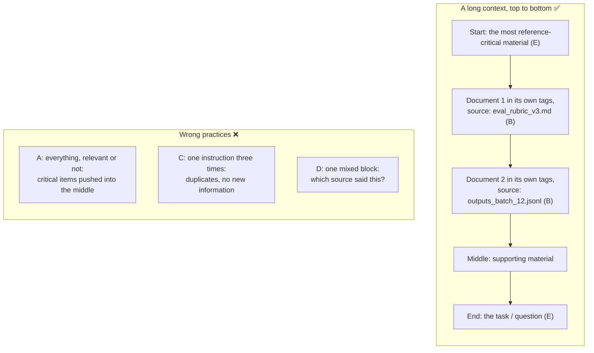

# Q80 — Structuring sources in a long context: delimit each source, put critical material at the start or end

**Domain / lesson:** D5 › 5.1 Context Window Management (E, A, C)
**Also touches:** D5 › 5.6 Information Provenance (B, D: keeping claims tied to their sources) · Anthropic's prompting docs (long-context tips)
**Scenario:** A standalone context-design question: a knowledge manager preparing source material for a long evaluation task (not one of the developer-tools questions)
**Follows:** [Q02](../Q02-context-passing-source-index/question.md) (don't pass everything raw) · [Q38](../Q38-sliding-window-recent-turns/question.md) (the case facts block goes near the top) · [Q09](../Q09-synthesis-preserve-merge-mappings/question.md) (keep claim-source links)

## Question

You are a knowledge manager structuring source material in the context window for a long Claude evaluation task.

Which two practices produce a more effective use of the context window? (Choose two.) Each correct answer presents a complete solution.

- **A.** Paste every available document into context regardless of relevance to the task.
- **B.** Mark each source clearly with delimiters so the model can attribute claims correctly.
- **C.** Repeat the same instruction at the start, middle, and end to reinforce it.
- **D.** Mix sources together in a single block so the model can synthesize them freely.
- **E.** Place the most reference-critical material near the beginning or end of context.

## Answer: **B** and **E**

## Diagram



## Concept

**"Effective use of the context window" means three choices: what goes in, where it goes, and how it's labelled.** Guide 5.1: *"Context window management means choosing what to put in the context window."* B is about labelling, E is about placement. A, C and D each spend context without making it more useful.

**E: position matters in a long context.** Guide 5.1: *"Models process information at the beginning and end of long inputs reliably. A model may miss findings in the middle of a long context, or may give them less weight. This effect is well documented in large language models. It guides how you structure aggregated inputs, which combine results from several sources."* So the material the evaluation depends on most (the rubric, the key reference) goes at the start or the end, not somewhere in the middle of 30 documents. Anthropic's prompting docs say the same for long inputs: *"Put long-form data at the top: Place your long documents and inputs near the top of your prompt, above your query, instructions, and examples."* *"Queries at the end can improve response quality by up to 30 percent in tests, especially with complex, multidocument inputs."*

**B: each source in its own clearly marked block.** Anthropic's docs: *"When using multiple documents, wrap each document in <document> tags with <document_content> and <source> (and other metadata) subtags for clarity."* For an evaluation task (illustrative):

```xml
<documents>
  <document index="1">
    <source>eval_rubric_v3.md</source>
    <document_content>
    Criterion 4: answers must cite the policy section they rely on...
    </document_content>
  </document>
  <document index="2">
    <source>outputs_batch_12.jsonl</source>
    <document_content>
    ...
    </document_content>
  </document>
</documents>
```

Now the model can say *"output 7 fails criterion 4 of eval_rubric_v3.md"*, and a reader can check it. That's what the guide's provenance lesson asks for: every claim traceable to a source. Guide 5.1 also gives each source its own header in its layout example: *"Put the detailed results under explicit section headers."*

**B and E work together, and each one also works alone.** That's why the question says *"Each correct answer presents a complete solution"*: delimiting sources helps whatever the order, and good placement helps whatever the labels.

## Why the others are wrong

| Option | Why not |
|---|---|
| **A** Every document, regardless of relevance | **Context management is choosing what goes in, and A doesn't choose.** Irrelevant documents use budget, and they push the documents that matter into the middle, where *"A model may miss findings … or may give them less weight."* The same idea as the 5.1 trap for tool results: *"Keeping full tool results in context because 'the model might need them later'"*; trim to what's relevant (Q42). And Q02: pass what the next step needs, not everything. |
| **C** The same instruction at the start, middle and end | **Three copies of one instruction add no information.** They spend context on duplicates, and if someone later edits one copy, the three can disagree. A clearly marked instruction, once, works better. Anthropic's docs: *"Wrapping each type of content in its own tag (for example, <instructions>, <context>, <input>) reduces misinterpretation."* |
| **D** All sources mixed in one block | **The model can no longer tell which source said what.** Guide 5.6: *"Attribution is lost during summarisation. A synthesis agent that combines findings from several subagents compresses and paraphrases those findings. Without explicit instructions to keep the mappings, the source details are lost."* D removes the boundaries before the model even starts. And when two sources disagree, the guide wants both values kept with their sources (Q08); in one block they blur into one. "Synthesise freely" sounds good, but untraceable claims are what the provenance lesson warns against. |

## Pattern to remember

> **Use the context window deliberately: include only relevant material, put the most critical material at the start or end, and give each source its own delimited, labelled block.** More material, repeated instructions or mixed sources don't make the context work better.

**Exam signals:**
- *"Beginning or end of context"*, *"key findings first"* → **lost-in-the-middle** placement (right).
- *"Delimiters"*, *"XML tags"*, *"section headers"*, *"attribute claims"* → **labelled sources** (right).
- *"Regardless of relevance"*, *"every available document"* → no selection (wrong).
- *"Mix sources"*, *"single block"*, *"synthesize freely"* → attribution lost (wrong).
- *"Repeat the instruction"* → duplicates, no new information (wrong).
- *"Tell the model to read everything / pay attention to the middle"* → a prompt fix for a position problem (trap, check question).

### Where this comes from

**Guide D5 › 5.1 Context Window Management:**
- *"Context window management means choosing what to put in the context window."* (**A**)
- *"Models process information at the beginning and end of long inputs reliably. A model may miss findings in the middle of a long context, or may give them less weight. This effect is well documented in large language models. It guides how you structure aggregated inputs, which combine results from several sources."* (**E**)
- *"Put the detailed results under explicit section headers."* (**B**)
- Exam trap: *"Keeping full tool results in context because 'the model might need them later'"* (the same thinking as **A**)
- *"The fix is a change to the structure of the input, not an instruction in the prompt. Put a summary of the main findings at the start of the aggregated input. Put the detailed results under explicit section headers. A reminder to read everything leaves each finding in the same position."* (check question)
- Exam trap: *"Assuming the 'lost in the middle' effect is solved by telling the model to pay attention to everything."* *"The fix is structural: place key findings at the beginning of inputs and use explicit section headers. Prompt-based reminders are unreliable for effects caused by where information sits in the input."* (check question)

**Guide D5 › 5.6 Information Provenance:**
- *"Attribution is lost during summarisation. A synthesis agent that combines findings from several subagents compresses and paraphrases those findings. Without explicit instructions to keep the mappings, the source details are lost."* (**D**)
- *"The prompt of the synthesis agent must explicitly require every claim in its output to be traceable to a specific source."* (**B**)

**Anthropic, Prompting best practices (long context prompting):**
- *"Put long-form data at the top: Place your long documents and inputs near the top of your prompt, above your query, instructions, and examples."* *"Queries at the end can improve response quality by up to 30 percent in tests, especially with complex, multidocument inputs."* (**E**)
- *"When using multiple documents, wrap each document in <document> tags with <document_content> and <source> (and other metadata) subtags for clarity."* (**B**)
- *"XML tags help Claude parse complex prompts unambiguously, especially when your prompt mixes instructions, context, examples, and variable inputs."* (**B**, **C**, **D**)

## How this connects to earlier questions

| Question | Link |
|---|---|
| [Q02](../Q02-context-passing-source-index/question.md) | Pass a source index, not everything raw: A's mistake, and lost in the middle |
| [Q38](../Q38-sliding-window-recent-turns/question.md), [Q40](../Q40-multi-issue-case-facts-layer/question.md) | The case facts block goes **near the top** (E); one entry per issue so their data doesn't mix (like B vs D) |
| [Q42](../Q42-trim-tool-outputs-relevant-fields/question.md) | Trim tool results to the relevant fields: the same "choose what goes in" rule as A |
| [Q01](../Q01-source-attribution-multi-agent/question.md), [Q09](../Q09-synthesis-preserve-merge-mappings/question.md) | Claim-source mappings that synthesis must keep: what B makes possible and D destroys |
| [Q08](../Q08-conflicting-findings-annotation/question.md) | Conflicting sources: keep both values with their sources. Only possible if the sources stay separate |

## Check question

**A colleague's evaluation prompt has 40 documents. The model keeps missing a key finding in document 21, in the middle. The colleague adds one line to the instructions: "Read every document carefully, including the ones in the middle." Will that fix it? What would you do instead?**

*My answer:* "Move this document closer to the beginning of the context window." ✅ **That's the fix, and it's the guide's: change where the information sits, not what the prompt says.** The reminder won't work. Guide 5.1: *"The fix is a change to the structure of the input, not an instruction in the prompt."* *"A reminder to read everything leaves each finding in the same position."* It's a listed exam trap: *"Assuming the 'lost in the middle' effect is solved by telling the model to pay attention to everything."* *"Prompt-based reminders are unreliable for effects caused by where information sits in the input."*

**Why the reminder can't work.** Lost in the middle comes from **where** the finding sits. After the new line, document 21 is still document 21 of 40, so the cause is unchanged.

**One step further: the guide's layout.** Moving document 21 works when you know which document matters. Often you don't: the next evaluation item may depend on document 33. And moving one document pushes another into the middle. The guide's structural fix covers that: a **summary of key findings at the start**, then each document under its own header. Trap answer: *"place key findings at the beginning of inputs and use explicit section headers."*

```markdown
## Key Findings Summary
- Doc 21 (incident_report_q3.md): the failure rate doubled after the July release
- Doc 4 (eval_rubric_v3.md): criterion 4 requires a cited policy section
- ...one line per document that matters

## Documents
### Doc 1: release_notes_june.md
...
### Doc 21: incident_report_q3.md
...

## Task
Evaluate ... (the question at the end)
```

Every key finding now sits at the start, whatever its document's position. The full text stays below for detail, and each header keeps the source clear (B). The question goes last, as Anthropic's docs recommend.

> **Lost in the middle is a position problem, so the fix is a position change: move the critical material, or a summary of it, to the start. An instruction to "read carefully" leaves everything where it was.**

## Glossary

- **Context window:** everything Claude reads on one request: instructions, conversation, tool results, documents.
- **Lost in the middle:** models use information at the start and end of a long input reliably, and may miss or under-weight what's in the middle.
- **Delimiter:** a clear marker of where one piece of content starts and ends: XML tags such as `<document>`, or section headers.
- **Attribution / provenance:** knowing which source each claim came from, so it can be checked.
- **Aggregated input:** one input that combines results or documents from several sources.

## Related course lessons

*Lecture lengths aren't recorded in the study-map files, so the watch times below are estimates from each course's average lecture length.*

### Udemy A (primary): Claude Certified Architect (CCAR-F) - 2026 Exam Prep
| # | Lecture | Part | Why |
|---|---|---|---|
| **88** | **Document Structure Patterns** | 4A | ⭐ How to lay out documents in a prompt: B and E |
| **87** | **XML Tags** | 4A | ⭐ Delimiting each source (B) |
| 107 | How the Context Window Works | 5A | What fills the window, and why position matters (A, E) *(also in Q38, Q46)* |
| 131 | Claim-to-Source Mappings — Why Every Sentence Needs a Source | 5D | Why mixed sources (D) lose attribution *(also in Q01, Q02, Q08, Q09)* |
| Quiz 12, Quiz 15, Quiz 18 | 4A, 5A and 5D quizzes | | Self-test |

**▶ Watch in this order (~25 min, est.):** #87 → #88 → #107 → #131, then do **Quiz 12**, **Quiz 15** and **Quiz 18**.

### Udemy B: Claude Certified Architect Foundations: Complete Course (Voroniuk)
| # | Lecture | Section | Why |
|---|---|---|---|
| **55** | **Trimming Tool Results and Lost in the Middle** | S6 Support Agent | ⭐ Lost in the middle (E) and trimming (A) *(also in Q02, Q38, Q40, Q42)* |
| 67 | Keeping Claims Tied to Sources | S7 Multi-Agent | Why each source needs its own label (B vs D) *(also in Q01, Q02, Q08, Q09)* |
| Quiz 6, Quiz 7 | Support Agent and Multi-Agent quizzes | S6, S7 | Self-test |

**▶ Watch in this order (~10 min, est.):** #55 → #67, then do **Quiz 6** and **Quiz 7**.

### CBT Nuggets: CCA-F course
| Skill | Why |
|---|---|
| **18. Structure Prompts with XML Tags** | ⭐ Delimiting sources and instructions (B, C) |
| 26. Explain RAG and Document Chunking | Choosing the relevant chunks instead of everything (A) *(also in Q01, Q02, Q03, Q08, Q38)* |
