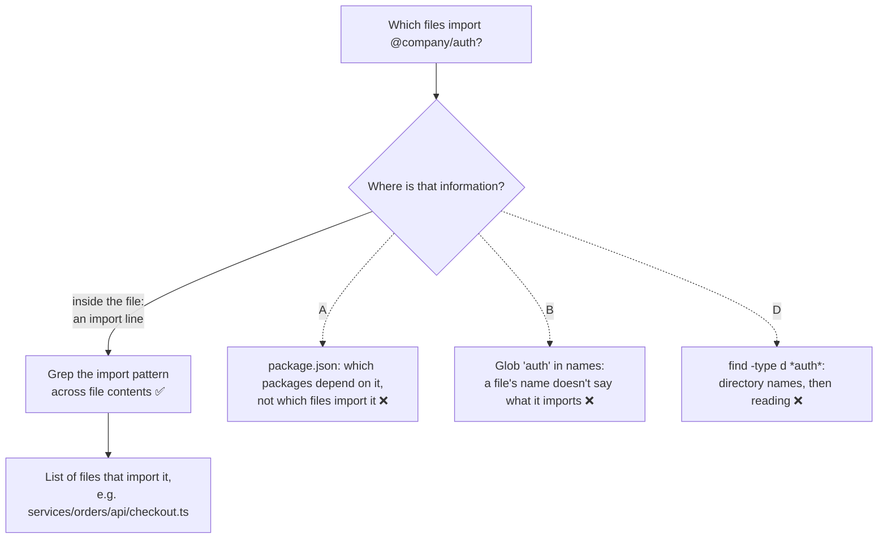

# Q81

**Scenario:** Developer productivity tools built with the Claude Agent SDK (same set as [Q68](../Q68-trace-from-base-class-incremental-reading/question.md)–[Q79](../Q79-scratchpad-file-for-long-sessions/question.md))

## Question

You are building developer productivity tools using the Claude Agent SDK. The agent helps engineers explore unfamiliar codebases, understand legacy systems, generate boilerplate code, and automate repetitive tasks. It uses the built-in tools (Read, Write, Bash, Grep, Glob) and integrates with Model Context Protocol (MCP) servers.

An engineer asks the agent to find all files in the monorepo that import the @company/auth package to understand how authentication is used across services. Which built-in tool is most appropriate for this task?

- **A.** Read, starting with package.json files to trace dependency declarations
- **B.** Glob, to find files with "auth" in their filename or path
- **C.** Grep, to search for the import statement pattern across file contents
- **D.** Bash, to execute `find . -type d -name "*auth*"` and explore matching directories

<details>
<summary><b>Show answer and explanation</b></summary>

**Topic:** Every file that imports @company/auth: Grep the import statement
**Domain / lesson:** D2 › 2.5 Built-in Tools
**Follows:** [Q69](../Q69-grep-distinctive-error-text/question.md) (Grep for text you know is in the file) · [Q76](../Q76-edit-no-unique-anchor-read-write/question.md) (same lesson: the tool for changing code)

## Answer: **C**

## Diagram



## Concept

**Ask where the information lives.** "Imports `@company/auth`" is a line **inside** a file:

```typescript
// services/orders/api/checkout.ts
import { requireUser } from '@company/auth';
```

Nothing in the path `services/orders/api/checkout.ts` says that. So the tool has to search contents, and that's Grep. Guide 2.5: *"Grep searches file contents for patterns. Use it to find function callers, error messages, import statements and variable assignments."* Its own example is nearly this question: *"// Find all files that import a specific module"*, *"Grep: "import.*from 'utils/auth'""*.

**What the call looks like** (illustrative):

```text
Grep
  pattern:     "@company/auth"
  glob:        "**/*.{ts,tsx,js,jsx}"
  output_mode: "files_with_matches"
```

Anchoring on the package name rather than a full `import … from` line also catches the other ways a file can pull it in: `require('@company/auth')`, a subpath like `'@company/auth/jwt'`, or a dynamic `import()`. *(Practical tip, not guide wording.)* Then Read only the files whose usage the engineer needs to understand: guide 2.5's *"Read only what you need."*

**The rule behind it:** *"Grep finds what is inside files. Glob finds files by their names. So Glob cannot find function callers, because a file's path contains no information about what the file calls."* An import works the same way as a call here: it's in the file, not in its name.

## Why the others are wrong

| Option | Why not |
|---|---|
| **A** Read, starting with `package.json` files | **`package.json` answers a different question.** It says which *packages* declare a dependency on `@company/auth`, not which *files* import it. A service can declare it and use it in 3 files of 400, and in a monorepo a file can import a workspace package that its own `package.json` doesn't list. You'd still need to find the files, and reading your way there means reading most of the repo. Guide exam trap: *"Reading all source files upfront before understanding what is relevant."* |
| **B** Glob for "auth" in file names or paths | **A file's name doesn't tell you what it imports.** `checkout.ts` imports `@company/auth` and has no "auth" in its path. `docs/auth-faq.md` has "auth" in its name and imports nothing. Guide exam trap: *"Using Glob to find function callers"*: *"Glob matches file paths by naming pattern. It cannot search inside files for function calls."* |
| **D** Bash `find . -type d -name "*auth*"`, then explore | **The same mistake as B, made worse.** It matches **directory** names (path, not contents), then "explore" means reading whatever is inside them. It also uses Bash for a job a built-in tool does directly. Even in Bash, the right command would be a content search (`grep -rl "@company/auth"`), not `find` on directory names. |

**A note on Bash** (guide's "Current state", checked 14 October 2026): *"On macOS, Linux, and WSL, Claude Code leaves Glob and Grep out of the default tool set, and Claude searches with find and grep through the Bash tool instead."* The guide's instruction: *"On the exam, treat Grep and Glob as built-in tools."* So on the exam the answer is Grep. In real work, Bash `grep` does the same content search.

## Pattern to remember

> **The thing you're looking for is text inside files (an import, a call, an error message) → Grep.** A path or name pattern → Glob. Don't read your way to it, and don't guess from file or directory names.

**Exam signals:**
- *"Files that import"*, *"callers of"*, *"uses of"*, *"error message"* → **Grep** (contents).
- *"Files named"*, *"with extension"*, *"in directory"* → **Glob** (paths).
- *"Glob for 'auth' in the filename"* when the question is about imports → path vs contents confusion (trap).
- *"Read package.json / README first, then…"* → reading before searching.
- *"Bash find -type d"* → directory names, and a built-in tool exists for the job.
- *"Find the tests for these files"* → **Glob** for sibling test files (a test names its source file); Grep would miss tests that never mention the package (check question).

### Where this comes from

**Guide D2 › 2.5 Built-in Tools:**
- *"Grep searches file contents for patterns. Use it to find function callers, error messages, import statements and variable assignments."* (**C**)
- Example: *"// Find all files that import a specific module"*, *"Grep: "import.*from 'utils/auth'""*.
- *"Grep finds what is inside files. Glob finds files by their names. So Glob cannot find function callers, because a file's path contains no information about what the file calls."* (**B**, **D**)
- Exam trap: *"Using Glob to find function callers."* *"Glob matches file paths by naming pattern. It cannot search inside files for function calls. Use Grep to search file contents for function names, import statements, or error messages."* (**B**)
- Exam trap: *"Reading all source files upfront before understanding what is relevant."* (**A**)
- Current state: *"On the exam, treat Grep and Glob as built-in tools."* (**D**)
- *"Glob for sibling test files. This path match finds the test file that pairs with each caller by naming convention."* *"A test that reaches the function through its source module may never contain the function's name, so Grep misses it. The test's path follows the source file's name, so Glob finds it."* (check question)
- *"The correct sequence is Grep, then Glob, then Grep again. Starting with Glob is wrong."* (check question)
- Exam trap: *"Using Grep to find files by extension or naming pattern."* *"Glob is the purpose-built tool for matching file paths. Use Glob for path patterns such as test files and config files."* (check question)

## How this connects to earlier questions

| Question | Link |
|---|---|
| [Q69](../Q69-grep-distinctive-error-text/question.md) | The same rule with an error message: Grep the text you know is in the file. There, Glob on `errors/` directories was the path-guessing trap, like B and D here |
| [Q68](../Q68-trace-from-base-class-incremental-reading/question.md) | Grep imports and class lines to find the core abstraction; its check: a wrapper (decorator) hides direct calls, so Grep for the wrapper's name too |
| [Q76](../Q76-edit-no-unique-anchor-read-write/question.md) | Same lesson, other half: Edit vs Read + Write for changing code |
| [Q74](../Q74-mcp-descriptions-compete-with-built-ins/question.md) | Same scenario: picking the right tool for the job, there between an MCP tool and a built-in |

## Check question

**The Grep finds 23 files that import `@company/auth`. The engineer now asks: "Which tests cover those 23 files?" Which tool do you use now, and why not just Grep the test files for `@company/auth`?**

*My answer:* "Will now read some files now, so possibly, Read?" ❌ **Read comes later, but it can't *find* the test files. Read opens a file you already know; to find tests with Read you'd have to open candidates one by one, which is option A's mistake again. The tool here is Glob: test files are found by their *path*.**

**Three tools, three questions:**

| Tool | The question it answers | Here |
|---|---|---|
| Grep | Which files **contain** this text? | Step 1: the 23 files that import `@company/auth` ✅ |
| **Glob** | Which files have a **path** like this? | **Step 2: the test file next to each of the 23** |
| Read | What's **in** this file I've already found? | Step 3: open the tests you need to understand |

**Why Glob: a test's name follows its source file's name.** Guide 2.5: *"Glob for sibling test files. This path match finds the test file that pairs with each caller by naming convention. For example, OrderProcessor.ts pairs with OrderProcessor.test.tsx."* For each of the 23 files, e.g. `services/orders/api/checkout.ts` → Glob `**/checkout.test.*` (or `**/checkout.{test,spec}.*` if the repo uses both). Guide: *"Glob matches file paths by naming patterns: name, extension or directory structure. Use it for test files, configuration files, or all TypeScript files in one directory."*

**Why not Grep the tests for `@company/auth`: most tests never mention it.** A test exercises the file it tests, so it imports *that file*:

```typescript
// services/orders/api/checkout.test.ts
import { createCheckout } from './checkout';   // no '@company/auth' anywhere
```

Grep for `@company/auth` misses this test, even though it covers code that uses auth. Guide: *"A test that reaches the function through its source module may never contain the function's name, so Grep misses it. The test's path follows the source file's name, so Glob finds it."* And the exam trap from the other side: *"Using Grep to find files by extension or naming pattern"*: *"Glob is the purpose-built tool for matching file paths."*

**The full sequence the guide teaches** (it uses a deprecated function; the same steps work for a package):
1. **Grep** for the name: the files that use it (Q81's answer).
2. **Glob** for each one's sibling test file: the tests that cover them (this check).
3. **Grep again** for wrapper names: if a file wraps auth in its own helper (say `withAuth()`), Grep for that name too, to find tests that reach auth through it (Q68's check).

Guide: *"The correct sequence is Grep, then Glob, then Grep again. Starting with Glob is wrong."* Then Read only the tests you need.

> **Find by content → Grep. Find by path or name → Glob. Read only what you've already found. To find the tests for a set of files, Glob their sibling test files: a test usually names its source file, not the package the source file uses.**

## Glossary

- **Grep:** a built-in tool that searches file **contents** for a text pattern (regex) and returns matching files or lines.
- **Glob:** a built-in tool that matches file **paths** against a name pattern such as `**/*.ts`.
- **Import statement:** the line in a source file that pulls in another module or package (`import … from '@company/auth'`, `require('@company/auth')`).
- **Monorepo:** one repository that holds many services or packages.
- **Workspace package:** a package that lives inside the monorepo (like `@company/auth`) and is imported by other packages in it.
- **`files_with_matches`:** a Grep output mode that returns only the names of matching files, not the lines.

## Related course lessons

*Lecture lengths aren't recorded in the study-map files, so the watch times below are estimates from each course's average lecture length.*

### Udemy A (primary): Claude Certified Architect (CCAR-F) - 2026 Exam Prep
| # | Lecture | Part | Why |
|---|---|---|---|
| **56** | **The Built-in Toolset** | 2C | ⭐ Grep vs Glob vs Read: exactly this question *(also in Q68, Q69, Q76)* |
| 59 | The Tool System — Reads, Bash, Edits, and Web Search | 3A | Search before you read (A), and Bash vs built-ins (D) *(also in Q58, Q68, Q69, Q76)* |
| Quiz 7, Quiz 8 | 2C and 3A quizzes | | Self-test |

**▶ Watch in this order (~15 min, est.):** #56 → #59, then do **Quiz 7** and **Quiz 8**.

### Udemy B: Claude Certified Architect Foundations: Complete Course (Voroniuk)
| # | Lecture | Section | Why |
|---|---|---|---|
| **79** | **Built-in Tools: Grep, Glob, Read, Write and Edit** | S8 Claude Code Setup | ⭐ Grep for contents, Glob for paths *(also in Q68, Q69, Q76)* |
| 80 | Exploring a Codebase Step by Step | S8 Claude Code Setup | Grep first, then read only the matches *(also in Q58, Q68, Q69, Q75, Q79)* |
| Quiz 8 | Claude Code Setup quiz | S8 | Self-test |

**▶ Watch in this order (~10 min, est.):** #79 → #80, then do **Quiz 8**.

### CBT Nuggets: CCA-F course
| Skill | Why |
|---|---|
| **23. Apply Built In Tools Safely** | ⭐ Choosing Grep, Glob and Read deliberately *(also in Q68, Q69, Q75, Q76)* |

</details>
