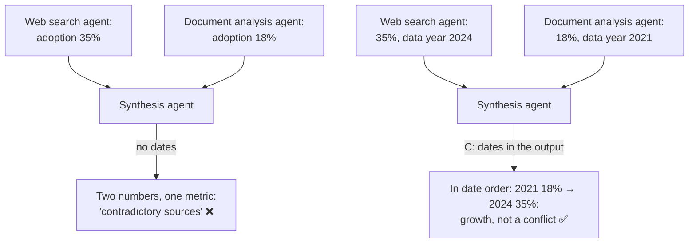

# Q82

**Scenario:** Multi-agent research system (same system as [Q01](../Q01-source-attribution-multi-agent/question.md)–[Q09](../Q09-synthesis-preserve-merge-mappings/question.md))

## Question

You are building a multi-agent research system using the Claude Agent SDK. A coordinator agent delegates to specialized subagents: one searches the web, one analyzes documents, one synthesizes findings, and one generates reports. The system researches topics and produces comprehensive, cited reports.

When researching "renewable energy adoption," the web search agent returns recent statistics (2024: 35% adoption) while the document analysis agent extracts data from internal reports (2021: 18% adoption). The synthesis agent incorrectly flags these as contradictory sources rather than recognizing the data shows growth over time. What change would best enable the synthesis agent to correctly interpret such temporal differences?

- **A.** Instruct the synthesis agent to always treat the most recent data as authoritative and place older findings in a separate historical appendix.
- **B.** Add a conflict resolution agent that automatically discards older data when newer data exists for the same metric.
- **C.** Require subagents to include publication or data collection dates in their structured outputs.
- **D.** Configure the web search agent to only return results from the past 6 months.

<details>
<summary><b>Show answer and explanation</b></summary>

**Topic:** 18% vs 35% flagged as a contradiction: require dates in the subagents' outputs
**Domain / lesson:** D5 › 5.6 Information Provenance & Multi-Source Synthesis
**Also touches:** D4 › 4.3 Structured Output (the date is a field in the subagents' output schema)
**Follows:** [Q08](../Q08-conflicting-findings-annotation/question.md) (a real conflict: annotate both values) · [Q09](../Q09-synthesis-preserve-merge-mappings/question.md) (synthesis must keep the claim-source mappings)

## Answer: **C**

## Diagram



## Concept

**Why the synthesis agent got it wrong: it never saw the dates.** It received two numbers for one metric, 35% and 18%, and nothing that put them in order. Two different values for the same thing, with no time context, look like a conflict. Guide 5.6: *"Different publication dates explain different numbers. The publication dates are temporal context, and they have to be preserved."* *"Without dates, the two numbers look contradictory. With dates, they show a trend."*

**The guide describes this exact failure:** *"Without these dates, the synthesis agent cannot put two numbers for one measure in date order. It can misread a valid trend as a data quality issue. Then it can incorrectly flag or suppress findings that are consistent."* *"Incorrectly flag"* is what happened here.

**The fix belongs at the source, in the subagents' structured output.** Guide: *"So require publication or data collection dates in all structured outputs."* Publication date is already one of the five fields of the guide's claim-source mapping: *"Publication date: When the source was published or data was collected"*. Illustrative outputs:

```json
{
  "claim": "Renewable energy adoption reached 35%",
  "sourceUrl": "https://example.org/energy-outlook-2024",
  "documentName": "Energy Outlook 2024",
  "relevantExcerpt": "In 2024, 35% of surveyed firms had adopted renewable energy...",
  "publicationDate": "2024-09-12",
  "dataPeriod": "2024"
}
```

```json
{
  "claim": "Renewable energy adoption reached 18%",
  "sourceUrl": "internal://reports/market-review-2021.pdf",
  "documentName": "Internal Market Review 2021",
  "relevantExcerpt": "Adoption across our customer base stood at 18% at year end...",
  "publicationDate": "2021-11-30",
  "dataPeriod": "2021"
}
```

Now the synthesis agent can order the values: 2021 → 18%, 2024 → 35%. That's growth, not a contradiction. *(Practical tip, not guide wording: when a source publishes data about an earlier period, record the period the data covers as well as the publication date. The guide's own example has a report *"published June 2024, using 2023 calendar year data"*.)*

**Why "structured outputs" matters.** If the date is only somewhere in the prose, synthesis can drop it when it paraphrases. As a field in the output, it's data that the synthesis agent receives every time. That's the same reason the guide wants claim-source mappings as data: *"Subagents emit structured claim-source mappings. These are data rather than prose."*

## Why the others are wrong

| Option | Why not |
|---|---|
| **A** Treat the most recent data as authoritative, older data in an appendix | **It picks one value, and it can't even do that without dates.** Guide: *"The wrong approach is to arbitrarily select one value: the more recent source, the average, or the more authoritative publisher. Each of these choices destroys information and presents a false certainty."* Here the real finding is the **growth** from 18% to 35%. Hiding 2021 in an appendix hides the trend. And "most recent" needs the dates C provides: without them, the synthesis agent can't tell which value is newer. |
| **B** A conflict-resolution agent that discards older data | **Discarding is the same mistake as A, done automatically by an extra agent.** Guide exam trap: *"Selecting the most recent source when two credible sources conflict"*: *"Arbitrarily selecting one value destroys information."* It treats a trend as a conflict to resolve, which is the very error in the question. It also needs dates to know which data is older. |
| **D** Web search returns only the last 6 months | **It cuts data instead of adding context.** The internal 2021 report still arrives from the document analysis agent, still without a date, so the synthesis agent is just as confused. A *comprehensive* report also loses everything older than 6 months, including the history that shows the trend. |

## Pattern to remember

> **Different numbers for the same measure from different times are a trend, not a contradiction, but only if the dates travel with the numbers.** Require publication or data-collection dates in every subagent's structured output. Don't pick the newest, don't discard the oldest, don't filter by recency.

**Exam signals:**
- *"Incorrectly flags as contradictory"*, *"growth over time"*, *"temporal differences"* → **dates in the structured outputs**.
- *"Most recent is authoritative"*, *"discard older data"* → picking one value (trap).
- *"Only return results from the past N months"* → filtering data instead of adding context.
- Two values, **same** period, still different → a real conflict: annotate both with sources (Q08).

### Where this comes from

**Guide D5 › 5.6 Information Provenance:**
- Claim-source mapping fields: *"Publication date: When the source was published or data was collected"*.
- *"Different publication dates explain different numbers. The publication dates are temporal context, and they have to be preserved. Suppose the 8% report was published in 2023 and the 12% report was published in 2024. Without dates, the two numbers look contradictory. With dates, they show a trend: the rise accelerated from 8% to 12%."*
- *"So require publication or data collection dates in all structured outputs. Without these dates, the synthesis agent cannot put two numbers for one measure in date order. It can misread a valid trend as a data quality issue. Then it can incorrectly flag or suppress findings that are consistent."* (**C**)
- *"The wrong approach is to arbitrarily select one value: the more recent source, the average, or the more authoritative publisher. Each of these choices destroys information and presents a false certainty."* (**A**, **B**)
- Exam trap: *"Assuming different numbers from different sources are contradictions."* *"Different publication or data collection dates often explain different numbers. Require dates in structured outputs to enable correct temporal interpretation."* (**C**)
- Exam trap: *"Selecting the most recent source when two credible sources conflict."* *"Arbitrarily selecting one value destroys information."* (**A**, **B**)
- In the exam: *"Questions test attribution through synthesis, conflicting sources, and the dates that prevent false contradictions."*
- *"Subagents include the dates. The synthesis agent preserves the dates when it merges findings. The final output shows the dates beside the data."* (check question)
- *"Financial data goes in tables. Numbers, comparisons and trends read best in a table. In prose, values are harder to compare and patterns are harder to see."* (check question)
- *"The final output includes inline citations or a structured reference section that traces each claim to its source."* (check question)

## How this connects to earlier questions

| Question | Link |
|---|---|
| [Q08](../Q08-conflicting-findings-annotation/question.md) | The other case: a **real** conflict (same measure, same time, different values) → annotate both with sources and methodology. Dates tell you which case you're in |
| [Q09](../Q09-synthesis-preserve-merge-mappings/question.md), [Q01](../Q01-source-attribution-multi-agent/question.md) | Claim-source mappings must survive synthesis; the date is one of their fields |
| [Q80](../Q80-delimit-sources-place-critical-at-edges/question.md) | Keep sources separate and labelled; mixed together, their values blur |
| [Q40](../Q40-multi-issue-case-facts-layer/question.md) | The same principle elsewhere: exact values (amounts, dates) go into structured data, not prose that gets summarised |

## Check question

**C is in place. The synthesis agent now receives "18%, data year 2021, Internal Market Review" and "35%, data year 2024, Energy Outlook 2024", and recognises growth. How should the final report present these two numbers to the reader?**

*My answer:* "It should see it as growth over the years, not a contradiction." 🟡 **Right framing, but that's what the synthesis agent already does once C is in place. The question is how the report shows it to the reader. Three things: the dates beside the numbers, a source for each number, and a table for the trend. Add a note if the two sources measure different things.**

**1. The dates appear next to the numbers.** The dates have to survive all the way to the page, not just reach the synthesis agent. Guide: *"Subagents include the dates. The synthesis agent preserves the dates when it merges findings. The final output shows the dates beside the data."* If the report says "adoption grew to 35%" with no years, the reader can't see the trend, or check it.

**2. Each number keeps its source.** Guide: *"The final output includes inline citations or a structured reference section that traces each claim to its source."* The guide's example of what goes wrong without this: *"Investment in renewable energy has grown significantly", with no amount, no source and no date.*

**3. A trend goes in a table.** Guide, content-appropriate rendering: *"Financial data goes in tables. Numbers, comparisons and trends read best in a table. In prose, values are harder to compare and patterns are harder to see."*

**What it looks like** (illustrative):

| Year | Adoption | Source |
|---|---|---|
| 2021 | 18% | Internal Market Review 2021 (internal report, published 30 Nov 2021) |
| 2024 | 35% | Energy Outlook 2024 (published 12 Sep 2024) |

> Adoption roughly doubled between 2021 and 2024. *Note: the 2021 figure covers our own customer base; the 2024 figure comes from a survey of firms. Part of the difference may reflect the different populations measured.*

**About that note.** Two numbers from two different sources aren't automatically comparable. The guide asks reports to keep *"original source characterisations and methodological context"*, and its conflict example closes with *"The difference may reflect different reporting periods and methodological approaches."* Here the dates explain most of the gap, but the reader should still know the two figures come from different kinds of source.

**What not to write:**
- *"Adoption is 35%"*: the 2021 value is gone, so the trend is gone too. That's option A's mistake, made in the report.
- *"Adoption has grown significantly"*: no numbers, no dates, no sources. That's the guide's own example of lost attribution.

> **The dates have to reach the reader, not just the synthesis agent: each number with its year and its source, and a trend in a table. Add a note when the sources differ in what they measure.**

## Glossary

- **Information provenance:** knowing where every claim comes from (source, excerpt, date) and how far to trust it.
- **Claim-source mapping:** a structured record linking one claim to its source URL, document name, excerpt and publication date.
- **Publication date vs data-collection period:** when the source was published vs which period its numbers describe; a 2024 report can describe 2023.
- **Temporal context:** the dates that let two values for one measure be put in order.
- **False contradiction:** two values that look like a conflict only because the time context is missing.

## Related course lessons

*Lecture lengths aren't recorded in the study-map files, so the watch times below are estimates from each course's average lecture length.*

### Udemy A (primary): Claude Certified Architect (CCAR-F) - 2026 Exam Prep
| # | Lecture | Part | Why |
|---|---|---|---|
| **131** | **Claim-to-Source Mappings — Why Every Sentence Needs a Source** | 5D | ⭐ The mapping fields, including the date: exactly C *(also in Q01, Q02, Q08, Q09, Q80)* |
| **132** | **Conflict Annotation — Surfacing Disagreement in Synthesis** | 5D | ⭐ Conflict vs trend; why picking the newest (A, B) is wrong *(also in Q01, Q08, Q09)* |
| Quiz 18 | 5D quiz | | Self-test |

**▶ Watch in this order (~15 min, est.):** #131 → #132, then do **Quiz 18**.

### Udemy B: Claude Certified Architect Foundations: Complete Course (Voroniuk)
| # | Lecture | Section | Why |
|---|---|---|---|
| **68** | **When Sources Disagree** | S7 Multi-Agent | ⭐ Different values: conflict or trend? *(also in Q01, Q08)* |
| 67 | Keeping Claims Tied to Sources | S7 Multi-Agent | The structured output the date belongs in *(also in Q01, Q02, Q08, Q09, Q80)* |
| 70 | Research Case: Citing Sources | S7 Multi-Agent | An exam-style case in this same system *(also in Q01, Q02, Q08, Q09)* |
| Quiz 7 | Multi-Agent quiz | S7 | Self-test |

**▶ Watch in this order (~15 min, est.):** #67 → #68 → #70, then do **Quiz 7**.

### CBT Nuggets: CCA-F course
| Skill | Why |
|---|---|
| 24. Compare Web Search and RAG | Web results vs internal documents: different sources, different dates *(also in Q01, Q08)* |
| 26. Explain RAG and Document Chunking | Keeping source context (including dates) with each chunk *(also in Q01, Q02, Q03, Q08, Q38, Q80)* |

*CBT has no dedicated lesson on temporal context in synthesis. Use Udemy A #131–132 or Udemy B #68.*

</details>
