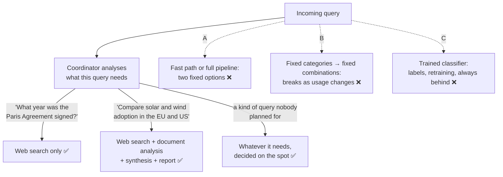

# Q83 — Simple facts go through all four subagents: the coordinator selects subagents per query

**Domain / lesson:** D1 › 1.2 Multi-Agent Orchestration
**Also touches:** D2 › 2.1 Tool Interface Design (why a separate routing classifier is the over-engineered answer)
**Scenario:** Multi-agent research system (same system as [Q01](../Q01-source-attribution-multi-agent/question.md)–[Q09](../Q09-synthesis-preserve-merge-mappings/question.md), [Q82](../Q82-dates-turn-conflicts-into-trends/question.md); the pasted text leaves out the scenario intro)
**Follows:** [Q39](../Q39-coordinator-answers-simple-followups/question.md) (don't spawn a subagent you don't need) · [Q73](../Q73-same-steps-every-pr-prompt-chaining/question.md) (fixed pipeline vs dynamic: which fits which input)

## Question

In production, you observe that simple fact-checking queries (e.g., "What year was the Paris Climate Agreement signed?") traverse all four subagents sequentially, consuming 40+ seconds and significant tokens per query. Complex comparative research benefits from the full pipeline. Your query distribution is diverse and evolving as users discover new applications. What's the most effective approach to optimize for varying query complexity?

- **A.** Create a fast-path for factual questions that bypasses subagents entirely, routing all other queries through the complete pipeline to ensure research thoroughness.
- **B.** Implement pattern-based routing that categorizes queries by structure (single-fact vs. comparative vs. analytical) and maps each category to a predefined subagent combination.
- **C.** Train a query complexity classifier on labeled historical data to predict optimal subagent combinations, retraining periodically as query patterns evolve.
- **D.** Have the coordinator analyze each query and dynamically decide which subagents to invoke based on its assessment of query requirements.

## Answer: **D**

## Diagram



## Concept

**Selecting subagents per query is one of the coordinator's four jobs.** Guide 1.2: *"1. Dynamic subagent selection. The coordinator analyses what a query requires and selects only the subagents it needs. A simple factual question might need only web search, not the full chain of research, analysis and synthesis. A coordinator that routes every query through every subagent wastes time and resources."* That's this question, nearly word for word.

**What D looks like:**

| Query | What the coordinator sees it needs | Subagents invoked |
|---|---|---|
| "What year was the Paris Climate Agreement signed?" | One fact, findable on the web | Web search |
| "Compare solar and wind adoption in the EU and the US since 2015, with sources" | Several sources, comparison, a cited report | Web search + document analysis + synthesis + report |
| "Summarise our internal 2023 energy reports" | Only internal documents | Document analysis (+ synthesis if long) |

**Why "diverse and evolving" points to D.** The other options all decide the routing **in advance**: two paths (A), fixed categories (B), or a model trained on past queries (C). When users find new uses, those decisions are out of date. D decides **per query, at the time**, using the coordinator's understanding of the request. A new kind of query needs no new category, rule or retraining.

**It doesn't add a step.** The coordinator already reads every query: guide 1.2, *"The coordinator receives the initial task and decomposes it. It decides which subagents to invoke and passes context to them."* D just lets that decision include "invoke fewer".

## Why the others are wrong

| Option | Why not |
|---|---|
| **A** A fast path that bypasses all subagents; everything else through the full pipeline | **Two fixed paths for a diverse distribution.** Every query that isn't a pure fact still goes through all four subagents, which is the guide's trap: *"Routing every query through the full subagent pipeline"*, because *"Invoking subagents that a query does not need adds latency and API call overhead"*. And "bypasses subagents entirely" is too far the other way: the guide's simple fact *"might need only web search"*, not no search. Without a subagent, the coordinator answers from the model's memory, with no source, in a system built to produce cited reports. (In Q39 the coordinator could answer directly because the findings were already in its context. Here they aren't.) |
| **B** Pattern-based routing: categories by structure → predefined combinations | **The categories are fixed, and usage keeps changing.** New kinds of queries don't fit "single-fact / comparative / analytical", or fit one badly. Structure also isn't what decides the subagents: "What was our 2021 adoption rate?" is a single fact, but it needs **document analysis** (internal reports), not web search. Someone has to keep maintaining the categories and combinations by hand. |
| **C** A trained complexity classifier, retrained periodically | **Heavy infrastructure, and always behind.** It needs labelled historical data and a retraining process, and it learns from **past** queries, while the question stresses that the distribution is *evolving*. It also puts a separate model in front of a coordinator that can already read the query. Guide 2.1 says the same about tool routing: a routing classifier *"is over-engineered as a first step. It bypasses the LLM's natural language understanding and adds infrastructure complexity."* (Applied here by analogy: there it chose tools, here subagents.) |

## Pattern to remember

> **Queries vary and keep changing → the coordinator analyses each query and invokes only the subagents it needs.** Not one fixed pipeline for everything, not fixed categories, not a separate trained router.

**Exam signals:**
- *"Simple queries go through all subagents"*, *"40+ seconds"*, *"varying complexity"* → **dynamic subagent selection by the coordinator**.
- *"Diverse and evolving"* → anything decided in advance (categories, fast paths, a trained classifier) goes out of date.
- *"Train a classifier"*, *"routing layer"* → over-engineered; bypasses the LLM's understanding.
- *"Route every query through the full pipeline"* (even with caching) → trap.
- *"Bypass subagents entirely"* → no source for the answer in a cited-research system.

### Where this comes from

**Guide D1 › 1.2 Multi-Agent Orchestration:**
- *"The coordinator receives the initial task and decomposes it. It decides which subagents to invoke and passes context to them. It aggregates their results, handles errors, and routes information between them."*
- *"1. Dynamic subagent selection. The coordinator analyses what a query requires and selects only the subagents it needs. A simple factual question might need only web search, not the full chain of research, analysis and synthesis. A coordinator that routes every query through every subagent wastes time and resources."* (**D**)
- Exam trap: *"Routing every query through the full subagent pipeline and caching the unused subagents' results to cut cost."* *"Invoking subagents that a query does not need adds latency and API call overhead, cached or not. Have the coordinator analyse each query and invoke only the subagents it needs, such as web search alone for a simple factual lookup."* (**A**, **D**)

**Anthropic, Agent SDK subagents docs** (check question):
- `description`: *"Natural language description of when to use this agent"*.
- *"Claude automatically decides when to invoke subagents based on the task and each subagent's description."* *"Write clear, specific descriptions so Claude can match tasks to the right subagent."*

**Guide D2 › 2.1 Tool Interface Design** (by analogy):
- *"Routing classifier: wrong. A routing classifier is code that parses the user input before each turn and selects the tool from detected keywords. It is over-engineered as a first step. It bypasses the LLM's natural language understanding and adds infrastructure complexity."* (**B**, **C**)

## How this connects to earlier questions

| Question | Link |
|---|---|
| [Q39](../Q39-coordinator-answers-simple-followups/question.md) | Same lesson: don't spawn a subagent you don't need. There the coordinator **had** the findings, so it answered directly; here it doesn't, so it calls only the subagent that can find the fact |
| [Q74](../Q74-mcp-descriptions-compete-with-built-ins/question.md) | The same "routing classifier" distractor, for tools. Both times the fix stays inside the model's own judgement |
| [Q73](../Q73-same-steps-every-pr-prompt-chaining/question.md), [Q75](../Q75-intermittent-500-dynamic-decomposition/question.md) | Fixed pipeline when every input needs the same steps (Q73); dynamic when they differ. Here queries differ, so a fixed four-step pipeline is the wrong fit |
| [Q06](../Q06-coordinator-gap-loop/question.md) | Another coordinator job from the same list: evaluate the output and re-delegate for gaps |
| [Q10](../Q10-missing-context-in-subagent-prompt/question.md), [Q12](../Q12-include-complete-findings-in-prompt/question.md), [Q36](../Q36-coordinator-missing-task-tool/question.md) | The other subagent failures, told apart in the check question: runs but lacks information (Q10, Q12), never runs at all (Q36), never **chosen** for one kind of query (here) |

## Check question

**D is live. Two weeks later you notice that questions like "What did our 2023 board report say about solar?" get answered from web search only: the coordinator never invokes the document analysis subagent for them. What's the likely cause, and what do you fix?**

*My answer:* "Coordinator is not instructed to pass web search agent results to synthesis agent." ❌ **That's a real failure mode (Q10, Q12: a subagent runs but lacks the information it needs), but not this one. Here the document analysis subagent never runs at all. The board report is internal, and web search can't see it. So passing web results to synthesis wouldn't help: the right content was never retrieved. The problem is the coordinator's *choice* of subagent.**

**Read the symptom precisely:**

| Symptom | Where to look |
|---|---|
| A subagent **runs**, but its output is missing things the coordinator knew | What the coordinator put in its prompt (Q10, Q12) |
| **No** subagent ever runs; the coordinator only talks about them | `Task` missing from `allowedTools` (Q36) |
| **Other** subagents run, but never **this one** for this kind of query | **How the coordinator chooses**: what it knows about each subagent ← this case |

Web search runs, so delegation works. The coordinator just doesn't see document analysis as the right subagent for "our 2023 board report".

**Likely cause: the subagent's description doesn't tell the coordinator when to use it.** With D, the coordinator chooses from what it knows about each subagent. In the Agent SDK that's mainly the subagent's `description`: *"Natural language description of when to use this agent"*. The SDK docs: *"Claude automatically decides when to invoke subagents based on the task and each subagent's description."* A description like "Analyzes documents" doesn't say that this is the **only** subagent that can read internal reports.

**The fix: rewrite the descriptions so the choice is obvious** (illustrative):

```python
agents = {
    "document-analysis": AgentDefinition(
        description=(
            "Searches and analyses the company's INTERNAL documents: board reports, "
            "internal market reviews, strategy papers (2018 to now). Use for any question "
            "about what our own reports, documents or internal data say, e.g. 'our 2023 "
            "board report', 'our adoption rate'. Web search cannot see these documents."
        ),
        ...
    ),
    "web-search": AgentDefinition(
        description=(
            "Searches the PUBLIC web for published facts, statistics and news. "
            "Not for the company's internal documents."
        ),
        ...
    ),
}
```

SDK docs: *"Write clear, specific descriptions so Claude can match tasks to the right subagent."* It's the same fix as Q74 and guide 2.1 for tools (*"When weak descriptions cause misrouting, improving them is the first fix"*), now applied to subagents.

**Also check the coordinator's prompt.** A line like "For factual questions, search the web" can override good descriptions. That's guide 2.1's keyword-sensitive instruction problem, and it was Q74's check. Rephrase it, then re-run test queries like "What did our 2023 board report say about solar?" and check the coordinator's log to see which subagents it invoked. (The hub gives you that log: *"Observability: you can log and monitor every message in one place."*)

**Not the fix:** a keyword rule ("if the query says 'board report', call document analysis"). That's B's fixed routing again, and it misses the next phrasing ("our Q3 strategy paper").

> **Wrong subagent chosen (or one never chosen) → fix what the coordinator knows: clear, specific subagent descriptions that say what each covers and when to use it, and no prompt lines that override them. Context passing (Q10) is for subagents that run but lack information.**

## Glossary

- **Coordinator:** the hub agent that decomposes a task, selects subagents, passes them context and combines their results.
- **Dynamic subagent selection:** the coordinator decides per query which subagents to invoke, instead of always running all of them.
- **Fast path:** a shortcut route for one kind of request that skips the normal processing.
- **Pattern-based routing:** rules that sort requests into predefined categories and send each category down a fixed route.
- **Routing classifier:** a separate model or code that labels each request before the agent sees it, to choose the route.
- **Query distribution:** the mix of kinds of questions users actually ask; "evolving" means the mix changes over time.

## Related course lessons

*Lecture lengths aren't recorded in the study-map files, so the watch times below are estimates from each course's average lecture length.*

### Udemy A (primary): Claude Certified Architect (CCAR-F) - 2026 Exam Prep
| # | Lecture | Part | Why |
|---|---|---|---|
| **18** | **Multi Agent Topology and Selection** | 1C | ⭐ Selecting only the subagents a query needs: exactly D *(also in Q06, Q07, Q12, Q39)* |
| **16** | **The Orchestrator Role** | 1C | ⭐ What the coordinator decides *(also in Q05, Q06, Q07, Q10, Q11, Q36, Q39)* |
| 23 | Multi-Agent Cost and Fit | 1D | What each unnecessary subagent call costs (the 40+ seconds) *(also in Q39)* |
| Quiz 3, Quiz 4 | 1C and 1D quizzes | | Self-test |

**▶ Watch in this order (~20 min, est.):** #16 → #18 → #23, then do **Quiz 3** and **Quiz 4**.

### Udemy B: Claude Certified Architect Foundations: Complete Course (Voroniuk)
| # | Lecture | Section | Why |
|---|---|---|---|
| **69** | **Research Case: Coordinator Calls** | S7 Multi-Agent Systems | ⭐ Which calls the coordinator should make, in this exact system *(also in Q02, Q05, Q06, Q11, Q39)* |
| 60 | The Coordinator Pattern | S7 Multi-Agent Systems | The coordinator's responsibilities *(also in Q05, Q06, Q07, Q36, Q39)* |
| Quiz 7 | Multi-Agent Systems quiz | S7 | Self-test |

**▶ Watch in this order (~10 min, est.):** #60 → #69, then do **Quiz 7**.

### CBT Nuggets: CCA-F course
| Skill | Why |
|---|---|
| **36. Design Workflows and Agent Systems** | ⭐ When to use (and not use) each agent *(also in Q01–Q07, Q09–Q13, Q29, Q36, Q39, Q73, Q75)* |
| 39. Build an Agentic Multimedia Article System: Part 1 | A coordinator choosing which subagents to call *(also in Q01, Q02, Q03, Q05, Q06, Q07, Q09, Q11, Q36, Q39, Q78)* |
