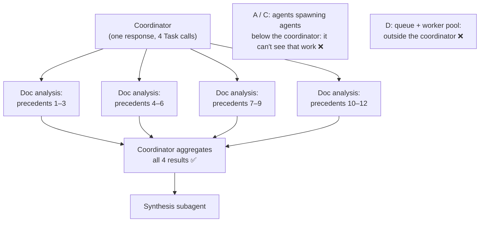

# Q84

**Scenario:** Multi-agent research system (same system as [Q01](../Q01-source-attribution-multi-agent/question.md)–[Q09](../Q09-synthesis-preserve-merge-mappings/question.md), [Q82](../Q82-dates-turn-conflicts-into-trends/question.md), [Q83](../Q83-coordinator-selects-subagents-per-query/question.md))

## Question

You are building a multi-agent research system using the Claude Agent SDK. A coordinator agent delegates to specialized subagents: one searches the web, one analyzes documents, one synthesizes findings, and one generates reports. The system researches topics and produces comprehensive, cited reports.

When analyzing complex legal cases that cite multiple precedents, the document analysis subagent processes each sequentially. A landmark case citing 12 precedents takes over 3 minutes to analyze completely. What's the most effective way to reduce this latency while preserving the coordinator's ability to monitor and debug the system?

- **A.** Create a recursive agent hierarchy where analysis agents subdivide work among child agents until reaching single-precedent granularity
- **B.** Have the coordinator spawn parallel document analysis subagents, each handling a subset of precedents, then aggregate results before synthesis
- **C.** Enable the document analysis subagent to spawn its own specialized subagents dynamically when it encounters cases with many citations
- **D.** Implement a message queue where precedent analysis tasks are processed asynchronously by a pool of worker agents

<details>
<summary><b>Show answer and explanation</b></summary>

**Topic:** 12 precedents analysed one by one: the coordinator spawns parallel subagents
**Domain / lesson:** D1 › 1.3 Subagent Invocation & Context Passing (parallel spawning)
**Also touches:** D1 › 1.2 Multi-Agent Orchestration (hub-and-spoke: why the coordinator must stay at the centre)
**Follows:** [Q36](../Q36-coordinator-missing-task-tool/question.md) (its check: several Task calls in one response) · [Q83](../Q83-coordinator-selects-subagents-per-query/question.md) (the coordinator decides which subagents run)

## Answer: **B**

## Diagram



## Concept

**Two requirements, and B is the only option that meets both.**

| Requirement in the question | How B meets it |
|---|---|
| *"Reduce this latency"* | The 12 precedents are analysed at the same time, in 4 subagents, instead of one after another |
| *"Preserving the coordinator's ability to monitor and debug"* | The coordinator spawns every subagent and receives every result, so all the work still passes through the hub |

**Latency: parallel spawning.** The precedents can be analysed independently, so there's no reason to wait for one before starting the next. Guide 1.3: *"When a coordinator needs several subagents for independent tasks, it should emit multiple Task tool calls in a single response."* *"Spawn independent subagents in parallel by emitting multiple Task tool calls in a single coordinator response. Parallel spawning reduces latency compared to sequential invocation across separate turns."* Roughly: 3 minutes for 12 one after another becomes about the time of the slowest group of 3.

**Monitoring: the hub stays the hub.** Guide 1.2 lists what a single hub gives you: *"Observability: you can log and monitor every message in one place. Consistent error handling: the coordinator applies uniform error recovery policies. Controlled information flow: the coordinator decides what context each subagent receives."* In B, each of the four subagents is a spoke of the same coordinator. If one fails or returns something odd, the coordinator sees it and can act (Q67: a structured error comes back to the coordinator).

**Then aggregate, then synthesise.** Synthesis depends on all 12 analyses, so it waits for the parallel step to finish. The coordinator collects the four results and passes them into the synthesis subagent's prompt (subagents see only their prompt: Q10, Q12).

**Each subagent still needs a complete brief** (illustrative):

```text
You are analysing precedents cited by <landmark case name>.
The case's legal question: <...>.
Your precedents: (4) <...>, (5) <...>, (6) <...>.
For each one, return: citation, holding, and how the landmark case uses it,
with page references.
```

## Why the others are wrong

| Option | Why not |
|---|---|
| **A** A recursive hierarchy, down to one precedent per agent | **The work moves below the coordinator, out of its sight.** Parent analysis agents spawn children, which spawn more. The coordinator talks only to the top layer; everything underneath happens between agents it never sees, which is what the hub was there to prevent: *"Observability: you can log and monitor every message in one place."* It also adds layers of spawning overhead for 12 small tasks. The exam tests one pattern: *"hub-and-spoke, with a coordinator at the centre."* |
| **C** The document analysis subagent spawns its own subagents | **The same problem at one level.** The coordinator delegates once, and the splitting, error handling and results of the sub-subagents happen inside the document analysis subagent. The coordinator gets one combined answer and can't tell which precedent's analysis went wrong. *"Dynamically when it encounters cases with many citations"* also makes the system's shape vary from case to case, which is harder to debug. |
| **D** A message queue and a pool of worker agents | **Infrastructure outside the agent system.** Tasks go to a queue and come back asynchronously from workers the coordinator doesn't spawn or see. Monitoring and error handling now live in the queue, not the coordinator. It can work, but it gives up exactly what the question asks to keep, and it's far more to build than several Task calls in one response. |

**A note on current docs** (real work, not the exam): guide 1.2's current-state box says *"in Claude Code a subagent can itself spawn subagents, up to three layers below the main conversation. So the strict "never" rule is a simplification for the exam, not a hard product limit."* The Agent SDK docs agree: *"a subagent can spawn subagents of its own, so one prompt can grow into a tree of agents,"* and you can cap it: depth `1` *"stops your subagents from spawning any of their own."* So A and C are *possible* in real work, but they're not what the exam means by keeping the coordinator able to monitor and debug.

## Pattern to remember

> **Independent pieces of work + a need for speed → the coordinator spawns several subagents in parallel (several Task calls in one response), then aggregates their results.** Keep the coordinator at the centre: no agent trees below it, no queues around it.

**Exam signals:**
- *"Sequentially"*, *"takes minutes"*, independent items → **parallel spawning** (*"in a single response"*, *"simultaneously"*).
- *"Preserve the coordinator's ability to monitor and debug"* → everything through the hub; subagents spawned **by the coordinator**.
- *"Recursive hierarchy"*, *"subagent spawns its own subagents"* → work hidden below the coordinator.
- *"Message queue"*, *"worker pool"*, *"asynchronous"* → infrastructure outside the coordinator's view.

### Where this comes from

**Guide D1 › 1.3 Subagent Invocation & Context Passing:**
- *"When a coordinator needs several subagents for independent tasks, it should emit multiple Task tool calls in a single response. Sequential spawning means one subagent per coordinator turn. The second subagent cannot start until the first has returned and the coordinator takes another turn. When the tasks are independent, that wait adds latency with no benefit."* (**B**)
- Key concept: *"Spawn independent subagents in parallel by emitting multiple Task tool calls in a single coordinator response. Parallel spawning reduces latency compared to sequential invocation across separate turns."*
- *"The exam tests whether you are aware of latency. For independent subagent tasks, the correct answer involves parallel spawning. Options that mention "in a single response" or "simultaneously" signal parallel spawning."*
- Exam trap: *"Proposing sequential subagent invocation for tasks that can run independently."*

**Guide D1 › 1.2 Multi-Agent Orchestration:**
- *"Observability: you can log and monitor every message in one place. Consistent error handling: the coordinator applies uniform error recovery policies. Controlled information flow: the coordinator decides what context each subagent receives."* (**A**, **C**, **D** give these up)
- *"The exam tests one orchestration pattern: hub-and-spoke, with a coordinator at the centre."*
- Current state: *"in Claude Code a subagent can itself spawn subagents, up to three layers below the main conversation. So the strict "never" rule is a simplification for the exam, not a hard product limit."*

**Anthropic, Agent SDK subagents docs** (current state):
- *"a subagent can spawn subagents of its own, so one prompt can grow into a tree of agents."* Depth `1` *"stops your subagents from spawning any of their own."*

## How this connects to earlier questions

| Question | Link |
|---|---|
| [Q36](../Q36-coordinator-missing-task-tool/question.md) | The coordinator needs `Task` to spawn at all; its check: independent subagents → several Task calls in one response |
| [Q83](../Q83-coordinator-selects-subagents-per-query/question.md) | The coordinator decides which subagents run; here it also decides how many copies, and what each gets |
| [Q10](../Q10-missing-context-in-subagent-prompt/question.md), [Q12](../Q12-include-complete-findings-in-prompt/question.md) | Each parallel subagent starts with only its prompt: the case context goes in every brief, all results go into synthesis |
| [Q67](../Q67-subagent-timeout-structured-error-context/question.md) | If one parallel subagent fails, a structured error comes back to the coordinator, which only works if the coordinator spawned it |
| [Q75](../Q75-intermittent-500-dynamic-decomposition/question.md) | Its check: 40 endpoints, one pass each, in parallel, still a fixed plan |

## Check question

**B is live. Precedent 4 went to the first subagent and precedent 9 to the third. Precedent 9 overruled precedent 4, but neither subagent ever saw the other precedent. Where in B's design does that relationship get caught, and what has to be in the subagents' outputs for it to work?**

*My answer:* "At the synthesis subagent." 🟡 **Right place: synthesis is the first step that sees all 12 analyses. The second half is missing: synthesis can only connect what the outputs contain. If subagent 3 doesn't write down *which cases* precedent 9 overruled, nothing links it to precedent 4.**

**Why synthesis is the place.** After the parallel step, the coordinator puts all four results into the synthesis subagent's prompt. That's the first context holding precedent 4 and precedent 9 together. It plays the role of guide 1.6's integration pass (by analogy): *"After all local passes, a cross-item integration pass looks for cross-cutting concerns: data flow issues, inconsistent pattern usage and cross-file dependencies."* Here the cross-cutting concern is one precedent overruling another.

**What the outputs need: each precedent's relationships, as structured data.** A summary like "Precedent 9: held that X" doesn't help. The brief has to ask each subagent for the citations of the cases each precedent **follows, distinguishes or overrules**, and its date (illustrative):

```json
{
  "precedent": 9,
  "citation": "Brown v. Clark (2019)",
  "decided": "2019-04-02",
  "holding": "...",
  "treatmentOfOtherCases": [
    { "citation": "Smith v. Jones (1998)", "relation": "overrules" }
  ],
  "source": { "document": "brown_v_clark.pdf", "page": 14 }
}
```

Subagent 1's output for precedent 4 says `"citation": "Smith v. Jones (1998)"`. Synthesis matches the two citations: precedent 4 is no longer good law, and if the landmark case relies on it, the report says so. The dates matter too (Q82): a 2019 decision can overrule a 1998 one, not the reverse.

**Two more pieces make it reliable:**
- **Tell synthesis to look.** Its prompt should say to check relationships across the precedents, not just summarise each one. Otherwise it may paraphrase 12 independent summaries.
- **The coordinator closes gaps.** If synthesis finds a possible link it can't confirm (a citation that only nearly matches), the coordinator re-delegates a targeted question, such as "Does precedent 9 overrule precedent 4? Read both." That's coordinator job 3 in guide 1.2: *"The coordinator evaluates the synthesis output for gaps. If it is incomplete, the coordinator re-delegates to the search and analysis subagents with targeted queries."*

*(Practical tip, not guide wording: give every parallel subagent the list of all 12 citations, without their content. It's cheap, and a subagent can then flag "this precedent overrules another one on your list" directly.)*

> **Parallel subagents can't see each other's items, so relationships between items are caught at the step that sees them all (synthesis), and only if each output records them as data: citations, dates, and how each item treats the others.**

## Glossary

- **Precedent:** an earlier court decision that a case cites as authority.
- **Parallel spawning:** the coordinator emits several Task tool calls in one response, so the subagents run at the same time.
- **Sequential spawning:** one subagent per coordinator turn; the next can't start until the previous one has returned.
- **Hub-and-spoke:** the coordinator (hub) spawns every subagent (spoke), and all communication goes through it.
- **Aggregate:** collect all the parallel results in the coordinator before the next step uses them.
- **Message queue / worker pool:** infrastructure where tasks wait in a queue and a set of workers takes them asynchronously.

## Related course lessons

*Lecture lengths aren't recorded in the study-map files, so the watch times below are estimates from each course's average lecture length.*

### Udemy A (primary): Claude Certified Architect (CCAR-F) - 2026 Exam Prep
| # | Lecture | Part | Why |
|---|---|---|---|
| **13** | **Parallel Execution — Fan-Out, Fan-In** | 1B | ⭐ Fan out the precedents, fan in before synthesis: exactly B *(also in Q73, Q75)* |
| **16** | **The Orchestrator Role** | 1C | ⭐ Why the coordinator stays at the centre *(also in Q05, Q06, Q07, Q10, Q11, Q36, Q39, Q83)* |
| 17 | Subagent Design — Scope, Authority, and Isolation | 1C | What each parallel subagent gets in its brief *(also in Q02, Q04, Q05, Q07, Q10, Q12, Q36)* |
| 18 | Multi Agent Topology and Selection | 1C | Hub-and-spoke vs hierarchies (A, C) *(also in Q06, Q07, Q12, Q39, Q83)* |
| Quiz 2, Quiz 3 | 1B and 1C quizzes | | Self-test |

**▶ Watch in this order (~25 min, est.):** #13 → #16 → #18 → #17, then do **Quiz 2** and **Quiz 3**.

### Udemy B: Claude Certified Architect Foundations: Complete Course (Voroniuk)
| # | Lecture | Section | Why |
|---|---|---|---|
| **62** | **Spawning Subagents with Task** | S7 Multi-Agent | ⭐ Several Task calls in one response *(also in Q02, Q05, Q07, Q10, Q12, Q36)* |
| 60 | The Coordinator Pattern | S7 Multi-Agent | The hub and its spokes *(also in Q05, Q06, Q07, Q36, Q39, Q83)* |
| 65 | Practice: Coordinator and Subagents in Code | S7 Multi-Agent | Parallel spawning in code *(also in Q07, Q36, Q39)* |
| Quiz 7 | Multi-Agent quiz | S7 | Self-test |

**▶ Watch in this order (~15 min, est.):** #62 → #60 → #65, then do **Quiz 7**.

### CBT Nuggets: CCA-F course
| Skill | Why |
|---|---|
| **39. Build an Agentic Multimedia Article System: Part 1** | ⭐ A coordinator spawning and collecting subagents *(also in Q01, Q02, Q03, Q05, Q06, Q07, Q09, Q11, Q36, Q39, Q78, Q83)* |
| 36. Design Workflows and Agent Systems | Parallel vs sequential work *(also in Q01–Q07, Q09–Q13, Q29, Q36, Q39, Q73, Q75, Q83)* |

</details>
