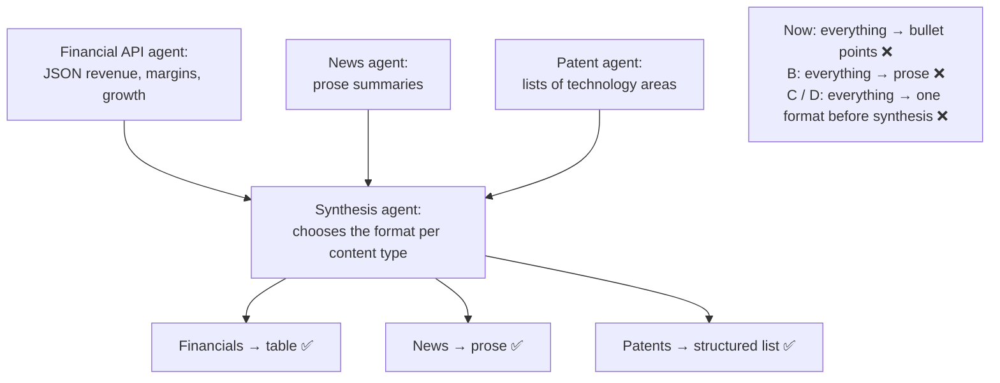

# Q85 — Everything becomes bullet points: synthesis renders each content type in its own format

**Domain / lesson:** D5 › 5.6 Information Provenance & Multi-Source Synthesis (content-appropriate rendering)
**Scenario:** Multi-agent research system (same system as [Q01](../Q01-source-attribution-multi-agent/question.md)–[Q09](../Q09-synthesis-preserve-merge-mappings/question.md), [Q82](../Q82-dates-turn-conflicts-into-trends/question.md)–[Q84](../Q84-parallel-subagents-from-the-coordinator/question.md))
**Follows:** [Q82](../Q82-dates-turn-conflicts-into-trends/question.md) (its check: a trend goes in a table) · [Q09](../Q09-synthesis-preserve-merge-mappings/question.md) (synthesis keeps the claim-source mappings)

## Question

You are building a multi-agent research system using the Claude Agent SDK. A coordinator agent delegates to specialized subagents: one searches the web, one analyzes documents, one synthesizes findings, and one generates reports. The system researches topics and produces comprehensive, cited reports.

A user is expanding the research system beyond its single web search agent by adding specialized data sources. They add a financial API agent that returns structured JSON with revenue, margins, and growth rates; a news monitoring agent that returns prose summaries of recent developments; and a patent analysis agent that returns structured lists of technology areas. The synthesis agent combines these into executive briefings. Currently, it converts everything to bullet points, causing financial comparisons to lose tabular clarity and news summaries to lose narrative flow. What change would most improve briefing quality?

- **A.** Update the synthesis agent to render each content type appropriately – financial data as tables, news as prose
- **B.** Standardize all subagent outputs to prose summaries with inline citations
- **C.** Standardize all subagent outputs to JSON with fields for claim, evidence, source, and confidence
- **D.** Add a format conversion layer between subagents and synthesis that transforms all outputs to a common intermediate representation

## Answer: **A**

## Diagram

## Concept

**The problem is in one place: the synthesis agent's output.** The subagents already return each kind of content in a shape that suits it: numbers as JSON, news as prose, patents as lists. Synthesis flattens all three into bullets. Guide 5.6: *"If you put all content into one format (all tables, all prose or all lists), the content is harder to read and understand. The synthesis agent selects the format from the content type."*

**The guide's three rules map straight onto the three new agents:**

| Content | Format | Guide 5.6 |
|---|---|---|
| Financial API: revenue, margins, growth rates | **Table** | *"Financial data goes in tables. Numbers, comparisons and trends read best in a table. In prose, values are harder to compare and patterns are harder to see."* |
| News monitoring: recent developments | **Prose** | *"News and current events go in prose. Narrative context, cause and effect, and chronological developments read naturally as paragraphs."* |
| Patent analysis: technology areas | **Structured list** | *"Technical findings go in structured lists. Architectural patterns, API specifications and configuration options are clearest as bulleted or numbered lists with clear hierarchy."* |

**What changes in the briefing** (illustrative):

| Company | Revenue 2025 | Gross margin | YoY growth |
|---|---|---|---|
| Acme Energy | $412M | 38% | +12% |
| Volt Systems | $298M | 44% | +21% |

Volt Systems' faster growth follows its March acquisition of a battery-storage start-up, which analysts expect to lift margins further once the integration is complete…

- **Patent activity**
  - Grid-scale storage: 14 filings (Volt 9, Acme 5)
  - Solid-state electrolytes: 6 filings (all Volt)

**How to make the change:** it's the synthesis agent's prompt. Tell it which format each content type gets, and that every claim keeps its source whatever the format (Q09). *(Practical tip, not guide wording: one short example of a finished briefing in the prompt shows the target layout faster than a description.)*

## Why the others are wrong

| Option | Why not |
|---|---|
| **B** Everything to prose with inline citations | **Swaps one single format for another.** Financial comparisons lose their table even more completely: *"In prose, values are harder to compare and patterns are harder to see."* Guide 5.6, in the exam: *"Putting every content type into one format is also wrong."* It also rewrites the subagents' outputs, when the problem is synthesis's rendering. |
| **C** Everything to JSON (claim, evidence, source, confidence) | **Good for provenance, but it doesn't touch the rendering.** Structured claim-source data from subagents is something the guide wants, but that's what synthesis *reads*. What executives *read* is still decided by synthesis, which can go on turning everything into bullets. Squeezing news into claim fields also strips out the narrative the briefing needs. |
| **D** A conversion layer to one common intermediate format | **Flattens the differences before synthesis even sees them.** Once financial tables and news narratives are converted to one representation, synthesis has to work out again what each piece was. It adds a component, and it still leaves the final format to the same synthesis agent. One format for all content is what the guide warns against. |

## Pattern to remember

> **Mixed content in one output → the synthesis agent picks the format per content type: numbers and comparisons as tables, news and narrative as prose, technical findings as structured lists.** Don't standardise everything into one format, before synthesis or after.

**Exam signals:**
- *"Converts everything to bullet points"*, *"loses tabular clarity"*, *"loses narrative flow"* → **content-appropriate rendering** in the synthesis agent.
- *"Standardize all outputs to prose / JSON / one representation"* → one format for every content type (trap).
- Financial / numeric / comparisons → table. News / events / cause and effect → prose. Technical specs / categories → list.

### Where this comes from

**Guide D5 › 5.6 Information Provenance**, *Content-Appropriate Rendering*:
- *"If you put all content into one format (all tables, all prose or all lists), the content is harder to read and understand. The synthesis agent selects the format from the content type."* (**A**)
- *"Financial data goes in tables. Numbers, comparisons and trends read best in a table. In prose, values are harder to compare and patterns are harder to see."* (**A**, **B**)
- *"News and current events go in prose. Narrative context, cause and effect, and chronological developments read naturally as paragraphs."*
- *"Technical findings go in structured lists. Architectural patterns, API specifications and configuration options are clearest as bulleted or numbered lists with clear hierarchy."*
- In the exam: *"Putting every content type into one format is also wrong."* (**B**, **C**, **D**)
- Key concept: *"Match the format to the content."*

## How this connects to earlier questions

| Question | Link |
|---|---|
| [Q82](../Q82-dates-turn-conflicts-into-trends/question.md) | Its check: a trend (18% → 35%) goes in a table with dates and sources. Same rule, one content type |
| [Q09](../Q09-synthesis-preserve-merge-mappings/question.md), [Q01](../Q01-source-attribution-multi-agent/question.md) | Whatever the format, each claim keeps its source: a table cell needs a citation as much as a sentence does |
| [Q80](../Q80-delimit-sources-place-critical-at-edges/question.md) | The input side of the same idea: keep sources separate and labelled; mixing them into one block blurs them |

## Check question

**The briefing now has a revenue table. For one company, the financial API says revenue was $4.2M, but the news agent's summary quotes $3.8M for the same year. What goes in that table cell, and why?**

## Glossary

- **Synthesis agent:** the subagent that combines the other subagents' findings into one output.
- **Content-appropriate rendering:** choosing the output format (table, prose, list) from the kind of content, not using one format for everything.
- **Executive briefing:** a short report for decision-makers; it has to be quick to read and compare.
- **Intermediate representation:** a common format that every output is converted into before the next step.
- **Narrative flow:** the cause-and-effect and time order that prose carries and bullet points break up.

## Related course lessons

*Lecture lengths aren't recorded in the study-map files, so the watch times below are estimates from each course's average lecture length. None of the three courses has a lecture specifically on content-appropriate rendering; the guide's 5.6 section is the main source.*

### Udemy A (primary): Claude Certified Architect (CCAR-F) - 2026 Exam Prep
| # | Lecture | Part | Why |
|---|---|---|---|
| **131** | **Claim-to-Source Mappings — Why Every Sentence Needs a Source** | 5D | ⭐ The 5.6 lesson: sources survive whatever format synthesis picks *(also in Q01, Q02, Q08, Q09, Q80, Q82)* |
| 132 | Conflict Annotation — Surfacing Disagreement in Synthesis | 5D | The rest of the synthesis agent's job *(also in Q01, Q08, Q09, Q82)* |
| Quiz 18 | 5D quiz | | Self-test |

**▶ Watch in this order (~15 min, est.):** #131 → #132, then do **Quiz 18**.

### Udemy B: Claude Certified Architect Foundations: Complete Course (Voroniuk)
| # | Lecture | Section | Why |
|---|---|---|---|
| **70** | **Research Case: Citing Sources** | S7 Multi-Agent | ⭐ An exam-style case in this system: what synthesis outputs *(also in Q01, Q02, Q08, Q09, Q82)* |
| 67 | Keeping Claims Tied to Sources | S7 Multi-Agent | Citations in every format *(also in Q01, Q02, Q08, Q09, Q80, Q82)* |
| Quiz 7 | Multi-Agent quiz | S7 | Self-test |

**▶ Watch in this order (~10 min, est.):** #70 → #67, then do **Quiz 7**.

### CBT Nuggets: CCA-F course
| Skill | Why |
|---|---|
| **39. Build an Agentic Multimedia Article System: Part 1** | ⭐ Combining different kinds of content from several agents into one output *(also in Q01, Q02, Q03, Q05, Q06, Q07, Q09, Q11, Q36, Q39, Q78, Q83, Q84)* |
| 40. Build an Agentic Multimedia Article System: Part 2 | The same system, continued *(also in Q22, Q39, Q41, Q67)* |
