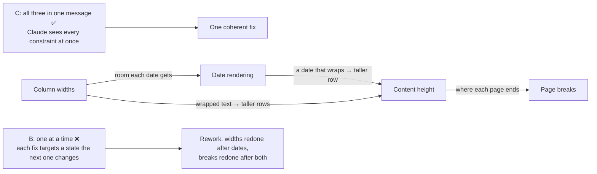

# Q86 — PDF formatting issues that interact: one detailed message, not one fix at a time

**Domain / lesson:** D3 › 3.5 Iterative Refinement (batch vs sequential feedback)
**Also touches:** D3 › 3.5 (concrete examples, for option A)
**Scenario:** Claude Code for a development team (same as [Q52](../Q52-posttooluse-hook-runs-formatter/question.md)–[Q66](../Q66-clear-stack-trace-direct-execution/question.md))
**Follows:** [Q55](../Q55-tests-first-share-failures/question.md) (its check: failures that broke together go in one message) · [Q58](../Q58-at-reference-example-files/question.md) (what concrete examples are for)

## Question

You are using Claude Code to accelerate software development. Your team uses it for code generation, refactoring, debugging, and documentation. You need to integrate it into your development workflow with custom slash commands, CLAUDE.md configurations, and understand when to use plan mode vs direct execution.

You've asked Claude Code to build a PDF report generation feature. The initial implementation queries the database correctly, but the output has formatting issues: table columns are too narrow causing content truncation, dates display without proper formatting, and page break handling is incorrect. You've noticed these issues interact – changing column widths affects how dates render, and page breaks depend on content height.

What's the most effective approach for iterating toward a working solution?

- **A.** Show Claude an example of a correctly formatted report and ask it to match that output, rather than listing the specific technical issues.
- **B.** Address the column width issue first with specific measurements, verify it works, then fix date formatting within the corrected columns, then adjust page breaks – testing after each change.
- **C.** Provide all three issues in a single detailed message with exact specifications for each, allowing Claude to address them together in one update.
- **D.** Start fresh with a detailed prompt specifying all formatting requirements upfront.

## Answer: **C**

## Diagram



## Concept

**The scenario tells you the issues interact:** *"changing column widths affects how dates render, and page breaks depend on content height."* That sentence decides the answer. Guide 3.5: *"How you deliver feedback depends on whether the fixes interact."* And: *"Single message (batch) when fixes interact with each other."* *"The model needs to see all the interacting constraints at once to produce a coherent fix"*.

**How the three depend on each other:**

| Fix | What it changes | What that affects |
|---|---|---|
| Column widths | Room in each cell; narrow cells truncate or wrap | Whether a formatted date fits on one line, and every row's height |
| Date format | The length of each date ("2026-11-02" vs "02 Nov 2026") | The width the date column needs, and the row height if the date wraps |
| Page breaks | Where each page ends | Worked out from content height, which is the result of the first two |

**What B does with these** (illustrative):

| Round | B sends | What happens |
|---|---|---|
| 1 | Column widths, sized for today's unformatted dates | Columns fit. Verified ✅ |
| 2 | Date format, "within the corrected columns" | The new dates need a different width. Either they're squeezed into a column sized for the old ones, or round 1 gets redone |
| 3 | Page breaks | Right for the current row heights, until any width or date tweak moves them again |

Guide 3.5 trap: *"If you send them apart, one fix targets a state that the next fix changes."* Testing after each change is a good habit. Here each test checks a state that the next fix changes.

**B and C are equally specific.** Both have exact measurements. The difference is when Claude sees them: B shows one constraint per round, while C shows all three together, so Claude can size the date column for the final date format and compute page breaks from the final row heights.

**What C's message looks like** (illustrative; the first line follows the guide's own example, *"Three changes needed (they interact with each other):"*):

```text
Three formatting fixes for the PDF report (they interact with each other):
1. Columns: Customer 45 mm, Date 28 mm, Amount 25 mm, Status 22 mm. No truncation:
   long text wraps inside its cell.
2. Dates: show as "02 Nov 2026". The Date column in 1 must fit this format on one line.
3. Page breaks: work them out from the row heights after 1 and 2. Never split a row
   across two pages.
Don't change the database query; it's correct. Generate the report from the 200-row
test set (it has the longest customer names) and show me pages 1 to 3.
```

After the update, check all three together. The guide's build exercise: *"observe whether the fix is coherent across all three"*.

## Why the others are wrong

| Option | Why not |
|---|---|
| **A** Show an example report instead of listing the issues | **Examples are for a different problem.** Guide 3.5: *"Concrete input/output examples are for when the developer knows the exact transformation but the model interprets it inconsistently."* Here nothing is being misread: the three defects are known, specific and measurable. A finished report shows the target but hides the constraints: which widths, which date format, how breaks are worked out. Matching it *"rather than listing the specific technical issues"* throws away the exact specs you already have, so Claude has to guess them from the picture. *(Practical tip, not guide wording: a sample report **alongside** the specs can help. **Instead of** them, it loses information.)* |
| **B** Columns first, verify, then dates, then page breaks | **The exam trap for interacting issues.** Guide 3.5: *"Sending interacting fixes to Claude one message at a time"*. *"Fixes that interact need to be seen together. If you send them apart, one fix targets a state that the next fix changes."* Build exercise: *"Sequential fixing of interdependent issues causes the model to fix one issue in a way that conflicts with the others."* It sounds disciplined (specific measurements, testing after each step), which is why it's tempting. |
| **D** Start fresh with every requirement up front | **Throws away what works.** The database query is already correct, and a new implementation can break it. It's also one big attempt that hopes the first output is final. Guide 3.5: *"Iterative refinement is the practice of guiding Claude Code to the right result over several rounds, because the first output is rarely the final one."* The new output can have its own formatting issues, and then you're back where you started. C gives the same specs but refines the working code. |

## Pattern to remember

> **Issues that interact (fixing one changes another) → one detailed message with exact specs for each, saying how they depend on each other, so Claude sees every constraint at once.** Testing after each step doesn't save a one-at-a-time approach when each fix changes what the next one works on.

**Exam signals:**
- *"These issues interact"*, *"changing X affects Y"*, *"Y depends on Z"* → **batch: one detailed message**.
- *"Fix X first, verify, then Y, then Z"* when the scenario says the issues interact → trap, however disciplined it sounds.
- *"Show an example rather than listing the issues"* → examples fit a known transformation that Claude misreads, not specific known defects.
- *"Start fresh"* / *"start over"* → throws away the parts that work; refinement takes several rounds.
- A mixed set of issues → group them by what each fix changes: same mechanism → one message; touches nothing else → its own message (check question).

### Where this comes from

**Guide D3 › 3.5 Iterative Refinement:**
- *"Iterative refinement is the practice of guiding Claude Code to the right result over several rounds, because the first output is rarely the final one."* (**D**)
- *"Batch feedback sends several fixes in one message."* *"Sequential feedback sends fixes one at a time."*
- *"How you deliver feedback depends on whether the fixes interact."*
- *"Single message (batch) when fixes interact with each other."* *"The model needs to see all the interacting constraints at once to produce a coherent fix"* (**C**). The guide's example message starts *"Three changes needed (they interact with each other):"*.
- In the exam table: *"Multiple issues that affect each other"* → *"Batch feedback (one message)"* (**C**).
- Exam trap: *"Sending interacting fixes to Claude one message at a time"*. *"Fixes that interact need to be seen together. If you send them apart, one fix targets a state that the next fix changes. Put interacting problems in a single detailed message, and fix independent ones sequentially."* (**B**)
- *"Sequential iteration when issues are independent."* *"Batching independent issues can confuse the model about which feedback applies to which part of the code."* (check question)
- Key concept: *"Concrete input/output examples are for when the developer knows the exact transformation but the model interprets it inconsistently."* In the exam table: *"Prose description interpreted differently each time"* → *"Concrete input/output examples"* (**A**).
- Build exercise: *"Practice batching: give Claude three interdependent issues in one message and observe whether the fix is coherent across all three"*. *"Sequential fixing of interdependent issues causes the model to fix one issue in a way that conflicts with the others."* (**B**, **C**)

## How this connects to earlier questions

| Question | Link |
|---|---|
| [Q55](../Q55-tests-first-share-failures/question.md) | Its check: failures that broke together after one fix go in one message. Here the scenario states the interaction up front, so it's the main question |
| [Q58](../Q58-at-reference-example-files/question.md) | The examples technique (option A's idea): right when Claude misreads a known pattern. Here nothing is misread |
| [Q64](../Q64-interview-pattern-unfamiliar-domain/question.md) | The interview pattern is for an unfamiliar domain. Here you know exactly what's wrong, so there's nothing for Claude to ask first |

## Check question

**C's update is in, and the columns, dates and page breaks look right. In a 40-page run you spot three new problems: (1) the column headers don't repeat on pages where a table continues, (2) the totals row sometimes lands alone at the top of a new page, and (3) the PDF is saved as `report.pdf` instead of `sales-report-2026-11.pdf`. How do you send these to Claude, and why?**

*My answer:* "One by one, as these are not related issues." 🟡 **Right for (3): the file name doesn't touch the layout, so it gets its own message. But (1) and (2) are related: they look like different symptoms, but both change the same thing, where each page ends. They go together in one message, and (3) goes separately.**

**Why (1) and (2) interact.** Both fixes move page breaks:
- **(1) Repeating headers** puts a header row at the top of every continuation page. Each of those pages now has less room for data rows, so the breaks move. The break calculation has to reserve the header's height.
- **(2) An orphaned totals row** is fixed by keeping it with the last few data rows. That pulls rows onto the next page, which moves a break too.

**What happens one at a time** (illustrative):

| Round | You send | What happens |
|---|---|---|
| 1 | Totals row only | Breaks adjusted so the totals stay with the last rows. Verified ✅ |
| 2 | Repeating headers only | Every continuation page loses a row's worth of space. All the breaks shift, and the totals row can land alone again, on a different page |
| 3 | Totals again… | Ping-pong: each fix targets a state the other one changes |

That's the guide's trap again: *"If you send them apart, one fix targets a state that the next fix changes."*

**Why (3) goes on its own.** Guide 3.5: *"Sequential iteration when issues are independent."* *"Batching independent issues can confuse the model about which feedback applies to which part of the code."* The file name comes from the save step, not the layout code.

**The test isn't "do they look related?"** It's this: **does fixing one change what the other one works on?** Headers and totals look like different problems (one at the top of a page, one at the end of the table), but both fixes change the page breaks.

**The two messages** (illustrative):

```text
Two page-layout fixes (they interact: both change where pages end):
1. Repeat the column headers at the top of every page where a table continues.
   Reserve the header's height when working out page breaks.
2. Never leave the totals row alone on a page: keep it with at least the last
   2 data rows.
Keep the rule from before: never split a row across two pages. From the 200-row
test set, show me every page where the table continues, and the last page.
```

```text
Save the PDF as sales-report-YYYY-MM.pdf, using the report's month
(e.g. sales-report-2026-11.pdf).
```

*(Practical tip, not guide wording: the two messages can go in either order, since they're independent. Note the first message restates the page-break rule from C's update: it's a constraint the new fixes must keep, like Q55's "what must stay passing".)*

> **Group feedback by mechanism, not by symptom: fixes that change the same thing (here, where pages end) go in one message; a fix that touches nothing else (the file name) goes on its own.**

## Glossary

- **Iterative refinement:** getting to the right result over several rounds of feedback, since the first output is rarely final.
- **Batch feedback:** several fixes in one message.
- **Sequential feedback:** one fix per message, checking the result before the next.
- **Truncation:** text cut off because it doesn't fit its column.
- **Content height:** the total height of the rows; text that wraps makes rows taller.
- **Page break:** where one page ends and the next begins; here it's worked out from content height.
- **Coherent fix:** one change that satisfies all the constraints together, instead of fixes that undo each other.

## Related course lessons

*Lecture lengths aren't recorded in the study-map files, so the watch times below are estimates from each course's average lecture length.*

### Udemy A (primary): Claude Certified Architect (CCAR-F) - 2026 Exam Prep
| # | Lecture | Part | Why |
|---|---|---|---|
| **79** | **Iterating on a Plan — Approve, Edit, Re-Plan** | 3C | ⭐ Iterating with Claude Code over several rounds *(also in Q55, Q64)* |
| 68 | Writing Instructions Claude Follows | 3B | Writing the exact specs a batched message needs *(also in Q55, Q56, Q58, Q64)* |
| Quiz 9, Quiz 10 | 3B and 3C quizzes | | Self-test |

**▶ Watch in this order (~15 min, est.):** #68 → #79, then do **Quiz 9** and **Quiz 10**.
Udemy A only partly covers 3.5. Udemy B #83 is the key lecture for this question.

### Udemy B: Claude Certified Architect Foundations: Complete Course (Voroniuk)
| # | Lecture | Section | Why |
|---|---|---|---|
| **83** | **Interviews and Issue Batching** | S8 Claude Code Setup | ⭐ Issue batching: exactly C vs B *(also in Q55, Q64)* |
| 82 | Refinement: Examples and Tests | S8 Claude Code Setup | When examples are the right technique (A) *(also in Q55, Q58, Q64)* |
| 89 | Claude Code Case: Plan and Iterate | S8 Claude Code Setup | A worked case of iterating *(also in Q53, Q55, Q66)* |
| Quiz 8 | Claude Code Setup quiz | S8 | Self-test |

**▶ Watch in this order (~15 min, est.):** #83 → #82 → #89, then do **Quiz 8**.

### CBT Nuggets: CCA-F course
| Skill | Why |
|---|---|
| 17. Design Clear Prompts with Examples | What examples do well (A), in prompt design (D4) *(also in Q05, Q31, Q37)* |

CBT has no lesson on iterative refinement (3.5). Use the guide lesson and Udemy B #83.
