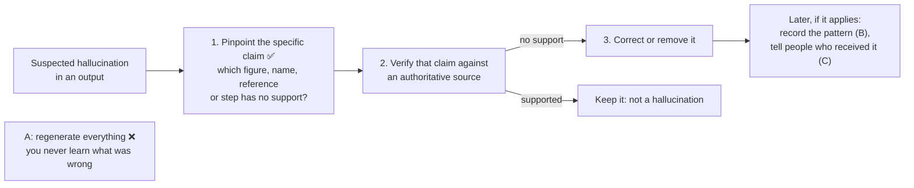

# Q87 — Suspected hallucination: first pinpoint the specific unsupported claim

**Domain / lesson:** Not a CCA-F guide lesson. The guide teaches this in its **CCAO-F** track (Claude Certified Associate – Foundations): D2 Output Evaluation and Validation › 2.2 Identifying Hallucinations, Inconsistencies and Bias, with 2.3 Fact-Checking and Validation.
**Closest CCA-F lessons:** D5 › 5.6 Information Provenance (every claim traceable to a source) · D4 › 4.3 Structured Output (fabricated values pass the schema)
**Scenario:** None (a standalone question)
**Follows:** [Q01](../Q01-source-attribution-multi-agent/question.md), [Q09](../Q09-synthesis-preserve-merge-mappings/question.md) (each claim keeps its source) · [Q85](../Q85-render-each-content-type-appropriately/question.md) (its check: two sourced values that disagree)

## Question

You are evaluating a Claude output that appears to contain hallucinated content. Which response step should be performed first when a hallucination is suspected?

- **A.** Discard the entire output and regenerate the output with a fresh prompt.
- **B.** Document the hallucination pattern in the team's risk register for future reference.
- **C.** Notify the user community that the output contains a hallucinated claim.
- **D.** Pinpoint the specific claim that appears to be unsupported by available evidence.

## Answer: **D**

## Diagram

*(Steps 2 and 3 follow the guide and Anthropic's docs. Placing B and C "later" is my reading of the question, not guide wording.)*

## Concept

**Every other step depends on knowing which claim.** "Appears to contain hallucinated content" is a suspicion about a whole output. Before you can verify, fix, regenerate, record or tell anyone, you need to know *which* statement is the problem, and whether it really has no support.

**What to look for.** CCAO-F 2.2: *"A hallucination is not vague or hesitant. It appears as an exact-looking figure, a named source or a numbered list of steps. An invented detail has the same confidence as a real one, so specificity is not evidence."* So you check the specifics, one by one: *"For any detail, ask "where would this have come from?" Asking "does this sound right?" tests only the confidence."*

**How to pinpoint.** The 2.2 build exercise: *"Hallucination check: underline every specific that did not come from material you supplied. Specifics are figures, names, references and instructions. Mark each one traceable or unverified"*. The reason: *"Hallucinations appear as specific details, so every specific without a source is a possible hallucination until traced."*

Example (illustrative): a summary Claude wrote from an attached sales report.

| Specific in the output | Where would it have come from? | Status |
|---|---|---|
| "Revenue £1.2M in Q3" | Attached sales report, page 3 | Traceable ✅ |
| "Ahead of the 2026 Retail Insights benchmark" | No such document was supplied | **Unverified: a named source** |
| "Export it via Reports › Stock › Export" | Claude was never shown the till system | **Unverified: highest risk** |

**Where to look first.** CCAO-F 2.2: the risk *"is highest where Claude has least to work from"*: *"your organisation's private, internal systems and documents Claude was never given"*, *"very recent events that happened after its training data was collected"*, and *"precise figures that were not in the source material"*.

**Then verify only the unverified rows.** *"Verify a hallucination against an authoritative source."* (2.2) The source has to be independent: *"The standard is the primary document. A second AI summary, a forum post, or Claude's own earlier output is not independent validation."* (2.3) For the till steps, that's the till system's documentation. If a claim has no support, correct or remove it. Anthropic's docs take the same approach claim by claim: *"If it can’t find a quote, it must retract the claim."*

**In CCA-F terms:** this is why 5.6 wants claim-source mappings. When every claim carries its source, pinpointing is a lookup, and a claim without a source is the first suspect.

## Why the others are wrong

| Option | Why not |
|---|---|
| **A** Discard everything and regenerate | **You never find out what was wrong.** The new output can repeat the same invented detail, or add new ones, with the same confidence, and you can't tell. It also throws away the parts that were correct. Re-running is a way to *find* suspects, not a fix. CCAO-F 2.2: *"Anthropic documents two checks. The first is a re-run that you compare against the first output."* *"Each check gives you a list of items to check against the source."* |
| **B** Record the pattern in the risk register | **Too early.** It's only *suspected*: you don't yet know whether anything is wrong, or what the pattern is. In the guide's CCAR-P track, a risk register row starts with the *"Mechanism. What goes wrong, in the language of the system"*. You can't write that before you've found and confirmed the claim. It's a useful later step if the problem recurs. |
| **C** Notify the user community | **Too early, and it says nothing useful yet.** You'd be announcing something unconfirmed, without being able to say *which* claim is wrong, so nobody can correct anything. If a confirmed hallucination has already reached people, telling them which claim was wrong comes after verification. *(My reasoning, not guide wording.)* |

## Pattern to remember

> **Suspected hallucination → first pinpoint the specific claim (a figure, name, reference or step) that has no support, then verify that claim against an authoritative source.** Regenerating, recording and notifying all depend on knowing which claim it is.

**Exam signals:**
- *"First"* + *"suspected"* → the step that finds the problem: locate the claim before taking any action.
- *"Regenerate"* / *"start over"* → you never learn what was wrong, and the new output can repeat it.
- *"Notify"*, *"document in the risk register"* → follow-up steps that need a confirmed, specific finding.
- *"Ask Claude to confirm its claims"* → not verification: no independent information enters the check.
- Confident, specific detail about something Claude was never shown → the highest-risk claim; check it first.
- The output **contradicts itself** (prose vs table, two dates for one event) → an **inconsistency**: re-verify the **whole** output; ✗ fix the one contradiction and send the rest (check question).

### Where this comes from

**Guide CCAO-F › D2 › 2.2 Identifying Hallucinations, Inconsistencies and Bias:**
- *"A hallucination is content that sounds convincing but is not grounded in fact."*
- *"A hallucination is not vague or hesitant. It appears as an exact-looking figure, a named source or a numbered list of steps. An invented detail has the same confidence as a real one, so specificity is not evidence."*
- *"For any detail, ask "where would this have come from?" Asking "does this sound right?" tests only the confidence."*
- *"Verify a hallucination against an authoritative source."*
- Build exercise: *"Hallucination check: underline every specific that did not come from material you supplied. Specifics are figures, names, references and instructions. Mark each one traceable or unverified"* (**D**)
- *"Anthropic documents two checks. The first is a re-run that you compare against the first output."* *"Each check gives you a list of items to check against the source."* (**A**)
- Inconsistency (check question): *"An inconsistency is an output that disagrees with itself."* *"An internal contradiction is a warning about the reliability of the whole output. It is not a single typo to fix. The process that produced one visible failure was just as able to produce invisible ones. So re-verify the whole output against its source, rather than fixing the one mismatch you noticed and sending the rest."*
- Exam trap (check question): *"Fixing the one contradiction you spotted and sending the rest"*. *"An internal inconsistency is evidence the output's process failed somewhere, so the whole output needs re-verification against its source. Fixing the one visible contradiction keeps a document that has already shown you it cannot be trusted line by line."*
- Build exercise (check question): *"Inconsistency check: compare every figure, date and conclusion that appears more than once, and where two appearances disagree, flag the whole output for re-verification"*. *"The tested judgement is that a contradiction discredits the process, not just the sentence it appears in."*

**Guide CCAO-F › D2 › 2.3 Fact-Checking and Validation:**
- *"Validation means checking an output's claims against something that can confirm them."*
- *"A traceable output shows where each claim came from, so it is checkable. Do not assume that an output is correct when you cannot trace its claims."*
- Exam trap: *"Asking Claude to confirm or re-check its claims and calling that verification"*. *"No independent information enters the check, and the same errors stay unnoticed."*

**Guide CCAR-P › D5 › 5.2:** *"A risk register has one row for each way a system can fail."* (**B**)

**Anthropic docs, *Reduce hallucinations*:**
- *"Verify with citations: Make Claude’s response auditable by having it cite quotes and sources for each of its claims. You can also have Claude verify each claim by finding a supporting quote after it generates a response. If it can’t find a quote, it must retract the claim."*
- *"Remember, although these techniques significantly reduce hallucinations, they don’t eliminate them entirely. Always validate critical information, especially for high-stakes decisions."*

**Closest CCA-F guide text:**
- 5.6: *"The prompt of the synthesis agent must explicitly require every claim in its output to be traceable to a specific source."*
- 4.3: *"tool_use with JSON schemas eliminates syntax errors but does not prevent semantic errors, where valid JSON holds wrong content."* One of those errors: *"Fabrication: the model invents values for required fields when the source document lacks the information"*.

## How this connects to earlier questions

| Question | Link |
|---|---|
| [Q01](../Q01-source-attribution-multi-agent/question.md), [Q09](../Q09-synthesis-preserve-merge-mappings/question.md) | Claim-source mapping: when every claim carries its source, pinpointing is a lookup. See also [claim-source mapping](../../concepts/claim-source-mapping.md) |
| [Q85](../Q85-render-each-content-type-appropriately/question.md) | Its check: two values for one figure, **both with sources**. That's a conflict between sources: annotate both. A hallucination is a claim with **no** source behind it |

## Check question

**While pinpointing claims in a sales summary, you notice its prose says revenue rose 14%, but the summary's own table shows 9% for the same period. Do you handle this the same way: pinpoint that one figure, verify it, fix it? Why or why not?**

*My answer:* "I'd ask "where would this have come from?"" ❌ **Not the same way. "Where would this have come from?" is the hallucination test, for a specific with nothing behind it. This is a different failure type, an inconsistency: the output disagrees with itself. The response is to re-verify the whole output against its source, not just the one figure.**

**A different failure type.** CCAO-F 2.2: *"An inconsistency is an output that disagrees with itself."* *"You need no external source to detect an inconsistency. One common form is a number in the prose that contradicts the table."* Here, 14% and 9% may both look traceable: both seem to come from the sales data. The problem is that they can't both be right.

**Why one figure isn't enough:** *"An internal contradiction is a warning about the reliability of the whole output. It is not a single typo to fix. The process that produced one visible failure was just as able to produce invisible ones. So re-verify the whole output against its source, rather than fixing the one mismatch you noticed and sending the rest."* For example (illustrative), if Claude compared against the wrong period to get 14%, the same mistake can sit in figures that appear only once, where nothing contradicts them and you can't see it.

**Your question still helps, but it's not enough.** Tracing 14% and 9% back to the sales report tells you which one is right, or that neither is. It doesn't tell you whether the rest of the summary is right. The guide's own example: *"If the spring sales prose and table give different compost figures, the manager checks the whole summary against the till data."*

**Each failure type has its own response** (CCAO-F 2.2):

| Failure type | How you spot it | Response |
|---|---|---|
| **Hallucination** | A specific with nothing behind it: *"where would this have come from?"* | *"Verify a hallucination against an authoritative source."* That claim |
| **Inconsistency** | The output contradicts itself: prose vs table, two dates for one event | *"When you find an inconsistency, re-verify the whole output."* |
| **Bias** | A pattern across descriptions of people | *"Rework bias as a pattern across the document."* |

The exam tests exactly this: *"For inconsistency, the tested point is the response: re-verify the whole output. Wrong options match a failure type with an incorrect response. They fix one contradiction, delete one biased word, or ask Claude to confirm its own invented steps."*

**Can you ask Claude which figure is right?** As a first pass, yes. CCAO-F 2.3: *"Self-check is a legitimate first check for slips and contradictions, but claims that matter go to an independent source."* Claude's answer gives you a list to check. The sales report settles it.

> **Hallucination → verify that claim. Inconsistency → re-verify the whole output: one visible contradiction shows the process failed, and it may have failed in places you can't see.**

## Glossary

- **Hallucination:** content that sounds convincing but isn't grounded in fact, often an exact-looking figure, a named source or a list of steps.
- **Grounding:** the material Claude had to work from. The less grounding, the higher the risk.
- **Traceable claim:** a claim you can follow back to the material it came from.
- **Authoritative / primary source:** the original record (official publication, the organisation's own records, the system's documentation), not another summary.
- **Risk register:** a list with one row for each way a system can fail, and the control that owns each risk.
- **CCAO-F:** Claude Certified Associate – Foundations, a separate exam whose Domain 2 covers evaluating outputs.

## Related course lessons

*Lecture lengths aren't recorded in the study-map files, so the watch times below are estimates from each course's average lecture length. No course has a lesson on what to do first when a hallucination is suspected; it's a CCAO-F topic. The lessons below cover the CCA-F side: catching wrong values and keeping claims tied to sources.*

### Udemy A (primary): Claude Certified Architect (CCAR-F) - 2026 Exam Prep
| # | Lecture | Part | Why |
|---|---|---|---|
| **101** | **Validation Loops and Hallucination Prevention** | 4C | ⭐ Catching invented values by checking against the source |
| 131 | Claim-to-Source Mappings — Why Every Sentence Needs a Source | 5D | Traceable claims make pinpointing a lookup *(also in Q01, Q02, Q08, Q09, Q80, Q82, Q85)* |
| Quiz 14, Quiz 18 | 4C and 5D quizzes | | Self-test |

**▶ Watch in this order (~15 min, est.):** #101 → #131, then do **Quiz 14** and **Quiz 18**.

### Udemy B: Claude Certified Architect Foundations: Complete Course (Voroniuk)
| # | Lecture | Section | Why |
|---|---|---|---|
| **67** | **Keeping Claims Tied to Sources** | S7 Multi-Agent | ⭐ Every claim with its source, so an unsupported one stands out *(also in Q01, Q02, Q08, Q09, Q80, Q82, Q85)* |
| 31 | Fields That Expose Errors | S4 Structured Output | Output fields that make wrong values visible *(also in Q35)* |
| Quiz 4, Quiz 7 | Structured Output and Multi-Agent quizzes | S4, S7 | Self-test |

**▶ Watch in this order (~10 min, est.):** #67 → #31, then do **Quiz 7** and **Quiz 4**.

### CBT Nuggets: CCA-F course
| Skill | Why |
|---|---|
| 15. Evaluate Prompts with Test Datasets | Checking outputs against known correct answers instead of trusting how they read *(also in Q55)* |

CBT has no lesson on spotting or handling hallucinations. Use the guide's CCAO-F 2.2 and 2.3 lessons.
