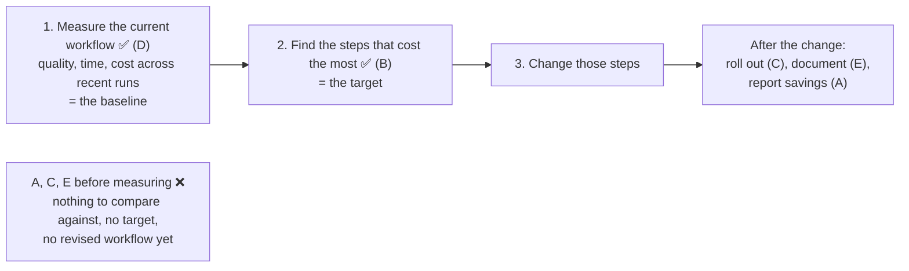

# Q88 — Before changing a recurring workflow: measure it, then find the steps that cost the most

**Domain / lesson:** Not a CCA-F guide lesson. The guide teaches this in its **CCAO-F** track (Claude Certified Associate – Foundations): D7 Troubleshooting and Optimisation › 7.3 Optimising Workflows for Efficiency and Effectiveness, with D4 › 4.2 (the optimisation loop). The CCAR-P track has the same rule for systems: D4 › 4.5 *"Rule One: Measure First"*.
**Closest CCA-F idea:** the build exercises in D4 › 4.1, 4.2 and 4.6 start by establishing a baseline before changing a prompt.
**Scenario:** None (a standalone question)
**Follows:** [Q87](../Q87-suspected-hallucination-pinpoint-the-claim/question.md) (also CCAO-F: find the specific problem before acting) · [Q84](../Q84-parallel-subagents-from-the-coordinator/question.md) (the fix targeted the step that took the time)

## Question

You are optimizing a recurring Claude workflow and must complete the diagnostic steps before changing the workflow. Which two diagnostic steps must be completed BEFORE changing the recurring workflow? (Choose two.)
Each correct answer presents part of the solution.

- **A.** Notify executive leadership of the projected savings from the optimization.
- **B.** Identify the steps that contribute most to time, cost, or quality issues.
- **C.** Deploy the updated workflow across the team and monitor for adoption issues.
- **D.** Measure the current workflow's quality, time, and cost across recent runs.
- **E.** Document the revised workflow steps and update the team's standard operating procedures.

## Answer: **D** and **B**

## Diagram

## Concept

**Diagnosis has two parts: how the workflow is doing now, and where the problem sits.** The question says *"diagnostic steps"* and *"BEFORE changing"*, and only D and B change nothing.

**1. Measure the current workflow (D): the baseline.** CCAO-F 7.3: *"Optimising differs from fiddling because it starts from a measured number."* Without it, the exam trap: *"Without a measurement there is no baseline, no way to know whether the change helped, and no honest claim to have saved anything. Time the work first; measure before you reorganise."* *(Practical tip, not guide wording: "across recent runs" matters because one run can be unusual. Several runs give you a typical number.)*

**2. Find the steps that cost the most (B): the target.** CCAO-F 4.2: *"Process optimisation finds and fixes the step that slows a process."* Its loop ends with *"Collect that evidence."* *"Change the step that the evidence identifies."* The reason: *"The most expensive mistake is optimising a step that was never the constraint."* CCAR-P 4.5 says the same for systems: *"If most spend is input tokens on one stage, tuning output tokens elsewhere is no improvement. Optimising the most visible line instead is an easy mistake to miss."*

**Example** (illustrative): a weekly supplier report, measured over the last 10 runs.

| Step | Time per run | Share of usage | Quality issues (10 runs) |
|---|---|---|---|
| 1. Re-explain the context, attach the price list | 12 min | 10% | 0 |
| 2. Claude drafts the report | 4 min | 60% | 1 |
| 3. Fix the totals in the tables by hand | 18 min | — | 7 (wrong totals) |
| 4. Final read-through | 5 min | — | 0 |

B reads this table. The biggest time cost is step 3, and it exists because of the wrong totals in step 2's drafts. Step 1 is repeated overhead: CCAO-F 7.3 says it belongs somewhere it *"only has to exist once"*, such as a Project. A team going on feeling might have started with step 4, the step everyone *sees*, and that costs 5 minutes.

**The order matters: measure first, then locate.** The per-step numbers come from the measurement. B without D is a guess about which step is slow. In the guide's words, that's treating *"the most plausible hypothesis as the confirmed one"* (CCAO-F 4.2).

## Why the others are wrong

| Option | Why not |
|---|---|
| **A** Tell leadership the projected savings | **A claim before any measurement.** There's nothing to project from yet. CCAO-F 7.3: *"Improve what you have observed, and claim no saving that you did not measure."* It's also communication, not diagnosis. |
| **C** Deploy the updated workflow and monitor adoption | **This is the change itself, not a step before it.** There's no updated workflow until you know what to change. And when that time comes, CCAO-F 4.4 warns: *"An all-at-once rollout measures nothing. It leaves nothing to compare against, and it risks everything at once."* |
| **E** Document the revised steps and update the SOP | **There are no revised steps yet.** Documenting comes last, once a change has been made and has proven itself. *(My reasoning, not guide wording.)* |

## Pattern to remember

> **Before changing a recurring workflow: measure it across recent runs (the baseline), then find the steps that cause most of the time, cost or quality problems (the target). Change those steps.** Announcing, rolling out and documenting come after.

**Exam signals:**
- *"Diagnostic"*, *"before changing"* → measure + locate. Nothing that presumes a new workflow exists.
- *"Projected savings"*, *"notify leadership"* → a claim, not a diagnosis, and it hasn't been measured.
- *"Deploy"*, *"roll out"*, *"document the revised steps"* → after the change.
- *"Feels slow"* / *"feels clunky"* → time it first.
- Claude's suggested bottleneck → a hypothesis: get the evidence before changing the step.

### Where this comes from

**Guide CCAO-F › D7 › 7.3 Optimising Workflows for Efficiency and Effectiveness:**
- *"Optimising differs from fiddling because it starts from a measured number."* (**D**)
- *"Improve what you have observed, and claim no saving that you did not measure."* (**A**)
- *"The exam tests whether you notice, from a symptom or a measurement, where an optimisation belongs."* (**B**)
- *"In 7.3 questions, look for the measurement."* *"Wrong options optimise something untimed, such as an unmeasured reorganisation, or they optimise everything indiscriminately."*
- Exam trap: *"Sweeping workflow changes proposed on the basis of a feeling"*. *"Without a measurement there is no baseline, no way to know whether the change helped, and no honest claim to have saved anything. Time the work first; measure before you reorganise."* (**D**)

**Guide CCAO-F › D4 › 4.2 Using Claude for Research, Planning and Process Optimisation:**
- *"Process optimisation finds and fixes the step that slows a process."* (**B**)
- The loop: *"Describe the process and its constraints."* *"Ask for candidate bottlenecks, and for the evidence that would confirm each one."* *"Collect that evidence."* *"Change the step that the evidence identifies."*
- *"Evidence comes before anything changes, so the change has a target."*
- *"The most expensive mistake is optimising a step that was never the constraint."*
- *"In this objective's questions, the right answer checks the evidence before changing anything: last season's timings, the usage records, the complaint log."*

**Guide CCAO-F › D4 › 4.4:** *"An all-at-once rollout measures nothing. It leaves nothing to compare against, and it risks everything at once."* (**C**)

**Guide CCAR-P › D4 › 4.5, *Rule One: Measure First*:** *"Traces and usage data identify the dominant term by stage, token type and call pattern."* *"Optimising the most visible line instead is an easy mistake to miss."* (**B**, **D**)

**Closest CCA-F guide text** (4.1 build exercise): *"Establishing a baseline with vague instructions demonstrates the false positive problem the exam tests."*

## How this connects to earlier questions

| Question | Link |
|---|---|
| [Q87](../Q87-suspected-hallucination-pinpoint-the-claim/question.md) | The same habit from the same track: find the specific problem (the claim, the step) before acting on the whole thing |
| [Q84](../Q84-parallel-subagents-from-the-coordinator/question.md) | 3+ minutes came from one step, sequential document analysis, so that's the step the fix changed |
| [Q55](../Q55-tests-first-share-failures/question.md) | Tests first: a measurable bar before the change, so each round shows whether it helped |

## Check question

**You've done D and B: across 20 recent runs, step 3 takes 70% of each run's time. You switch step 3 to a faster, cheaper model, and runs now take half as long. Can you tell leadership you've halved the time? What's missing first?**

## Glossary

- **Recurring workflow:** a task done the same way again and again, such as a weekly report.
- **Baseline:** the measured numbers before a change, to compare the after against.
- **Bottleneck / constraint:** the step that limits the whole workflow; speeding up any other step doesn't help much.
- **Overhead:** anything you type, explain or attach at the start of every similar conversation.
- **Dominant term:** the biggest part of the bill or the wait (CCAR-P wording).
- **SOP (standard operating procedure):** the team's written description of how a workflow is done.

## Related course lessons

*Lecture lengths aren't recorded in the study-map files, so the watch times below are estimates from each course's average lecture length. No CCA-F course has a lesson on optimising a recurring workflow; it's a CCAO-F topic. The lessons below cover the same habit in CCA-F terms: measure on a fixed set of cases, change one thing, measure again.*

### Udemy A (primary): Claude Certified Architect (CCAR-F) - 2026 Exam Prep
| # | Lecture | Part | Why |
|---|---|---|---|
| **104** | **Building a Prompt Evaluation Workflow** | 4C | ⭐ Measure before and after a change, on the same cases |
| 23 | Multi-Agent Cost and Fit | 1D | Where the cost of a workflow comes from *(also in Q39, Q83)* |
| Quiz 14, Quiz 4 | 4C and 1D quizzes | | Self-test |

**▶ Watch in this order (~15 min, est.):** #104 → #23, then do **Quiz 14** and **Quiz 4**.

### Udemy B: Claude Certified Architect Foundations: Complete Course (Voroniuk)
| # | Lecture | Section | Why |
|---|---|---|---|
| **17** | **Practice: Evaluate a Prompt Change on a Test Set** | S3 Prompt Engineering | ⭐ A baseline on a test set, then the change, then the comparison |
| Quiz 3 | Prompt Engineering quiz | S3 | Self-test |

**▶ Watch in this order (~5 min, est.):** #17, then do **Quiz 3**.

### CBT Nuggets: CCA-F course
| Skill | Why |
|---|---|
| 15. Evaluate Prompts with Test Datasets | Measuring outputs on fixed cases instead of judging by feel *(also in Q55, Q87)* |

None of the three courses covers workflow optimisation directly. Use the guide's CCAO-F 7.3 and 4.2 lessons.
