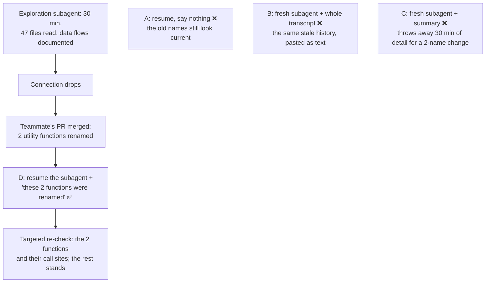

# Q91

**Scenario:** Developer productivity tools (like [Q72](../Q72-resume-and-name-changed-files/question.md); this question has no scenario preamble)

## Question

An engineer's exploration subagent spent 30 minutes analyzing a legacy payment system, reading 47 files and documenting data flows. The session was interrupted when the engineer's connection dropped. While away, a teammate merged a PR that renamed two utility functions. The engineer wants to continue the same exploration.

What's the most effective approach?

- **A.** Resume the subagent from its previous transcript without mentioning the changes – the architecture understanding remains valid.
- **B.** Launch a fresh subagent and include the prior transcript in the initial prompt for context.
- **C.** Launch a fresh subagent with a summary of prior findings.
- **D.** Resume the subagent from its previous transcript and inform it about the renamed functions.

<details>
<summary><b>Show answer and explanation</b></summary>

**Topic:** Interrupted exploration subagent, two functions renamed: resume it and tell it about the renames
**Domain / lesson:** D1 › 1.7 Session State and Resumption
**Also touches:** D1 › 1.3 Subagent Invocation (resuming a subagent in the Agent SDK)
**Follows:** [Q72](../Q72-resume-and-name-changed-files/question.md) (3 of 12 files changed → resume and name them) · [Q45](../Q45-fresh-session-structured-summary/question.md) (stale tool results → fresh session + summary) · [Q77](../Q77-fork-session-compare-two-approaches/question.md) (fork is for alternatives; continuing = resume)

## Answer: **D**

## Diagram



## Concept

**Almost all of the 30 minutes is still valid.** Renaming two utility functions doesn't change the architecture, the data flows or what the 47 files do. Only two names are out of date, along with the places in the history that mention them. Guide 1.7: *"If most of the context is still valid, resume and tell the agent which files changed."* Resume *"restores the entire conversation history, including every tool result, analysis and line of reasoning. Use it when the prior context is mostly still valid."*

**Why you still have to tell it.** The history still holds the old tool results, for example "`formatCents()` is called from 9 places" (illustrative). If it isn't told, the subagent keeps reasoning from those results, which is the guide's symptom: *"The agent recommends changes that were already made, or refers to code that no longer exists."* Telling it costs one message and keeps the re-check small: *"Targeted re-analysis means telling the agent which files changed and letting it re-analyse only those."*

**What the message says** (illustrative):

```text
Continue the payment-system exploration from where you stopped.
While you were paused, PR #482 was merged. It renamed two utility functions
and changed nothing else:
- utils/money.ts: formatCents() → formatMinorUnits()
- utils/ids.ts: newTxnId() → generateTransactionId()
Re-read those two files and grep for the new names to confirm the call sites.
Update any data-flow notes that use the old names, then carry on.
```

*(Practical tip, not guide wording: take the list from the PR or `git diff`, not from memory, so "changed nothing else" is a fact.)*

**Resuming a subagent** (current Agent SDK docs): *"You can resume a subagent to continue where it left off rather than starting fresh. A resumed subagent retains its full conversation history, including all previous tool calls, results, and reasoning."* To do it, you need two IDs from the first run: the session ID and the `agentId` from the Agent tool result. Then you resume that session with the agent ID in the prompt. The exam only needs the idea: resume continues the same history.

| | A | B | C | **D** |
|---|---|---|---|---|
| Keeps the 30 minutes of detail | ✅ | ✅ (as pasted text) | ❌ (compressed) | ✅ |
| Knows about the renames | ❌ | ❌ | ❌ | ✅ |
| No stale results left uncorrected | ❌ | ❌ | ✅ | ✅ (flagged and re-checked) |
| Cost | Low | Very high (47 files' worth in one prompt) | Medium, plus re-reading | Low |

## Why the others are wrong

| Option | Why not |
|---|---|
| **A** Resume without mentioning the changes | **Half right.** It's true that *"the architecture understanding remains valid"*, which is why resuming is right. But the history still treats the old names as current, so the subagent can describe calls to functions that no longer exist under those names, or grep for them and find nothing. That's the stale context problem in small form: *"the agent reasons from tool results that no longer reflect the current files."* |
| **B** Fresh subagent with the whole prior transcript in its prompt | **It keeps every stale result and throws away the point of a fresh start.** A fresh start is useful because *"The new session has no stale tool results. It has only the curated summary that you provide."* A pasted transcript isn't a curated summary: it brings back every old tool result, the old names included, and still doesn't mention the renames. It also packs 47 files' worth of output into one prompt, when resume would restore the same history directly. |
| **C** Fresh subagent with a summary of prior findings | **The right tool for a different situation.** Guide 1.7: *"Use a fresh start when tool results from the prior session are stale because files have changed, APIs have been updated or dependencies have changed."* Here two names changed and the rest is valid, so a summary throws away detail (exact call chains, edge cases) that may have to be re-read. *"If the prior context is still valid and you want the full conversation history, resume is more efficient."* As written, C doesn't mention the renames either. |

## Pattern to remember

> **Interrupted work + a small, known change → resume, and say exactly what changed (old name → new name, which files), so it re-checks only that.** The history is mostly valid, so keep it. The change is known, so name it.

**Exam signals:**
- *"Mostly valid"*, or a few known changes (renamed functions, a few files) → **resume + inform**.
- *"Without mentioning the changes"* → the stale names stay in the history (trap).
- *"Include the prior transcript in the prompt"* → every stale result carried over, nothing flagged, at high cost.
- *"Fresh + summary"* when the change is small → throws away valid detail. That tool is for stale context.
- *"Fork"* → for comparing alternatives, not for continuing one line of work (Q77).

### Where this comes from

**Guide D1 › 1.7 Session State and Resumption:**
- Resume: *"It restores the entire conversation history, including every tool result, analysis and line of reasoning. Use it when the prior context is mostly still valid."*
- *"If most of the context is still valid, resume and tell the agent which files changed. Otherwise the stale context problem occurs: the agent reasons from tool results that no longer reflect the current files."* (**D**, **A**)
- The symptom: *"The agent recommends changes that were already made, or refers to code that no longer exists."* (**A**)
- Fresh start: *"The new session has no stale tool results. It has only the curated summary that you provide."* (**B**) *"Use a fresh start when tool results from the prior session are stale because files have changed, APIs have been updated or dependencies have changed."* *"If the prior context is still valid and you want the full conversation history, resume is more efficient."* (**C**)
- *"Three session management options serve three distinct purposes: resume for continuation, fork for divergent exploration, and fresh start with summary injection for when prior tool results are stale."*
- *"Re-reading 50 files because 3 of them changed is wasted time. Targeted re-analysis means telling the agent which files changed and letting it re-analyse only those."*
- In the exam: *"Resume the session when prior context is mostly valid. Start fresh with an injected summary when prior tool results are stale."*
- Build exercise (check question): *"A good summary captures conclusions without raw tool output."*
- Fresh start, the other reason (check question): *"Use a fresh start too when context has degraded over a long session. In that case, too many irrelevant tool results clutter the history."*

**Agent SDK docs, *Subagents in the SDK* › Resume subagents:** *"You can resume a subagent to continue where it left off rather than starting fresh. A resumed subagent retains its full conversation history, including all previous tool calls, results, and reasoning."* And (check question): *"The built-in Explore and Plan agents are one-shot and don’t return an agentId, so use a custom agent or general-purpose when you need to resume."*

## How this connects to earlier questions

| Question | Link |
|---|---|
| [Q72](../Q72-resume-and-name-changed-files/question.md) | The same rule: 3 of 12 files changed → resume and name them. Here the change is smaller (two renames), and the session is a subagent's |
| [Q45](../Q45-fresh-session-structured-summary/question.md) | The other side: when the tool results are stale, a fresh session with a structured summary (option C's technique) is right |
| [Q77](../Q77-fork-session-compare-two-approaches/question.md) | Fork is for comparing alternatives. Its check: continuing one line of work = resume, without fork |
| [Q79](../Q79-scratchpad-file-for-long-sessions/question.md) | Findings written to a file as they're found survive an interruption, and give the fresh subagent its summary (check question) |

## Check question

**Your tool ran this exploration with Claude Code's built-in Explore subagent, and it turns out that subagent can't be resumed. D is off the table. What do you do instead, and what goes into the new subagent's prompt?**

*My answer:* "Launch a fresh subagent and include the prior transcript in the initial prompt for context, and inform it about the renamed functions." 🟡 **Fresh subagent: right. Telling it about the renames: right. The transcript is the weak part. Give it a structured summary of the findings instead, written with the new names, plus the renames to re-check.**

**Why not the transcript, even with the rename note.** The transcript holds every raw tool result from 47 files, including each place the old names appear. A note saying "formatCents() is now formatMinorUnits()" is one message against all of those, so both versions sit in the context and the model can pick either. That's Q72's check again: a correction adds to the context and removes nothing. A fresh start is only worth it because *"The new session has no stale tool results. It has only the curated summary that you provide."* It's also the long, cluttered context the guide gives as the other reason for a fresh start: *"too many irrelevant tool results clutter the history."*

**A summary can be fixed, a transcript can't.** You write the summary, so you write it with the new names, and nothing stale goes in. Guide 1.7: *"A good summary captures conclusions without raw tool output."*

**What goes into the new subagent's prompt** (illustrative):

```markdown
# Payment-system exploration: carried over from an interrupted run
Codebase state: after PR #482 (two utility functions renamed, nothing else changed)

## Findings so far (47 files read)
- Charge flow: CheckoutController → PaymentService.charge() → GatewayClient.post() → LedgerWriter.record()
- Amounts are formatted by utils/money.ts formatMinorUnits() at 9 call sites (list)
- Transaction IDs come from utils/ids.ts generateTransactionId()
- Not traced yet: the refund flow

## Re-check (renamed in PR #482)
- formatCents() → formatMinorUnits(), newTxnId() → generateTransactionId():
  grep for the new names to confirm the call sites

## Continue from
The refund flow: RefundService and its callers
```

**Where the summary comes from.** The run was interrupted, so the subagent never returned its report. If it wrote its findings to a file as it went (Q79), start from that. If not, extract the conclusions from the old transcript (the flows, call sites and open questions) and leave the raw file contents out.

**Why D was off the table, and how to avoid it next time** (current Agent SDK docs): *"The built-in Explore and Plan agents are one-shot and don’t return an agentId, so use a custom agent or general-purpose when you need to resume."* For long explorations that might be interrupted, use a custom agent, and store the session ID and `agentId` from the first run.

> **Can't resume → fresh subagent + a structured summary written with the current names (conclusions, not raw tool output) + the changes listed for a targeted re-check. Pasting the old transcript brings the stale results back, so a correction note has to compete with them.**

## Glossary

- **Session:** one conversation with an agent that you can return to; its history holds the reasoning and every tool result.
- **Resume:** continue a session with its full history restored.
- **Stale tool result:** a tool result that describes a file as it was before it changed.
- **Targeted re-analysis:** re-checking only what changed, instead of re-reading everything.
- **Summary injection:** starting a fresh session with a curated summary of the earlier findings.
- **Transcript:** the full record of a session: messages, tool calls and tool results.
- **`agentId`:** the ID the Agent SDK returns for a subagent run; you need it to resume that subagent.

## Related course lessons

*Lecture lengths aren't recorded in the study-map files, so the watch times below are estimates from each course's average lecture length.*

### Udemy A (primary): Claude Certified Architect (CCAR-F) - 2026 Exam Prep
| # | Lecture | Part | Why |
|---|---|---|---|
| **22** | **Session Continuity Across Turns and Failures** | 1C | ⭐ Continuing after an interruption: resume vs start fresh *(also in Q03, Q45, Q46, Q72, Q77)* |
| 81 | The Claude Agent SDK — Session Control | 3D | Resuming a stored session in the SDK *(also in Q03, Q45, Q72, Q77)* |
| Quiz 3, Quiz 11 | 1C and 3D quizzes | | Self-test |

**▶ Watch in this order (~15 min, est.):** #22 → #81, then do **Quiz 3** and **Quiz 11**.

### Udemy B: Claude Certified Architect Foundations: Complete Course (Voroniuk)
| # | Lecture | Section | Why |
|---|---|---|---|
| **84** | **Sessions: Resume or Start Fresh** | S8 Claude Code Setup | ⭐ This exact decision *(also in Q03, Q45, Q72, Q77)* |
| 85 | Forking a Session | S8 Claude Code Setup | The third option, and why it doesn't apply here *(also in Q03, Q45, Q72, Q77)* |
| Quiz 8 | Claude Code Setup quiz | S8 | Self-test |

**▶ Watch in this order (~10 min, est.):** #84 → #85, then do **Quiz 8**.

### CBT Nuggets: CCA-F course

*CBT doesn't cover 1.7 (see the study map). Use the guide and the Udemy lectures for session resumption.*

</details>
