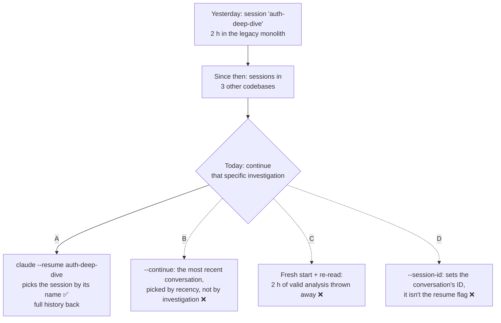

# Q92 — Continue yesterday's investigation after three other codebases: resume the session by its name

**Domain / lesson:** D1 › 1.7 Session State and Resumption
**Also touches:** the Claude Code CLI reference (the session flags the guide's 1.7 current-state note points to)
**Scenario:** Developer productivity tools built with the Claude Agent SDK (same as [Q68](../Q68-trace-from-base-class-incremental-reading/question.md), [Q69](../Q69-grep-distinctive-error-text/question.md), [Q71](../Q71-degraded-context-summary-into-subagent/question.md), [Q72](../Q72-resume-and-name-changed-files/question.md))
**Follows:** [Q72](../Q72-resume-and-name-changed-files/question.md) (prior context still valid → resume) · [Q77](../Q77-fork-session-compare-two-approaches/question.md) (continuing one line of work = resume, and name the session so you can find it)

## Question

You are building developer productivity tools using the Claude Agent SDK. The agent helps engineers explore unfamiliar codebases, understand legacy systems, generate boilerplate code, and automate repetitive tasks. It uses the built-in tools (Read, Write, Bash, Grep, Glob) and integrates with Model Context Protocol (MCP) servers.

An engineer used Claude Code yesterday to investigate authentication flows in a legacy monolith, building up significant context over a 2-hour session. Today she wants to continue that specific investigation. She's worked on three other codebases since then and knows the session was named "auth-deep-dive".

How should she resume?

- **A.** Use `--resume auth-deep-dive` to load that specific session by name
- **B.** Use `--continue` to pick up where the most recent conversation left off
- **C.** Start fresh and re-read the same files
- **D.** Use `--session-id` with the UUID from yesterday's session transcript file

## Answer: **A**

## Diagram



## Concept

**There are two decisions here: whether to resume, then which session.**

**1. Resume or not?** Nothing says the monolith changed overnight. Yesterday's 2 hours of tool results and reasoning still describe the code, so the guide's decision matrix applies: *"Continuing work from yesterday, no files changed"* → `--resume`, because the *"Prior context is valid, full history is useful"*. That rules out C.

**2. Which session?** This is what the question tests. The engineer knows the name, and names exist for exactly this. Guide 1.7: *"Resume continues a specific named session from the point where it stopped. It restores the entire conversation history, including every tool result, analysis and line of reasoning."* The detail about three other codebases is there to make "the most recent one" the wrong way to choose.

```bash
# Yesterday: how the session got its name
claude -n auth-deep-dive          # at start, or mid-session: /rename auth-deep-dive

# Today: from the monolith's folder
cd ~/code/legacy-monolith
claude --resume auth-deep-dive    # that session, with its full history
```

**How a session gets its name** (guide 1.7, current-state note): *"you name a CLI session at start with --name / -n, or mid-session with /rename. You continue it later with claude --resume <name>."*

*Practical tip from the Claude Code docs, not the guide:* run it from the monolith's folder. *"Resuming by name resolves across the current repository and its worktrees."* A name is looked up in the repository you're in, not across every project on the machine.

**Four ways to pick up a session, and what each one selects by:**

| Command | Selects the session by | Fits when |
|---|---|---|
| `claude --resume auth-deep-dive` | its **name** | you know which session you want ✅ (Q92) |
| `claude --resume <session-id>` | its **ID** | your tool stored the ID (the SDK version in Q72) |
| `claude --continue` | **recency**: the latest conversation in this folder | you're picking up what you were just doing |
| `claude --session-id <uuid>` | nothing: it sets the ID the conversation uses | not a way to resume |

**After the session loads, the 1.7 rules still apply.** Picking the right session doesn't make its contents current. If files in the monolith had changed since yesterday, you would name them for targeted re-analysis (Q72). If the files most of the analysis was built on had changed, you would start fresh with a summary instead (Q45).

## Why the others are wrong

| Option | Why not |
|---|---|
| **B** `--continue` | **It chooses by recency, not by investigation.** Guide 1.7: *"There is also -c / --continue, which resumes the most recent conversation in the current directory without naming anything."* "Without naming anything" is the point: it can't be told *which* investigation. *(Fine print from the CLI reference:* `--continue` *works per folder. Run from the monolith's folder, it would load auth-deep-dive only if no other session had run there since. That's a guess, and the name gives a sure answer.)* |
| **C** Start fresh and re-read the same files | **It throws away 2 hours of context that's still valid.** Re-reading brings back the file contents, not yesterday's reasoning or conclusions. Guide: *"If the prior context is still valid and you want the full conversation history, resume is more efficient."* A fresh start is for stale or cluttered context, and nothing here is stale. |
| **D** `--session-id` with the UUID from the transcript file | **Wrong flag, and wasted effort.** CLI reference: `--session-id` means *"Use a specific session ID for the conversation (must be a valid UUID)"*. It sets the ID; it isn't the resume flag. The resume flag takes an ID directly: `--resume` will *"Resume a specific session by ID or name"*. So even with the UUID, the command is `--resume <uuid>`, and digging the UUID out of a transcript file makes no sense when you already know the name. *(The reference doesn't say what `--session-id` does with an ID that's already in use. I haven't tested it.)* |

## Pattern to remember

> **You know which earlier session you want → resume it by name: `claude --resume <name>`.** `--continue` takes the most recent one, which isn't the same thing. Starting fresh discards valid context, and `--session-id` doesn't resume anything. Once it's loaded, the usual 1.7 check applies: has anything it read changed?

**Exam signals:**
- *"Knows the session was named …"*, *"that specific investigation"* → `--resume <name>`.
- *"Worked on other codebases / other tasks since"* → "most recent" (`--continue`) may not be the one you want.
- *"`--session-id`"* → sets a conversation's ID; resuming by ID is `--resume <id>`.
- *"Start fresh and re-read"* when nothing changed → wastes valid context (resume is the cheaper choice).
- *"Files changed since"* → after choosing the session, apply Q72 (resume + name the files) or Q45 (fresh + summary).
- Session **never named**, ID unknown → `claude --resume` with no argument (or `/resume`) opens the picker; then name it (check question).

### Where this comes from

**Guide D1 › 1.7 Session State and Resumption:**
- *"Resume continues a specific named session from the point where it stopped. It restores the entire conversation history, including every tool result, analysis and line of reasoning."* (**A**)
- *"Use it when the prior context is mostly still valid. The files have not changed significantly since the last session, and you want to continue from exactly where you stopped."* (**A**, **C**)
- *"--resume only resumes sessions that already exist. It accepts a session ID or name, or opens an interactive list where you choose a session, but it never creates a session."* (**D**; the interactive list is the check question)
- Current state: *"you name a CLI session at start with --name / -n, or mid-session with /rename. You continue it later with claude --resume <name>."* (**A**)
- *"There is also -c / --continue, which resumes the most recent conversation in the current directory without naming anything."* (**B**)
- *"If the prior context is still valid and you want the full conversation history, resume is more efficient."* (**C**)
- Decision matrix: *"Continuing work from yesterday, no files changed"* → `--resume`: *"Prior context is valid, full history is useful"*. (**A**, **C**)
- Build exercise: *"Named sessions resumed with --resume enable continuation of work across breaks."* (**A**)

**Claude Code CLI reference (current docs, not the guide):**
- `--resume`, `-r`: *"Resume a specific session by ID or name"* (**A**, **D**)
- `--continue`, `-c`: *"Load the most recent conversation in the current directory"* (**B**)
- `--session-id`: *"Use a specific session ID for the conversation (must be a valid UUID)"* (**D**)
- `--name`, `-n`: *"You can resume a named session with `claude --resume <name>`."* (**A**)

**Claude Code docs, Manage sessions:**
- *"Resuming by name resolves across the current repository and its worktrees."* (the practical tip)
- *"Run `/resume` inside a session, or `claude --resume` with no arguments, to open the interactive session picker."* (check question)
- *"Give sessions descriptive names so they're findable in the session picker and resumable by name."* (check question)
- *"Claude Code stores transcripts as JSONL at `~/.claude/projects/<project>/<session-id>.jsonl`"* (where the UUID lives, check question)

## How this connects to earlier questions

| Question | Link |
|---|---|
| [Q72](../Q72-resume-and-name-changed-files/question.md) | Same scenario, SDK side: the tool resumed a stored **session ID**. Here it's the CLI and a **name**. Both resume because the prior context is still valid |
| [Q77](../Q77-fork-session-compare-two-approaches/question.md) | Continuing one line of work = resume, not fork. Its check: resume the chosen fork by its own ID, or `/rename` it so you can find it again |
| [Q45](../Q45-fresh-session-structured-summary/question.md) | When a fresh start *is* right: the old tool results are stale. Not the case here, which is why C fails |
| [Q91](../Q91-resume-subagent-and-name-the-renames/question.md) | Resume whenever you can. There, resuming was the answer too, and a fresh start was the fallback when the subagent couldn't be resumed |
| [Q71](../Q71-degraded-context-summary-into-subagent/question.md) | Don't throw away accumulated knowledge: the cost of C |

## Check question

**Same engineer, but yesterday's session was never named. This morning she already opened a quick Claude Code session in the monolith's folder to ask about a build error. How does she get back to yesterday's auth investigation, and why not `--continue`?**

*My answer:* "--continue chooses by recency, not by investigation, so it might be not the right one. Sessions should have UUID, thus --session-id <uuid> should save her here" 🟡 **The `--continue` half is right. The other half has two problems. `--session-id` is option D from this question, so it's the wrong flag. And the UUID is the one thing she doesn't have. The easy route is `claude --resume` with no argument, which opens the session picker.**

**Why not `--continue`:** it loads *"the most recent conversation in the current directory"*. In the monolith's folder, that's this morning's build-error session, not yesterday's.

**Why not `--session-id <uuid>`:** the flag sets the ID a conversation uses (*"Use a specific session ID for the conversation"*). It doesn't resume anything. Your instinct is right that every session has a UUID and that an ID picks exactly one session. But the flag that takes it is `--resume`: `claude --resume <uuid>`.

**Even with the right flag, the UUID is hard to get.** She didn't note it yesterday, so she'd have to look it up. One place it appears is the transcript's file name: *"Claude Code stores transcripts as JSONL at `~/.claude/projects/<project>/<session-id>.jsonl`"*. That folder has one file per session, this morning's included, and she'd have to work out which file is yesterday's.

**The intended route: let Claude Code list the sessions.** Guide 1.7: *"It accepts a session ID or name, or opens an interactive list where you choose a session, but it never creates a session."*

```bash
cd ~/code/legacy-monolith
claude --resume      # no argument → the session picker for this repository
# ↑/↓ to move · Space to preview · type "auth" to search · Enter to resume
# Ctrl+R on the row → name it: auth-deep-dive
```

From inside this morning's session, `/resume` opens the same picker. Docs: *"Run `/resume` inside a session, or `claude --resume` with no arguments, to open the interactive session picker."* She can tell the sessions apart because *"Each row shows the session name if you set one, otherwise the AI-generated session title, conversation summary, or first prompt, along with time since last activity, git branch, and file size."* Yesterday's row is the one a day old, with a title about authentication.

| Route | Works? | Why |
|---|---|---|
| `claude --continue` | ❌ | Loads this morning's build-error session, the most recent in this folder |
| `claude --session-id <uuid>` | ❌ | Sets an ID; not a resume flag (Q92 D) |
| `claude --resume <uuid>` | ✅ but slow | Needs the UUID, which is only in the transcript's file name |
| `claude --resume` (no argument) / `/resume` | ✅ easiest | The picker lists the sessions with titles and times; preview before choosing |

**Then name it**, so next time it's Q92's answer: `/rename auth-deep-dive` in the session, or `Ctrl+R` in the picker. Docs: *"Give sessions descriptive names so they're findable in the session picker and resumable by name."* (Fine print from the docs: an unnamed session also gets a generated title, and *"You can pass either title to `claude --resume` or `/resume`, and Claude Code resolves it the same way as a name you set."* That only helps if you know the title, and the picker is where you see it.)

> **You don't know the name or the ID → `claude --resume` with no argument (or `/resume`) opens the session picker. Choose the session, then name it, so next time it's `claude --resume <name>`.**

## Glossary

- **Session:** one conversation with Claude Code or an agent, saved so you can return to it, with its full history.
- **Session name:** a label you give a session (`-n` / `--name` at start, `/rename` mid-session) so you can resume it by name.
- **Session ID:** the session's UUID; `claude --resume <session-id>` resumes by ID.
- **`--resume` / `-r`:** resume a specific session by ID or name.
- **`--continue` / `-c`:** resume the most recent conversation in the current folder.
- **`--session-id`:** set the ID a conversation uses (a valid UUID). Not a resume flag.
- **Transcript file:** the `.jsonl` file where Claude Code saves a session's history, under `~/.claude/projects/`. Its file name is the session ID.
- **Session picker:** the interactive list `claude --resume` (no argument) or `/resume` opens: one row per session, with a name or generated title, time and branch; search, preview, rename.
- **UUID:** a long random identifier, such as `550e8400-e29b-41d4-a716-446655440000`.

## Related course lessons

*Lecture lengths aren't recorded in the study-map files, so the watch times below are estimates from each course's average lecture length.*

### Udemy A (primary): Claude Certified Architect (CCAR-F) - 2026 Exam Prep
| # | Lecture | Part | Why |
|---|---|---|---|
| **22** | **Session Continuity Across Turns and Failures** | 1C | ⭐ Continuing work across breaks: when to resume *(also in Q03, Q45, Q46, Q72, Q77, Q91)* |
| 81 | The Claude Agent SDK — Session Control | 3D | Resuming a specific stored session *(also in Q03, Q45, Q72, Q77, Q91)* |
| Quiz 3, Quiz 11 | 1C and 3D quizzes | | Self-test |

**▶ Watch in this order (~15 min, est.):** #22 → #81, then do **Quiz 3** and **Quiz 11**.

### Udemy B: Claude Certified Architect Foundations: Complete Course (Voroniuk)
| # | Lecture | Section | Why |
|---|---|---|---|
| **84** | **Sessions: Resume or Start Fresh** | S8 Claude Code Setup | ⭐ Resuming a Claude Code session vs starting fresh (A vs C) *(also in Q03, Q45, Q72, Q77, Q91)* |
| 85 | Forking a Session | S8 Claude Code Setup | The third option, and why continuing one investigation isn't a fork *(also in Q03, Q45, Q72, Q77, Q91)* |
| Quiz 8 | Claude Code Setup quiz | S8 | Self-test |

**▶ Watch in this order (~10 min, est.):** #84 → #85, then do **Quiz 8**.

### CBT Nuggets: CCA-F course

*CBT doesn't cover 1.7 (see the study map). Use the guide, the Udemy lectures and the Claude Code CLI reference for the session flags.*
