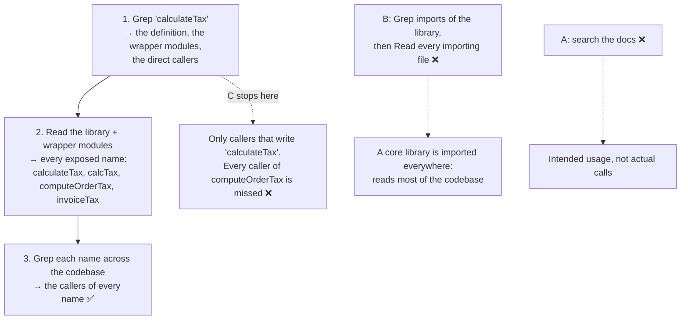

# Q93 — All callers of a function that wrappers rename: list every exposed name, then Grep each one

**Domain / lesson:** D2 › 2.5 Built-in Tools (Tracing Function Usage Across Wrapper Modules)
**Also touches:** D5 › 5.4 Codebase Exploration & Context Degradation (why reading every importing file hurts)
**Scenario:** Developer productivity tools built with the Claude Agent SDK (same set as [Q68](../Q68-trace-from-base-class-incremental-reading/question.md)–[Q81](../Q81-grep-import-statements/question.md), [Q92](../Q92-resume-named-session-by-name/question.md))
**Follows:** [Q68](../Q68-trace-from-base-class-incremental-reading/question.md) (its check: a wrapper hid the original name, so Grep the wrapper's name) · [Q81](../Q81-grep-import-statements/question.md) (Grep for import statements: a content search)

## Question

You are building developer productivity tools using the Claude Agent SDK. The agent helps engineers explore unfamiliar codebases, understand legacy systems, generate boilerplate code, and automate repetitive tasks. It uses the built-in tools (Read, Write, Bash, Grep, Glob) and integrates with Model Context Protocol (MCP) servers.

An engineer asks the agent to find all callers of a function before removing it. The function is defined in a core library but is also exposed through wrapper modules that rename the function for domain-specific use (e.g., `calculateTax` in the library becomes `computeOrderTax` in the orders module).

What exploration strategy will most reliably identify all callers?

- **A.** Search for the function name in project documentation to understand intended usage patterns and navigate to documented integration points.
- **B.** Use Grep to find all files that import from the library or wrapper modules, then read each file to check whether it uses the function.
- **C.** Use Grep to search for the function's original name across the codebase.
- **D.** Read the library and wrapper modules to identify all exposed names for the function, then Grep for each name across the codebase.

## Answer: **D**

## Diagram



## Concept

**A Grep finds only the text you search for.** A file that calls `computeOrderTax(order)` never contains the string `calculateTax`. The call to `calculateTax` happens inside the orders module. So the function has as many names as its wrappers give it, and a complete list of callers needs one Grep per name. Guide 2.5: *"A Grep for the original name misses every consumer that imports through the wrapper, because those files never contain that name."*

**The guide's four-step trace:**
1. *"Grep for the function definition to find where it is defined."*
2. *"Read the defining file to identify exported names."*
3. *"Grep for each exported name across the codebase to find all consumers."*
4. *"If the function is re-exported through a barrel file (e.g. index.ts), Grep for the barrel file's module name to find consumers who import from it."*

**What that looks like here** (illustrative):

```text
1. Grep "calculateTax": the definition, plus every file that names it
   core/tax/index.ts:14   export function calculateTax(amount, region) { … }
   core/tax/index.ts:40   export const calcTax = calculateTax;          // legacy alias
   orders/tax.ts:2        import { calculateTax } from '@core/tax';
   orders/tax.ts:9        export const computeOrderTax = (order) => calculateTax(order.total, order.region);
   invoices/index.ts:3    export { calculateTax as invoiceTax } from '@core/tax';   // barrel re-export
   reports/vat.ts:22      calculateTax(line.amount, 'EU')                // a direct caller

2. Read core/tax/index.ts, orders/tax.ts, invoices/index.ts
   exposed names: calculateTax, calcTax, computeOrderTax, invoiceTax

3. Grep each name across the whole codebase
   "calcTax"          → 4 files
   "computeOrderTax"  → 6 files
   "invoiceTax"       → 3 files
```

**Why the first Grep matters even though C alone is wrong.** The engineer may not know which modules wrap the function. The Grep for the original name is how you find them. It returns the wrapper lines along with the direct callers. The guide's example works the same way: *"A Grep for processOrder finds the definition, the line in the barrel file and the two consumers that import the original name."* C's mistake is stopping there.

**Why "the library" is on D's reading list too.** The defining module can expose the function under more than one name, like `calcTax` above. *(That alias is my example. The guide's step 2 says to read the defining file for its exported names.)*

**Two kinds of renaming, both in the guide:** *"One case is a wrapper (submitOrder() that calls processOrder() inside it). Another case is a barrel file that re-exports the function (export { processOrder as submitOrder })."* In the example, `computeOrderTax` is a wrapper and `invoiceTax` is a barrel re-export.

*Practical tip, not guide wording:* Grep with word boundaries, such as `\bcalcTax\b`. Otherwise `calcTax` also matches `calcTaxRate`, and `calculateTax` matches `recalculateTax`.

## Why the others are wrong

| Option | Why not |
|---|---|
| **A** Search the docs | **Docs describe intended usage, not the code.** They go out of date, and a caller nobody documented is still a caller. Callers are text in source files, which is what Grep is for: *"Use it to find function callers, error messages, import statements and variable assignments."* *(The docs point is my reasoning. The guide doesn't discuss documentation here.)* |
| **B** Grep the imports, then Read each file | **Too much reading, and it still needs the names.** It's a *core* library, so most of the codebase imports something from it. B reads every one of those files in full to find the few that use this one function. Guide: *"Read only what you need. Justify each file you read by what you found in the previous step."* And to check whether a file "uses the function", you have to know it might appear as `computeOrderTax` or `invoiceTax`. Learning those names is D's reading step. With the names, a Grep finds the callers without reading every importer. *(The second point is my reasoning.)* |
| **C** Grep only the original name | **It misses every caller of a renamed version.** Guide: *"Callers of the new name never mention the original name, so your first Grep never found them."* In the guide's example, the Grep for the original name finds 2 of 5 consumers. C is step 1 of the trace, not the whole trace. |

## Pattern to remember

> **You need all callers of a function that wrappers or re-exports expose under other names → Read the defining module and the wrappers to list every exposed name, then Grep each name across the whole codebase.** One Grep for the original name misses the callers of every wrapper. Reading every importing file costs too much, and the docs aren't the code.

**Exam signals:**
- *"Wrapper modules that rename the function"*, "re-exports", "barrel file", "alias" → list every exposed name, then Grep each one.
- *"Grep to search for the function's original name"* on its own → misses the wrappers' callers.
- *"Then read each file"* after a broad Grep of imports → reads far more than needed.
- *"Documentation"*, *"intended usage patterns"* → not where the calls are.
- *"Most reliably identify all callers"* → complete (every name) and targeted (Grep, then Read only what's needed).

### Where this comes from

**Guide D2 › 2.5 Built-in Tools:**
- *"Grep searches file contents for patterns. Use it to find function callers, error messages, import statements and variable assignments."* (**A**)
- *"In a common pattern, a function is defined in one module. A wrapper re-exports the function, and consumers use it through the wrapper's name. A Grep for the original name misses every consumer that imports through the wrapper, because those files never contain that name."* (**C**)
- The trace: *"Grep for the function definition to find where it is defined."* *"Read the defining file to identify exported names."* *"Grep for each exported name across the codebase to find all consumers."* (**D**)
- *"If the function is re-exported through a barrel file (e.g. index.ts), Grep for the barrel file's module name to find consumers who import from it."* (**D**)
- *"The files you read in step 2 may expose the function under another name. One case is a wrapper (submitOrder() that calls processOrder() inside it). Another case is a barrel file that re-exports the function (export { processOrder as submitOrder }). Callers of the new name never mention the original name, so your first Grep never found them. Grep for each new name, across the whole codebase, to get the full list of consumers."* (**C**, **D**)
- The example: *"three of the function's five consumers import submitOrder from utils. A Grep for processOrder finds the definition, the line in the barrel file and the two consumers that import the original name. That Grep cannot find the other three, because the string processOrder never appears in their files."* *"The multi-step trace finds indirect consumers that a single Grep would miss."* (**C**, **D**)
- *"Read only what you need. Justify each file you read by what you found in the previous step."* (**B**)
- Exam trap: *"Reading all source files upfront before understanding what is relevant"*. *"Loading every file into context is a large waste of context tokens."* (**B**)

## How this connects to earlier questions

| Question | Link |
|---|---|
| [Q68](../Q68-trace-from-base-class-incremental-reading/question.md) | Its check: services called a `@bust_cache` decorator, not `invalidate`, so the first Grep missed them. Q93 is that idea as a full question |
| [Q69](../Q69-grep-distinctive-error-text/question.md) | Its check: only the definition matched, so read it, find the wrapping name (`VersionConflictError`) and Grep that |
| [Q81](../Q81-grep-import-statements/question.md) | Grep for imports is a content search. B starts there, then reads every match |
| [Q91](../Q91-resume-subagent-and-name-the-renames/question.md) | Renames again: files that use the new name no longer contain the old one, so Grep the new names to find the call sites |

## Check question

**D's Greps come back: `calculateTax` → 2 direct callers, `calcTax` → 4 files, `computeOrderTax` → 6 files, `invoiceTax` → 3 files. The engineer says: "So 15 files. Once they stop using it, I can delete `calculateTax`." What's missing from that plan?**

## Glossary

- **Caller / consumer:** a file or function that uses the function, under any of its names.
- **Wrapper:** a function that calls the original inside it under a new name (`computeOrderTax` calls `calculateTax`).
- **Re-export:** a module exporting another module's function, often under a new name (`export { calculateTax as invoiceTax }`).
- **Barrel file:** an `index.ts` that re-exports things from several modules, so consumers import from one place.
- **Alias:** a second name for the same function (`calcTax = calculateTax`).
- **Exposed (exported) name:** a name other modules can import the function under.
- **Word boundary (`\b`):** a regex marker so a Grep for `calcTax` doesn't also match `calcTaxRate`.

## Related course lessons

*Lecture lengths aren't recorded in the study-map files, so the watch times below are estimates from each course's average lecture length.*

### Udemy A (primary): Claude Certified Architect (CCAR-F) - 2026 Exam Prep
| # | Lecture | Part | Why |
|---|---|---|---|
| **56** | **The Built-in Toolset** | 2C | ⭐ Grep for contents, Read for understanding: the two tools D combines *(also in Q68, Q69, Q76, Q81)* |
| 59 | The Tool System — Reads, Bash, Edits, and Web Search | 3A | Search before you read: why B costs too much *(also in Q58, Q68, Q69, Q76, Q81)* |
| Quiz 7, Quiz 8 | 2C and 3A quizzes | | Self-test |

**▶ Watch in this order (~15 min, est.):** #56 → #59, then do **Quiz 7** and **Quiz 8**.

### Udemy B: Claude Certified Architect Foundations: Complete Course (Voroniuk)
| # | Lecture | Section | Why |
|---|---|---|---|
| **79** | **Built-in Tools: Grep, Glob, Read, Write and Edit** | S8 Claude Code Setup | ⭐ Grep searches contents, so it finds only the names you give it *(also in Q68, Q69, Q76, Q81)* |
| 80 | Exploring a Codebase Step by Step | S8 Claude Code Setup | Grep, Read, then Grep again: the trace in D *(also in Q58, Q68, Q69, Q75, Q79, Q81)* |
| 90 | Dev Agent Case: Exploring Code | S8 Claude Code Setup | A worked case in this same scenario *(also in Q68, Q69, Q75)* |
| Quiz 8 | Claude Code Setup quiz | S8 | Self-test |

**▶ Watch in this order (~15 min, est.):** #79 → #80 → #90, then do **Quiz 8**.

### CBT Nuggets: CCA-F course
| Skill | Why |
|---|---|
| **23. Apply Built In Tools Safely** | ⭐ Choosing Grep, Glob and Read deliberately *(also in Q68, Q69, Q75, Q76, Q81)* |
