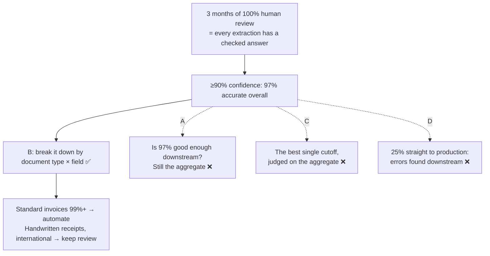

# Q95 — 97% accuracy at high confidence: break it down by document type and field before automating

**Domain / lesson:** D5 › 5.5 Human Review & Confidence Calibration (The Aggregate Metrics Trap)
**Scenario:** Structured data extraction system (extraction from unstructured documents, JSON-schema validation, downstream integration)
**Follows:** [Q21](../Q21-review-flag-from-calibrated-thresholds/question.md) (per-field thresholds tested against known answers)

## Question

You are building a structured data extraction system using Claude. The system extracts information from unstructured documents, validates the output using JavaScript Object Notation (JSON) schemas, and maintains high accuracy. It must handle edge cases gracefully and integrate with downstream systems.

Your system has been operating with 100% human review for 3 months. Analysis shows that extractions with model confidence ≥90% have 97% accuracy overall. To reduce reviewer workload, you plan to automate high-confidence extractions.

Before deploying, what validation step is most critical?

- **A.** Verify that 97% accuracy meets requirements for all downstream systems that consume the extracted data.
- **B.** Analyze accuracy by document type and field to verify high-confidence extractions perform consistently across all segments, not just in aggregate.
- **C.** Compare accuracy at different confidence thresholds (85%, 90%, 96%) to find the optimal cutoff that maximizes automation while minimizing errors.
- **D.** Run a two-week pilot routing 25% of high-confidence extractions directly to downstream systems and monitor error reports.

## Answer: **B**

## Diagram

## Concept

**97% is an average, and it's weighted by volume.** If most documents are clean standard invoices, the average sits near their accuracy, whatever happens to the rest. Guide 5.5: *"A 97% overall accuracy figure can hide catastrophic failure rates on specific document types or fields."* And: *"Most of the documents are standard invoices. So the average, weighted by volume, is near the figure for standard invoices. This average hides three document types with unacceptable accuracy."*

**What B might find here** (illustrative numbers that add up to the 97%):

| Segment (extractions with ≥90% confidence) | Share of volume | Accuracy | Weakest field |
|---|---|---|---|
| Standard supplier invoices | 90% | 99.3% | — |
| Scanned PDFs | 5% | 86% | amounts (81%) |
| Handwritten receipts | 3% | 72% | amounts (64%) |
| International formats | 2% | 65% | dates (58%) |
| **All together** | 100% | **97.1%** | |

Automating "everything at ≥90%" would send a 64%-accurate amount on a handwritten receipt downstream with nobody checking it. The guide adds that the hidden segments are often where mistakes cost most: *"In those segments, errors often have the highest business impact."*

**Why by field too, not only by document type.** A segment can be fine on names and poor on amounts. Amounts are often where an error costs the most (Q21). So the table you need is document type × field.

**You already have the data, so B costs nothing in risk.** Three months of 100% human review means every extraction has an answer a reviewer checked. That's a labelled set, the thing the guide says you need: *"Calibration requires labelled validation sets (ground truth data)."* B is an analysis of records you already hold. No documents go anywhere unchecked. *(This framing is my reasoning.)*

**What you do with the result:** automate the segments that hold up, and keep review on the ones that don't. Guide: *"Always validate accuracy by document type and field segment before automating. Never decide what to automate from aggregate metrics alone."* And: *"The result for the firm might be that it automates standard invoices while the office staff check the site receipts."*

## Why the others are wrong

| Option | Why not |
|---|---|
| **A** Check 97% against downstream requirements | **It's the right question asked of the wrong number.** 97% is the aggregate. A downstream system that receives handwritten receipts gets 72%, not 97%. Guide exam trap: *"Using aggregate accuracy (e.g., 97%) to justify automating all high-confidence extractions"*. Downstream requirements do matter, but you can only check them against per-segment numbers, so B has to come first. *(The last point is my reasoning.)* |
| **C** Compare thresholds to find the best cutoff | **A later step, run on the wrong data.** At every cutoff, accuracy is still one aggregate number, so the weak segments stay hidden at 85%, 90% and 96% alike. The guide's order starts with *"Measure accuracy by document type and field segment, not aggregate."* Calibration and thresholds come after that, and the thresholds come out *"per field type per document type"*, not as one cutoff for everything. |
| **D** Pilot: 25% straight to downstream systems, watch error reports | **The errors reach production first, and the sample hides the same thing.** Unchecked extractions go into real downstream systems. Error reports arrive only when someone downstream notices a problem and reports it, which is late and incomplete. A random 25% is also mostly standard invoices: 25% of the 2% international documents is a tiny sample, and the pilot's overall error rate is one more aggregate. And it isn't needed: the 3 months of reviewed data answer the question without any risk. *(My reasoning. The guide's rule is to validate by segment before automating.)* |

## Pattern to remember

> **Before cutting human review on high-confidence extractions, break accuracy down by document type and field. Automate only the segments that hold up.** An aggregate like 97% can hide segments at 60%, because the big, easy segment dominates the average.

**Exam signals:**
- *"97% accuracy overall"* + *"automate high-confidence extractions"* → the aggregate metrics trap: break it down by segment.
- *"100% human review for 3 months"* → you already have labelled data; analyse it before you change anything.
- *"Meets requirements"* checked with the aggregate → still the aggregate.
- *"Optimal cutoff"* before any segment analysis → a later step, and thresholds are per field and document type.
- *"Pilot … directly to downstream systems"*, *"monitor error reports"* → errors reach production before anyone checks.

### Where this comes from

**Guide D5 › 5.5 Human Review & Confidence Calibration:**
- *"Trusting aggregate metrics is the most dangerous misconception in production extraction systems. A 97% overall accuracy figure can hide catastrophic failure rates on specific document types or fields."* (**B**)
- *"Suppose the firm's system reports 97%, and the owner approves full automation for all high-confidence extractions. For dates, standard invoices reach 99.5% accuracy. Handwritten receipts reach 60%. Scanned PDFs with poor OCR reach 72%. International documents with non-standard formatting reach 45%."* (**B**)
- *"Most of the documents are standard invoices. So the average, weighted by volume, is near the figure for standard invoices. This average hides three document types with unacceptable accuracy."* *"In those segments, errors often have the highest business impact."*
- *"Always validate accuracy by document type and field segment before automating. Never decide what to automate from aggregate metrics alone."* (**B**, **A**)
- Exam trap: *"Using aggregate accuracy (e.g., 97%) to justify automating all high-confidence extractions"*. *"Aggregate metrics hide per-type performance. 97% overall can mean 40% accuracy on specific document types. Validate by document type and field segment before automating."* (**A**, **B**)
- The order starts: *"Measure accuracy by document type and field segment, not aggregate."* *"Calibrate confidence scores using labelled validation sets."* *"Set calibrated thresholds for automation versus human review."* (**C**)
- Build exercise: a calibration module that *"produces calibrated confidence thresholds per field type per document type"*. (**C**)
- *"Calibration requires labelled validation sets (ground truth data)."*
- *"Only then reduce human review on segments that demonstrate consistent, validated accuracy."* (**B**)
- *"The result for the firm might be that it automates standard invoices while the office staff check the site receipts."*

## How this connects to earlier questions

| Question | Link |
|---|---|
| [Q21](../Q21-review-flag-from-calibrated-thresholds/question.md) | Thresholds per field, tested on known answers. Q95 is the step before: does the accuracy hold in every segment at all? |
| [Q16](../Q16-escalation-triggers/question.md) | Raw confidence isn't something to trust on its own there either: self-reported confidence is poorly calibrated |

## Check question

**B's analysis comes back much like the table above. You automate standard supplier invoices and keep human review for the other three segments. Four months later, your largest supplier switches to a new invoice layout, and the model starts reading the "Subtotal" line as the total, at 95% confidence. Nobody reviews those invoices any more. How would you find out, and what should you have set up when you automated them?**

## Glossary

- **Aggregate metric:** one number across everything (97% overall). It's weighted by volume, so the biggest segment dominates it.
- **Segment:** a slice of the data, such as one document type, one field, or one combination of the two.
- **Labelled validation set / ground truth:** extractions whose right answers are known, for example because a reviewer checked them.
- **Calibration:** checking what a confidence score really means against known answers (0.90 on dates might be right 94% of the time, on amounts 82%).
- **Automation threshold:** the confidence above which an extraction skips human review.

## Related course lessons

*Lecture lengths aren't recorded in the study-map files, so the watch times below are estimates from each course's average lecture length.*

### Udemy A (primary): Claude Certified Architect (CCAR-F) - 2026 Exam Prep
| # | Lecture | Part | Why |
|---|---|---|---|
| **127** | **Calibrating with a Validation Set** | 5D | ⭐ Measuring accuracy against known answers before trusting the scores *(also in Q08, Q21)* |
| 126 | Per-Field Confidence | 5D | Why accuracy is checked per field, not overall *(also in Q08, Q21)* |
| Quiz 18 | 5D quiz | | Self-test |

**▶ Watch in this order (~10 min, est.):** #127 → #126, then do **Quiz 18**.

### Udemy B: Claude Certified Architect Foundations: Complete Course (Voroniuk)
| # | Lecture | Section | Why |
|---|---|---|---|
| **36** | **Extraction Case: Types and Review** | S4 Structured Output | ⭐ Extraction by document type and the review that goes with it *(also in Q21)* |
| **32** | **Confidence Calibration and Human Review** | S4 Structured Output | ⭐ When to trust confidence and when to keep review *(also in Q08, Q18, Q21)* |
| Quiz 4 | Structured Output quiz | S4 | Self-test |

**▶ Watch in this order (~10 min, est.):** #36 → #32, then do **Quiz 4**.

### CBT Nuggets: CCA-F course
| Skill | Why |
|---|---|
| 16. Improve Graders with Model Feedback | Review quality and confidence (5.5) *(also in Q18, Q21)* |

*CBT is thin on 5.5. Use the guide's Aggregate Metrics Trap section and the Udemy lectures.*
