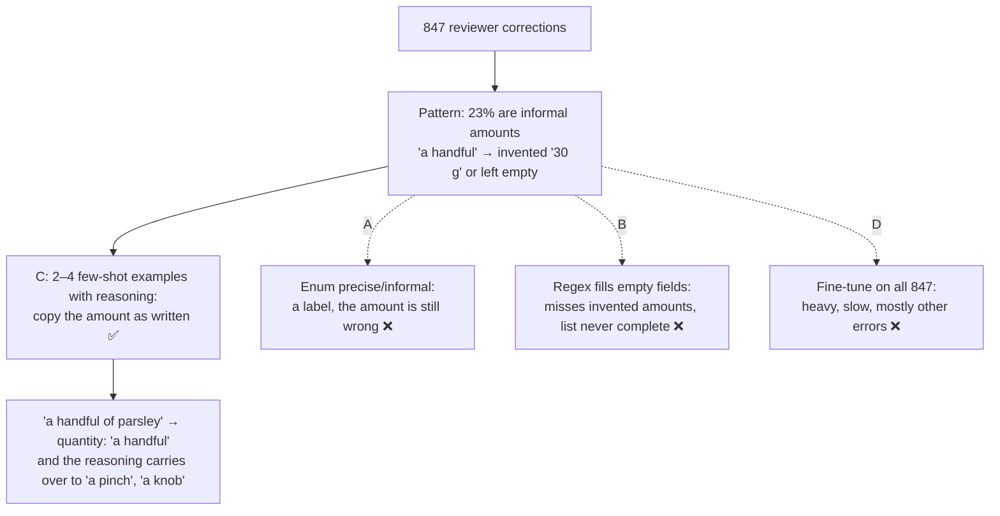

# Q98

**Scenario:** Structured data extraction system (same as [Q95](../Q95-accuracy-by-segment-before-automating/question.md))

## Question

You are building a structured data extraction system using Claude. The system extracts information from unstructured documents, validates the output using JavaScript Object Notation (JSON) schemas, and maintains high accuracy. It must handle edge cases gracefully and integrate with downstream systems.

Your system has been running for 3 weeks and human reviewers have corrected 847 extractions. Analysis reveals a recurring pattern: when recipes use informal measurements like "a handful" or "a splash," the model either invents specific amounts or leaves fields empty – accounting for 23% of all corrections.

How should you use this feedback to improve extraction accuracy?

- **A.** Update your JSON schema to add a "measurement_type" enum field (precise/informal).
- **B.** Implement a post-processing layer that uses pattern matching to detect informal measurement phrases in source text and automatically populate values when the extraction is empty.
- **C.** Add few-shot examples to your prompt demonstrating correct handling of informal measurements – extracting them verbatim rather than converting or omitting them.
- **D.** Fine-tune the model on the 847 corrected extractions.

<details>
<summary><b>Show answer and explanation</b></summary>

**Topic:** Reviewers keep fixing "a handful" and "a splash": add few-shot examples that copy them as written
**Domain / lesson:** D4 › 4.2 Few-Shot Prompting
**Also touches:** D4 › 4.3 Structured Output (what a schema change can and can't fix: A)
**Follows:** [Q95](../Q95-accuracy-by-segment-before-automating/question.md) (human-review results as evidence) · [Q17](../Q17-split-unified-tool/question.md), [Q23](../Q23-expand-minimal-tool-descriptions/question.md) (few-shot as the *wrong* answer, and why this case is different)

## Answer: **C**

## Diagram



## Concept

**Read the correction pattern as a diagnosis.** "A handful" is in the recipe. The model either turns it into a number nobody wrote ("30 g") or drops it. That's two of the three situations guide 4.2 says call for few-shot examples:
- *"The model makes inconsistent judgement calls on ambiguous cases."* Should "a splash" be converted, left out, or copied? The model decides differently from one recipe to the next.
- *"Extraction tasks return empty or null fields for information the document contains."* The amount is there, just not in the form the model expects.

**The amount isn't missing: "a handful" *is* the amount.** The model invents a number or leaves the field empty because nothing has shown it that an informal amount is an acceptable answer. Examples show it.

**The fix: a few examples with reasoning, aimed at the failing case.** Guide: *"Use 2 to 4 targeted examples."* *"Cover the failing cases."* *"Each example must show reasoning."* Illustrative:

```text
Example 1
Source:    "Add a handful of chopped parsley."
Output:    {"ingredient": "parsley", "quantity": "a handful"}
Reasoning: The recipe gives an informal amount. Copy it as written. Don't
           convert it to grams: the recipe never states a weight, so any
           number would be invented. Don't leave it empty: the amount is
           in the text.

Example 2
Source:    "Finish with a splash of white wine."
Output:    {"ingredient": "white wine", "quantity": "a splash"}
Reasoning: Same rule for liquids. "A splash" is the recipe's own amount.

Example 3 (contrast)
Source:    "Sift 200 g flour into the bowl."
Output:    {"ingredient": "flour", "quantity": "200 g"}
Reasoning: A precise amount is copied as written too. The rule is the
           same either way: record what the recipe says.
```

**Why the reasoning matters.** The 847 corrections show "a handful" and "a splash", but the next recipe will say "a pinch", "a knob of butter" or "a glug". *"The reasoning teaches the model to generalise its judgement to novel patterns, instead of only matching the cases in your examples."* Examples without the reasoning teach only the listed phrases.

**Few-shot was the wrong answer in Q17, Q21, Q23 and Q34. Why is it right here?** In those questions the problem was in the design: overlapping tools, a threshold that had to hold, a business rule. A rule that must always hold belongs in code, because examples only make the right behaviour more likely. Here the problem is how the model *reads* text. Deciding that "a handful" is an amount is a judgement about language, and code can't make it. That's what examples are for: *"When output is inconsistent, use few-shot examples first."*

From the guide's table of which technique fixes which problem:

| Problem | Technique |
|---|---|
| Inconsistent output formatting | Few-shot examples |
| Model misses information in narrative text | Few-shot examples showing narrative extraction |
| Malformed JSON output | `tool_use` with JSON schemas |
| Extraction sum does not match total | Validation-retry loop |

**The corrections double as your test set.** Re-run the corrected informal-measurement cases with the new prompt and compare: fewer invented amounts and fewer empty fields. The guide's build exercise does the same: *"Re-run the same 10 documents with the few-shot enhanced prompt and compare: empty field rate, format consistency, and extraction accuracy"*.

*Practical tip, not guide wording:* check that the schema lets the amount field hold text. If `quantity` must be a number, the model can't copy "a handful". It has to invent a number or leave the field empty, whatever the examples show.

## Why the others are wrong

| Option | Why not |
|---|---|
| **A** Add a `measurement_type` enum (precise/informal) | **It labels the problem and leaves it in place.** The model can tag a line "informal" and still write "30 g" in the amount, or nothing. The enum says *what kind* of amount it is, not *what to put in the field*. It might help downstream systems, but it doesn't fix the extraction. *(My reasoning.)* |
| **B** Pattern-matching post-processor that fills empty fields | **It fixes half the errors at best, with a list that's never complete.** Invented amounts aren't empty, so B never fires on the "30 g" cases, which are half of the pattern. For the empty cases, "populate values" with what? Converting "a handful" to a number in code is the same invention, just done by code. A phrase list misses "a knob", "a glug" and every phrasing nobody listed. The reasoning in examples carries over to those. *(My reasoning, with the guide's point about generalising.)* |
| **D** Fine-tune on the 847 corrections | **A heavy model change for a problem a prompt fixes.** Only 23% of the 847 (about 195) are this pattern. The rest are other errors. Training is slow and costly, and you can't read or edit what it learned the way you can a prompt. The guide's first choice for this kind of problem: *"When output is inconsistent, use few-shot examples first."* *(The cost points are my reasoning. One blog says the official exam guide lists fine-tuning as out of scope. I couldn't confirm that against the guide itself.)* |

## Pattern to remember

> **Reviewer corrections show a recurring mistake on one kind of ambiguous input → turn it into 2–4 few-shot examples with reasoning that show the correct handling.** Here that means copying informal amounts as written. A label (A), a phrase list in code (B) and retraining (D) don't teach the model how to read the case.

**Exam signals:**
- "Recurring pattern" in the corrections, on one kind of ambiguous input → few-shot examples of that case, with reasoning.
- *"Invents specific amounts or leaves fields empty"* for information that's in the document → few-shot (4.2 triggers 2 and 3).
- "Add an enum / a classification field" → labels the case, doesn't fix the value.
- "Post-processing pattern matching" → a brittle list that only catches the empty cases.
- *"Fine-tune"* → a heavy model change; try few-shot first (the exam is model-agnostic).
- A rule that must *always* hold (policy, threshold) → code, not examples (Q21, Q28, Q31).
- The model invents a value the source **doesn't have**, and "an instruction not to invent" hasn't helped → make the field optional/nullable (4.3) (check question).

### Where this comes from

**Guide D4 › 4.2 Few-Shot Prompting:**
- *"Few-shot examples are the most effective technique for consistent, well-formatted output from Claude. More instructions, confidence thresholds and temperature adjustments all do less. When output is inconsistent, use few-shot examples first."* (**C**, **D**)
- *"The model makes inconsistent judgement calls on ambiguous cases."* *"These ambiguous cases need examples that show the correct judgement, with reasoning."* (**C**)
- *"Extraction tasks return empty or null fields for information the document contains. The information is in the document, but in an unexpected format"*. (**C**)
- *"Use 2 to 4 targeted examples. Fewer than 2 examples do not establish a pattern. More than 4 examples waste tokens without proportional benefit. Choose examples that cover the specific ambiguous cases that cause problems."* (**C**)
- *"Each example must show reasoning."* *"The reasoning teaches the model to generalise its judgement to novel patterns, instead of only matching the cases in your examples."* (**C**, **B**)
- *"Cover the failing cases."* (**C**)
- *"Few-shot examples also reduce hallucination in extraction tasks."* *"From those examples, it learns to handle structural variety without inventing data."* (**C**)
- Build exercise: *"Identifying the specific failure patterns tells you exactly what your few-shot examples need to demonstrate."* (using the feedback)
- The technique table, the row held back for the check question: *"Fabricated values for missing fields"* → *"Optional/nullable schema fields"*. (check question)
- Build exercise: *"Fabrication of missing data should not improve and needs schema changes instead."* (check question)

**Guide D4 › 4.3 Structured Output with Tool Use** (check question):
- *"Optional/nullable fields. When a source document may lack some information, make the fields for that information optional or nullable. This is the primary defence against fabrication. A required field pressures the model to produce a value even when the source has none. A nullable field lets the model honestly return null."*
- Exam trap: *"Making all schema fields required to ensure data completeness"*. *"Make the fields a document may lack nullable, so the model can return null, and keep fields that are always present required."*
- Practice scenario: *"An instruction not to invent values is already in the prompt and has not stopped it."* Answer: *"Make fields optional/nullable when source documents may not contain the information"*.

## How this connects to earlier questions

| Question | Link |
|---|---|
| [Q95](../Q95-accuracy-by-segment-before-automating/question.md) | Same system, and again the reviewers' results are the evidence: there for what to automate, here for what to teach |
| [Q17](../Q17-split-unified-tool/question.md) · [Q23](../Q23-expand-minimal-tool-descriptions/question.md) · [Q34](../Q34-business-errors-not-retryable/question.md) | Few-shot was the distractor there: the problem was the tool design or the error format, so examples patched a symptom. Here the problem is the model's reading of the text |
| [Q21](../Q21-review-flag-from-calibrated-thresholds/question.md) | Raw confidence + few-shot to interpret it was wrong: a threshold has to hold every time, so it belongs in code |
| [Q55](../Q55-tests-first-share-failures/question.md) | A measurable bar before the change: here, the corrected cases re-run as a test set |

## Check question

**After C, informal amounts come through as written. A new correction pattern appears: some ingredients have no amount in the recipe at all ("Garnish with parsley."), and the model fills in "1 tbsp". Do you add another few-shot example, or change something else first? Why?**

*My answer:* "maybe you could tell in the prompt not to invent any units when none is given" 🟡 **The goal is right: no invented amounts. But the fix is in the wrong layer. The first thing to change is the schema: make `quantity` nullable, so "no amount" has a valid answer. An instruction alone is the fix the guide says doesn't work here.**

**This case is different from "a handful".** There the amount was in the recipe, just informal: a reading problem, so examples fixed it. Here there is no amount at all. The model writes "1 tbsp" because the schema demands *something* in `quantity`. Guide 4.3: *"A required field pressures the model to produce a value even when the source has none. A nullable field lets the model honestly return null."*

| The recipe says | Is the amount there? | Fix |
|---|---|---|
| "Add a handful of parsley." | Yes, informal | Few-shot: copy it as written (Q98) |
| "Garnish with parsley." | No | Schema: `quantity` nullable, return `null` (check) |

**Why the instruction isn't enough.** It asks the model not to fill a field that the schema says must be filled. The schema wins. If `quantity` is a required string, the only "honest" options are hacks like `""` or `"none"`, which downstream systems read as values. The guide's own practice scenario describes your fix as already tried: *"An instruction not to invent values is already in the prompt and has not stopped it."* Its answer: *"Make fields optional/nullable when source documents may not contain the information"*. And from 4.2's build exercise: *"Fabrication of missing data should not improve and needs schema changes instead."* That's also why another few-shot example isn't the first step.

**The change** (in the shape of the guide's own example schema):

```json
{
  "type": "object",
  "properties": {
    "ingredient": { "type": "string" },
    "quantity":   { "type": ["string", "null"] }
  },
  "required": ["ingredient"]
}
```

Keep required only what every recipe line always has, the ingredient. Guide: *"Make the fields a document may lack nullable, so the model can return null, and keep fields that are always present required."*

**Then your instruction helps** *(my suggestion, not guide wording)*: once `null` is a valid answer, an instruction or an example (`"Garnish with parsley."` → `"quantity": null`, reasoning: "the recipe gives no amount, so don't guess") tells the model when to use it. The schema makes the honest answer possible. The prompt points to it.

> **Few-shot fixes how the model reads information that's there. A nullable field fixes invention when the information isn't there. If the model invents a value the source doesn't have, check whether the schema forces the field first.**

## Glossary

- **Few-shot example:** a worked example in the prompt: an input, the output you want, and the reasoning for it.
- **Informal measurement:** an amount without a number or unit ("a handful", "a splash", "a pinch").
- **Verbatim:** copied exactly as written in the source.
- **Post-processing layer:** code that changes the model's output after extraction.
- **Enum:** a schema field limited to a fixed list of values (`precise` / `informal`).
- **Fine-tuning:** further training a model on your own examples, which changes the model itself.
- **Hallucination / fabrication:** output the source doesn't support, such as "30 g" for "a handful".
- **Required field:** a schema field that must have a value, which pushes the model to produce one even when the source has none.
- **Nullable field:** a field whose type allows `null` (`["string", "null"]`), so "not in the source" is a valid answer.

## Related course lessons

*Lecture lengths aren't recorded in the study-map files, so the watch times below are estimates from each course's average lecture length.*

### Udemy A (primary): Claude Certified Architect (CCAR-F) - 2026 Exam Prep
| # | Lecture | Part | Why |
|---|---|---|---|
| **90** | **Designing High-Quality Few-Shot Examples** | 4B | ⭐ 2–4 targeted examples with reasoning: exactly C |
| 89 | Why Examples Work | 4B | Why examples beat more instructions for this kind of problem |
| 98 | Schema Design for Reliable Extraction | 4C | Schema design for extraction: the layer the check question's fix changes *(also in Q35)* |
| Quiz 13, Quiz 14 | 4B and 4C quizzes | | Self-test |

**▶ Watch in this order (~15 min, est.):** #89 → #90 → #98, then do **Quiz 13** and **Quiz 14**.

### Udemy B: Claude Certified Architect Foundations: Complete Course (Voroniuk)
| # | Lecture | Section | Why |
|---|---|---|---|
| **22** | **Few-Shot Examples for Extraction** | S3 Prompt Engineering | ⭐ Few-shot in extraction: this question's case |
| 21 | Few-Shot for Format and Judgment | S3 Prompt Engineering | The judgement-call trigger ("convert, omit or copy?") |
| 24 | Exam Lens: Example Decisions | S3 Prompt Engineering | When the exam wants examples and when it wants something else |
| 35 | Extraction Case: Valid Fields | S4 Structured Output | Which extraction fields to require: the layer the check question's fix changes |
| Quiz 3, Quiz 4 | Prompt Engineering and Structured Output quizzes | S3, S4 | Self-test |

**▶ Watch in this order (~20 min, est.):** #21 → #22 → #24 → #35, then do **Quiz 3** and **Quiz 4**.

### CBT Nuggets: CCA-F course
| Skill | Why |
|---|---|
| **17. Design Clear Prompts with Examples** | ⭐ Writing examples that show the target behaviour *(also in Q05, Q31, Q37, Q86)* |
| 19. Explain Tool Use and Tool Schemas | Tool schemas: the layer the check question's fix changes *(also in Q01, Q04, Q09, Q17, Q19, Q20, Q21, Q30, Q35, Q47, Q48)* |

</details>
