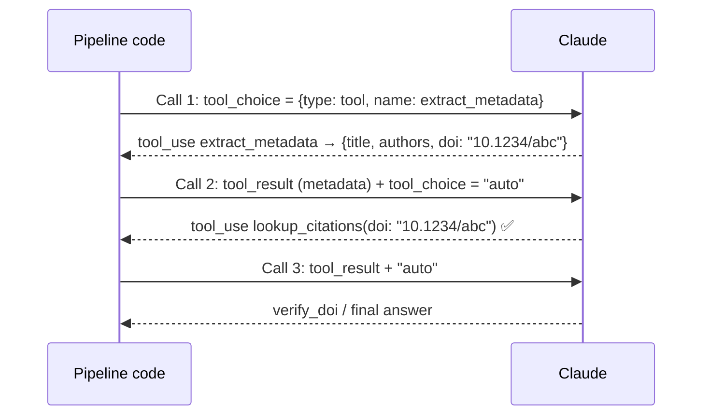

# Q99 — `lookup_citations` runs before the DOI exists: force `extract_metadata` first, then enrich in later turns

**Domain / lesson:** D2 › 2.3 Tool Distribution & Tool Choice (forced selection enforces a mandatory first step; later turns use `"auto"`)
**Also touches:** D4 › 4.3 Structured Output with Tool Use · D1 › 1.1 Agentic Loops (pass the tool result into the next turn)
**Scenario:** Structured data extraction from unstructured documents with JSON schemas
**Follows:** [Q98](../Q98-few-shot-for-informal-measurements/question.md) (same extraction scenario) · [Q46](../Q46-stateless-api-pass-full-history/question.md) (each call carries the full history)

## Question

You are building a structured data extraction system using Claude. The system extracts information from unstructured documents, validates the output using JavaScript Object Notation (JSON) schemas, and maintains high accuracy. It must handle edge cases gracefully and integrate with downstream systems.

Your pipeline uses a tool called `extract_metadata` with a JSON schema for paper details. You've also defined `lookup_citations` and `verify_doi` tools for enrichment. During testing, you notice that when users include requests like "extract the metadata and tell me how cited it is," Claude sometimes calls `lookup_citations` first, which fails because it needs the DOI that `extract_metadata` would provide.

What's the most effective way to ensure structured metadata extraction happens first?

- **A.** Set `tool_choice` to `{"type": "tool", "name": "extract_metadata"}` for every API call in the pipeline, ensuring Claude always extracts metadata before any enrichment can occur.
- **B.** Set `tool_choice` to `{"type": "tool", "name": "extract_metadata"}` and process the enrichment requests in subsequent turns after receiving the extracted metadata.
- **C.** Set `tool_choice` to `"auto"` and reorder the tool definitions so `extract_metadata` appears first in the tools array, since Claude prioritizes earlier-listed tools.
- **D.** Set `tool_choice` to `"any"` so Claude must use a tool, combined with system prompt instructions prioritizing `extract_metadata`.

## Answer: **B**

## Diagram

## Concept

**The failure is an ordering problem:** enrichment needs the DOI, and the DOI only exists after extraction. With `"auto"` the model **sometimes** picks enrichment first. You need a **guarantee** that step 1 is extraction.

**Forced selection gives that guarantee.** Guide 2.3: *"Use it to enforce a mandatory first step: the model cannot skip or reorder the required operation."* The guide uses this exact case: *"If metadata extraction must happen before any enrichment tools run, forcing `extract_metadata` guarantees that order."* *"The model cannot go directly to enrichment."*

**And then release it.** *"After the forced call completes, later turns can use `"auto"`."* The guide's build exercise: *"the first API call uses tool_choice with type: tool and name: extract_metadata"*; *"subsequent calls switch to tool_choice: auto for the remaining analysis steps."*

That's B: **force the first call, then `"auto"`** so the model can call `lookup_citations` and `verify_doi` with the DOI it now has (passed back as the `tool_result`).

## Why the others are wrong

| Option | Why not |
|---|---|
| **A** Force `extract_metadata` on **every** call | **Ordering right, pipeline broken.** If every call is forced to `extract_metadata`, the model can **never** call `lookup_citations` or `verify_doi`: enrichment never happens. It would just re-extract forever. Force only the **first** call. |
| **C** `"auto"` + put `extract_metadata` first in the array | **False premise.** The model chooses tools by **description and context**, not by their position in the list (2.1). With `"auto"` it can still pick `lookup_citations` first, which is the bug you're fixing. |
| **D** `"any"` + a prompt saying "prefer extract_metadata" | **`"any"` forces *a* tool, not *which* tool.** Guide: *"The model must call a tool but chooses which one."* `lookup_citations` is a tool, so it still satisfies `"any"`. The prompt instruction is probabilistic: it lowers the odds, doesn't guarantee. |

## Pattern to remember

> **Step X must happen first → force it with `tool_choice: {"type": "tool", "name": "X"}` on the first call, then switch to `"auto"` for the rest.**

**Exam signals:**
- "must happen first" / "before any enrichment" / "mandatory first step" → **forced selection on the first call**.
- "for every API call" + forced → trap (blocks the other tools).
- Reject: tool order in the array (no effect), `"any"` + prompt (any tool, not the right one).

**`tool_choice` cheat (2.3):**

| Setting | Model must… | Use for |
|---|---|---|
| `"auto"` (default) | Decide: a tool **or** text | General conversation |
| `"any"` | Call **some** tool (picks which) | Guaranteed structured output from one of several schemas |
| `{"type": "tool", "name": X}` | Call **X** | A mandatory first step; then go back to `"auto"` |

**Spec note (from the guide):** some current models reject `"any"` and forced `{"type": "tool"}` (400 error), and manual extended thinking rejects both; the documented route there is `"auto"` with strict tool use. *"On the exam, answer with `"any"` and forced selection."*

### Where this comes from

**Guide D2 › 2.3 Tool Distribution & Tool Choice** (checked 2026-11-03):
- Forced selection: *"The model must call one specific named tool."* *"Use it to enforce a mandatory first step: the model cannot skip or reorder the required operation."*
- *"If metadata extraction must happen before any enrichment tools run, forcing `extract_metadata` guarantees that order."* *"The model cannot go directly to enrichment."*
- *"After the forced call completes, later turns can use `"auto"`."*
- Build exercise: *"the first API call uses tool_choice with type: tool and name: extract_metadata"*; *"subsequent calls switch to tool_choice: auto for the remaining analysis steps."*
- `"any"`: *"The model must call a tool but chooses which one."*
- Trap: *"Using tool_choice 'auto' when structured output is required."*
- Current state: some models *"reject {"type": "any"} and {"type": "tool"} with a 400 error"*; *"On the exam, answer with `"any"` and forced selection."*

## How this connects to earlier questions

| Question | Link |
|---|---|
| [Q46](../Q46-stateless-api-pass-full-history/question.md) | The metadata reaches call 2 because you append the `tool_result` to the history |
| [Q51](../Q51-stop-reason-controls-loop/question.md) | The loop around these calls runs on `stop_reason` |
| [Q50](../Q50-post-loop-fallback-escalation/question.md) / [Q28](../Q28-tamper-proof-threshold-in-tool/question.md) | Guarantees come from code/config, not prompts (vs D) |
| [Q23](../Q23-expand-minimal-tool-descriptions/question.md) | Selection runs on descriptions, not on list order (vs C) |

## Check question

**(1) A also forces `extract_metadata` first. What exactly goes wrong in A on the second call? (2) In B, how does the DOI from call 1 actually reach `lookup_citations` in call 2?**

*(Your answer and feedback will be recorded here.)*

## Glossary

- **`tool_choice`:** API parameter controlling whether and which tool the model must call.
- **Forced selection:** `{"type": "tool", "name": "X"}`: the model must call tool X.
- **`"any"`:** the model must call some tool but chooses which.
- **`"auto"`:** the model decides between calling a tool and replying with text.
- **Enrichment:** adding data from other sources (citations, DOI verification) after extraction.
- **DOI:** Digital Object Identifier, a unique ID for a paper; needed to look up citations.

## Related course lessons

*Lecture lengths aren't recorded in the study-map files, so the watch times below are estimates.*

### Udemy A (primary): Claude Certified Architect (CCAR-F) - 2026 Exam Prep
| # | Lecture | Part | Why |
|---|---|---|---|
| **41** | **Controlling Tool Selection** | 2A | ⭐ `tool_choice`: auto, any, forced |
| 40 | Selection Heuristics and Tool-Selection Failures | 2A | Why order in the array doesn't decide (C) |
| 100 | Using Tool Definitions to Extract Structured Data | 4C | Extraction via tool_use *(also in Q130)* |
| Quiz 5, Quiz 14 | 2A and 4C quizzes | | Self-test |

**▶ Watch in this order (~15 min, est.):** #40 → #41 → #100, then do **Quiz 5** and **Quiz 14**.

### Udemy B: Claude Certified Architect Foundations: Complete Course (Voroniuk)
| # | Lecture | Section | Why |
|---|---|---|---|
| **27** | **tool_choice: auto, any and Forced** | S4 Structured Output | ⭐ Exactly this question |
| 26 | Practice: Your First Tool Call, End to End | S4 Structured Output | Passing the tool result into the next call (check question part 2) |
| Quiz 4 | Structured Output quiz | S4 | Self-test |

**▶ Watch in this order (~10 min, est.):** #26 → #27, then do **Quiz 4**.

### CBT Nuggets: CCA-F course
| Skill | Why |
|---|---|
| **22. Route Requests Across Multiple Tools** | ⭐ Tool choice and routing *(also in Q70, Q74)* |
